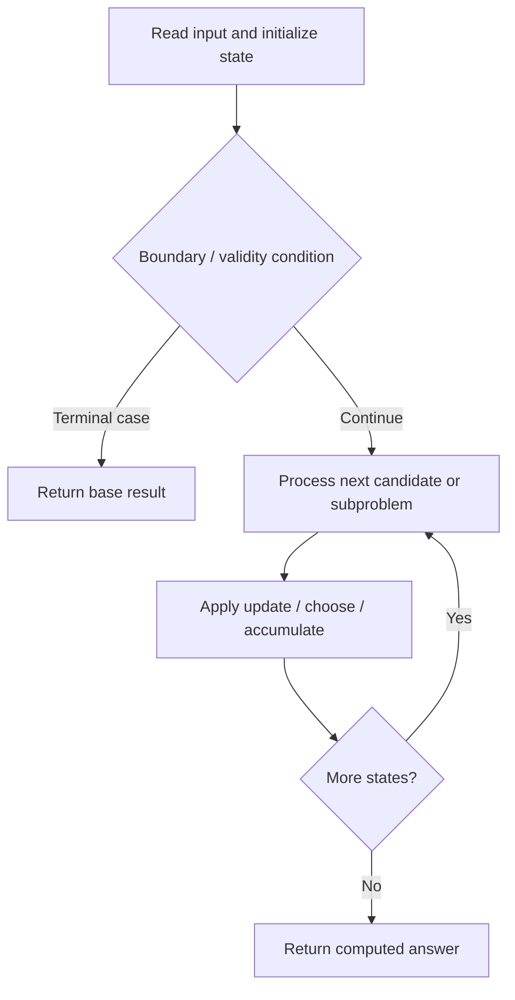

# 279. Perfect Squares

**Difficulty:** Medium  
**Concept family:** [Take-or-Skip and Knapsack](https://github.com/gaurav1kr/Miscellaneous/blob/main/DSA/DP/DP_Mathematics_Master_Guide_Illustrated/Theory/Chapter-02.md)  
**Problem:** https://leetcode.com/problems/perfect-squares/  
**Original submission:** https://leetcode.com/submissions/detail/1541849901/

## Understand the mathematics first

This problem belongs to the study family **Take-or-Skip and Knapsack**. Start by defining the objective and minimal sufficient state; inspect the code to identify the actual transitions.

### Problem-specific recurrence

Refer to the source-grounded algorithm walkthrough below for the state transitions used by your implementation. The generic family recurrence has been removed because it may not apply to this problem.

## Code landmarks

- `dp[0] = 0;`
- `dp[i] = std::min(dp[i], dp[i - square] + 1);`
- `return dp[n];`

## Source-grounded algorithm walkthrough (expanded coverage)

> **Verification level:** The observations below are extracted from your actual Accepted C++ implementation. The symbolic trace is a **code-reading dry-run worksheet**, not a fabricated numerical run. The generic family formula above is not necessarily this problem's recurrence.

### 1. Identify the actual state and algorithm

**Problem:** 279. Perfect Squares. An explicit state table or memo is present. Interpret each index as a mathematical state and every update as a transition.

| Role | C++ source line | Evidence from your solution |
|---|---:|---|
| Candidate state / accumulator | 5 | `std::vector<int> dp(n + 1, INT_MAX);` |
| Candidate state / accumulator | 8 | `dp[0] = 0;` |
| Candidate state / accumulator | 20 | `dp[i] = std::min(dp[i], dp[i - square] + 1);` |
| Boundary / termination | 8 | `dp[0] = 0;` |
| Boundary / termination | 19 | `if (i < square) break; // No need to check further if the square exceeds i` |
| Traversal order | 12 | `for (int i = 1; i * i <= n; ++i) {` |
| Traversal order | 17 | `for (int i = 1; i <= n; ++i) {` |
| Traversal order | 18 | `for (int square : perfectSquares) {` |
| Transition / update | 8 | `dp[0] = 0;` |
| Transition / update | 13 | `perfectSquares.push_back(i * i);` |
| Transition / update | 20 | `dp[i] = std::min(dp[i], dp[i - square] + 1);` |
| Return / result | 24 | `return dp[n];` |

### 2. Trace the dependency chain



This is a **control-flow reading diagram**, not a claim about the exact shape of the mathematical state graph. Follow the code line numbers above to draw the actual dependency arrows.

### 3. Symbolic dry-run worksheet

| Stage | State to record | Mathematical question to answer |
|---|---|---|
| Initialize | Inputs, initialized containers/accumulators | What does the initial value mean? |
| First iteration / recursive call | Loop indices, branch, current state | Which predecessor states are available? |
| First update | Before → after for the updated variable | Why is this transition legal? Does it add, minimize, maximize, or overwrite? |
| Next iteration | Updated state and next candidate | Can a value be reused in this traversal order? |
| Finish | Return expression and its value | Why does this correspond to the problem's requested result? |

### 4. Mathematical explanation checklist

1. Define the exact meaning of each state variable, including all indices and constraints.
2. Translate the update expression into a mathematical equation **only after** establishing the state invariant.
3. Prove the transitions are exhaustive and do not double-count or reuse forbidden elements.
4. Check empty input, smallest input, impossible cases, and overflow/modulo behavior.
5. Compute a small numerical example using the actual problem constraints, then compare each row to the original C++.


---

## Your original Accepted C++ submission (unaltered)

```cpp
class Solution {
public:
    int numSquares(int n) {
        // DP array to store the minimum number of perfect squares for each number
        std::vector<int> dp(n + 1, INT_MAX);
        
        // Base case: 0 can be represented as the sum of 0 perfect squares
        dp[0] = 0;

        // Precompute all perfect squares less than or equal to n
        std::vector<int> perfectSquares;
        for (int i = 1; i * i <= n; ++i) {
            perfectSquares.push_back(i * i);
        }

        // Fill the DP array
        for (int i = 1; i <= n; ++i) {
            for (int square : perfectSquares) {
                if (i < square) break; // No need to check further if the square exceeds i
                dp[i] = std::min(dp[i], dp[i - square] + 1);
            }
        }

        return dp[n];
    }
};
```

## Time and Space Complexity

- **Time:** `Depends on loop nesting and bounds`
- **Auxiliary space:** `Depends on auxiliary arrays/containers`

**Reasoning:** Count how many iterations each loop executes and whether loops are nested; do not assume all nested loops are quadratic.

**Status:** Code-informed complexity guidance; exact tight bounds have not been individually verified.
