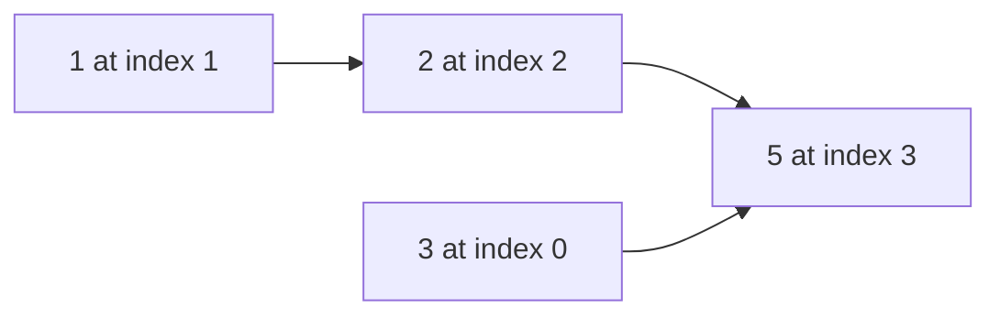
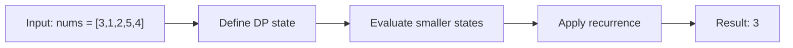

# 300. Longest Increasing Subsequence

**Difficulty:** Medium  
**Concept family:** [Subsequence and Ordering DP](https://github.com/gaurav1kr/Miscellaneous/blob/main/DSA/DP/DP_Mathematics_Master_Guide_Illustrated/Theory/Chapter-05.md)  
**Problem:** https://leetcode.com/problems/longest-increasing-subsequence/  
**Original submission:** https://leetcode.com/submissions/detail/1542496094/

## Understand the mathematics first

Find best increasing subsequence ending at each position.

### Problem-specific recurrence

Refer to the source-grounded algorithm walkthrough below for the state transitions used by your implementation. The generic family recurrence has been removed because it may not apply to this problem.

## Code landmarks

- `auto it = std::lower_bound(lis.begin(), lis.end(), num);`

## Worked mathematical walkthrough (illustrated)

**State:** L(i): best increasing subsequence ending exactly at i.

**Transition:** `L(i)=1+max(L(j) for j<i and a[j]<a[i]); empty maximum=0`

**Why:** Choose the previous element of the subsequence. The strict inequality makes the transition legal; taking the maximum finds the best predecessor.



**Hand calculation:** [3,1,2,5]: L = [1,1,2,3]. The LIS is [1,2,5], length 3.

**Six-month revision test:** Without looking at the code, reconstruct the state, enumerate the legal choices, and justify why this transition does not miss or double-count any answer.

---

## Detailed dry run — LIS: best subsequence ending at each index

### Start from the mathematical question

Let L(i) be the length of the longest strictly increasing subsequence whose final index is i.

### Derive the recurrence

```math
L(i)=1+\max_{j<i,\ a_j<a_i}L(j)
```

**Why the transition is correct:** Any increasing subsequence ending at i either has no predecessor (length 1) or extends one ending at a smaller previous value. Your submitted code may use an O(n log n) tails array, which is an optimized alternative invariant.

### Concrete example

**Input:** `nums = [3,1,2,5,4]`



**Evaluate the states in dependency order:**

| i | Value | Valid predecessors | L(i) |
|---|---:|---|---:|
| 0 | 3 | none | 1 |
| 1 | 1 | none | 1 |
| 2 | 2 | 1 | 2 |
| 3 | 5 | 3,1,2 | 3 |
| 4 | 4 | 3,1,2 | 3 |

**Expected result:** `3`.

### What to remember six months later

Explain (1) what one state means, (2) which earlier states it needs, (3) why those cases are exhaustive, and (4) why the answer is `3` for this input. Then inspect your preserved C++ solution below and match its variables to the mathematical states.

---

## Your original Accepted C++ submission (unaltered)

```cpp
class Solution {
public:
    int lengthOfLIS(std::vector<int>& nums) {
        std::vector<int> lis;
        for (int num : nums) {
            auto it = std::lower_bound(lis.begin(), lis.end(), num);
            if (it == lis.end()) lis.push_back(num);
            else *it = num;
        }
        return lis.size();
    }
};
```

## Time and Space Complexity

- **Time:** `O(n log n)`
- **Auxiliary space:** `O(n)`

**Reasoning:** For each value, binary search the tails array; the array can contain up to n values.

**Basis:** Analyzed algorithm structure in the preserved C++ submission.
