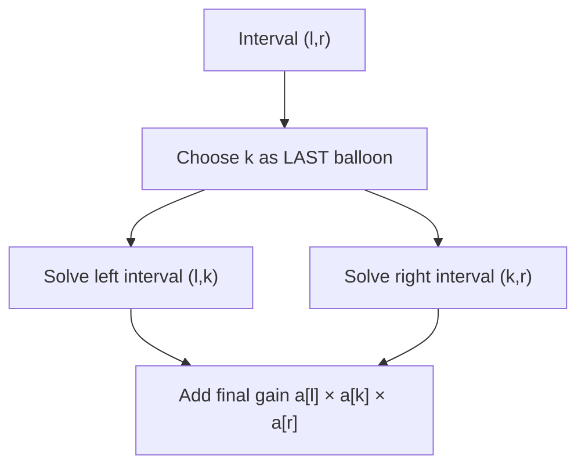
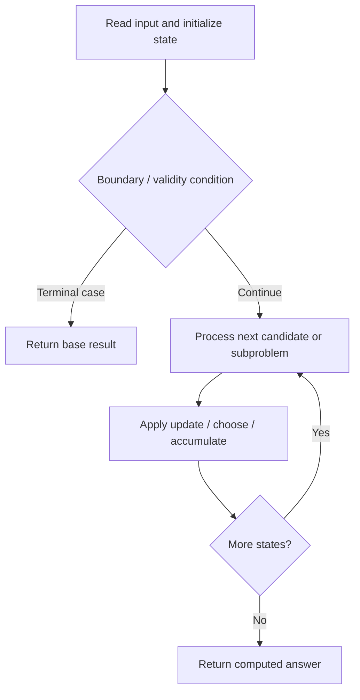

# 312. Burst Balloons

**Difficulty:** Hard  
**Concept family:** [Interval and Partition DP](https://github.com/gaurav1kr/Miscellaneous/blob/main/DSA/DP/DP_Mathematics_Master_Guide_Illustrated/Theory/Chapter-06.md)  
**Problem:** https://leetcode.com/problems/burst-balloons/  
**Original submission:** https://leetcode.com/submissions/detail/1541009965/

## Understand the mathematics first

This problem belongs to the study family **Interval and Partition DP**. Start by defining the objective and minimal sufficient state; inspect the code to identify the actual transitions.

### Related concept template (not necessarily this problem’s recurrence)

$$
F(l,r)=\min_{l\le k<r}(F(l,k)+F(k+1,r)+cost(l,k,r))
$$

**What this template illustrates:** Some interval problems maximize rather than minimize. Choosing the last operation can make otherwise interacting subproblems independent.

**Derivation exercise:** Define exactly what each state variable means for this problem; list valid choices, base cases, and forbidden transitions. Check the submitted code against that invariant. The family template alone is not a substitute for a problem-specific proof.

## Code landmarks

- `coins += dp[left][k - 1]; // Left subarray`
- `coins += dp[k + 1][right]; // Right subarray`
- `dp[left][right] = max(dp[left][right], coins);`

## Worked mathematical walkthrough (illustrated)

**State:** D(l,r): maximum coins bursting balloons strictly between boundaries l and r.

**Transition:** `D(l,r)=max over l<k<r of [D(l,k)+D(k,r)+a[l]*a[k]*a[r]]`

**Why:** Choosing the FIRST balloon leaves changing neighbors; choosing the LAST makes the interval boundaries fixed. This is the crucial mathematical trick.



**Hand calculation:** Padded [1,3,1,5,1]: choose a balloon k to burst LAST in an interval, after its interior neighbors have gone.

**Six-month revision test:** Without looking at the code, reconstruct the state, enumerate the legal choices, and justify why this transition does not miss or double-count any answer.

---

## Source-grounded algorithm walkthrough (expanded coverage)

> **Verification level:** The observations below are extracted from your actual Accepted C++ implementation. The symbolic trace is a **code-reading dry-run worksheet**, not a fabricated numerical run. The generic family formula above is not necessarily this problem's recurrence.

### 1. Identify the actual state and algorithm

**Problem:** 312. Burst Balloons. An explicit state table or memo is present. Interpret each index as a mathematical state and every update as a transition.

| Role | C++ source line | Evidence from your solution |
|---|---:|---|
| Candidate state / accumulator | 11 | `vector<vector<int>> dp(n + 2, vector<int>(n + 2, 0));` |
| Candidate state / accumulator | 22 | `coins += dp[left][k - 1]; // Left subarray` |
| Candidate state / accumulator | 23 | `coins += dp[k + 1][right]; // Right subarray` |
| Boundary / termination | — | No obvious matching statement; inspect the original C++ below. |
| Traversal order | 14 | `for (int len = 1; len <= n; ++len) { // Length of the subarray` |
| Traversal order | 15 | `for (int left = 1; left <= n - len + 1; ++left) {` |
| Traversal order | 19 | `for (int k = left; k <= right; ++k) {` |
| Transition / update | 7 | `nums.insert(nums.begin(), 1);` |
| Transition / update | 8 | `nums.push_back(1);` |
| Transition / update | 24 | `dp[left][right] = max(dp[left][right], coins);` |
| Return / result | 30 | `return dp[1][n];` |

### 2. Trace the dependency chain



This is a **control-flow reading diagram**, not a claim about the exact shape of the mathematical state graph. Follow the code line numbers above to draw the actual dependency arrows.

### 3. Symbolic dry-run worksheet

| Stage | State to record | Mathematical question to answer |
|---|---|---|
| Initialize | Inputs, initialized containers/accumulators | What does the initial value mean? |
| First iteration / recursive call | Loop indices, branch, current state | Which predecessor states are available? |
| First update | Before → after for the updated variable | Why is this transition legal? Does it add, minimize, maximize, or overwrite? |
| Next iteration | Updated state and next candidate | Can a value be reused in this traversal order? |
| Finish | Return expression and its value | Why does this correspond to the problem's requested result? |

### 4. Mathematical explanation checklist

1. Define the exact meaning of each state variable, including all indices and constraints.
2. Translate the update expression into a mathematical equation **only after** establishing the state invariant.
3. Prove the transitions are exhaustive and do not double-count or reuse forbidden elements.
4. Check empty input, smallest input, impossible cases, and overflow/modulo behavior.
5. Compute a small numerical example using the actual problem constraints, then compare each row to the original C++.


---

## Your original Accepted C++ submission (unaltered)

```cpp
class Solution {
public:
    int maxCoins(vector<int>& nums) {
        int n = nums.size();
        
        // Add virtual balloons with value 1 at both ends
        nums.insert(nums.begin(), 1);
        nums.push_back(1);
        
        // DP table
        vector<vector<int>> dp(n + 2, vector<int>(n + 2, 0));
        
        // Fill the DP table
        for (int len = 1; len <= n; ++len) { // Length of the subarray
            for (int left = 1; left <= n - len + 1; ++left) {
                int right = left + len - 1;
                
                // Find the maximum coins for the subarray nums[left:right]
                for (int k = left; k <= right; ++k) {
                    // Coins gained by bursting balloon k last
                    int coins = nums[left - 1] * nums[k] * nums[right + 1];
                    coins += dp[left][k - 1]; // Left subarray
                    coins += dp[k + 1][right]; // Right subarray
                    dp[left][right] = max(dp[left][right], coins);
                }
            }
        }
        
        // The result is the maximum coins for the entire array
        return dp[1][n];
    }
};
```

## Interview self-check

1. What is the smallest state that determines the remaining answer?
2. Why are the transitions exhaustive and valid?
3. What is the exact base case, including empty and impossible cases?
4. What is the time complexity (states × work per state)?
5. Can the memory be compressed without overwriting needed dependencies?
