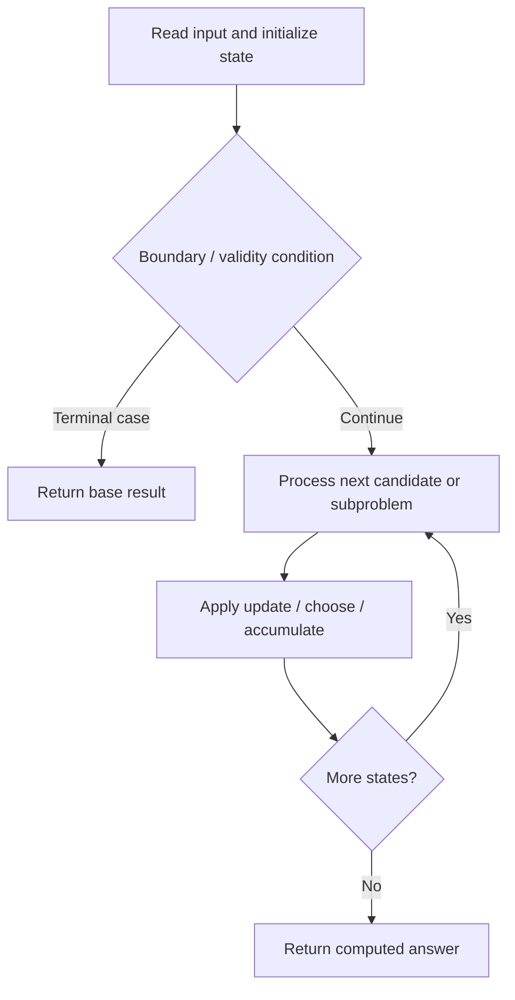

# 313. Super Ugly Number

**Difficulty:** Medium  
**Concept family:** [Mathematical Recurrences and Combinatorics](https://github.com/gaurav1kr/Miscellaneous/blob/main/DSA/DP/DP_Mathematics_Master_Guide_Illustrated/Theory/Chapter-01.md)  
**Problem:** https://leetcode.com/problems/super-ugly-number/  
**Original submission:** https://leetcode.com/submissions/detail/2163955139/

## Understand the mathematics first

This problem belongs to the study family **Mathematical Recurrences and Combinatorics**. Start by defining the objective and minimal sufficient state; inspect the code to identify the actual transitions.

### Related concept template (not necessarily this problem’s recurrence)

$$
F(n)=\sum_{c\in Choices(n)}F(next(n,c))
$$

**What this template illustrates:** For counting, add disjoint cases. For optimization, replace sum with min or max. Base cases must express empty structures correctly.

**Derivation exercise:** Define exactly what each state variable means for this problem; list valid choices, base cases, and forbidden transitions. Check the submitted code against that invariant. The family template alone is not a substitute for a problem-specific proof.

## Code landmarks

- `dp[0] = 1;`
- `mn = min(mn, next[j]);`
- `dp[i] = (int)mn;`

## Source-grounded algorithm walkthrough (expanded coverage)

> **Verification level:** The observations below are extracted from your actual Accepted C++ implementation. The symbolic trace is a **code-reading dry-run worksheet**, not a fabricated numerical run. The generic family formula above is not necessarily this problem's recurrence.

### 1. Identify the actual state and algorithm

**Problem:** 313. Super Ugly Number. An explicit state table or memo is present. Interpret each index as a mathematical state and every update as a transition.

| Role | C++ source line | Evidence from your solution |
|---|---:|---|
| Candidate state / accumulator | 6 | `vector<int> dp(n);` |
| Candidate state / accumulator | 10 | `dp[0] = 1;` |
| Candidate state / accumulator | 23 | `dp[i] = (int)mn;` |
| Boundary / termination | 10 | `dp[0] = 1;` |
| Boundary / termination | 27 | `if (next[j] == mn) {` |
| Traversal order | 12 | `for (int j = 0; j < k; ++j)` |
| Traversal order | 15 | `for (int i = 1; i < n; ++i) {` |
| Traversal order | 20 | `for (int j = 1; j < k; ++j)` |
| Transition / update | 10 | `dp[0] = 1;` |
| Transition / update | 21 | `mn = min(mn, next[j]);` |
| Transition / update | 23 | `dp[i] = (int)mn;` |
| Return / result | 34 | `return dp[n - 1];` |

### 2. Trace the dependency chain



This is a **control-flow reading diagram**, not a claim about the exact shape of the mathematical state graph. Follow the code line numbers above to draw the actual dependency arrows.

### 3. Symbolic dry-run worksheet

| Stage | State to record | Mathematical question to answer |
|---|---|---|
| Initialize | Inputs, initialized containers/accumulators | What does the initial value mean? |
| First iteration / recursive call | Loop indices, branch, current state | Which predecessor states are available? |
| First update | Before → after for the updated variable | Why is this transition legal? Does it add, minimize, maximize, or overwrite? |
| Next iteration | Updated state and next candidate | Can a value be reused in this traversal order? |
| Finish | Return expression and its value | Why does this correspond to the problem's requested result? |

### 4. Mathematical explanation checklist

1. Define the exact meaning of each state variable, including all indices and constraints.
2. Translate the update expression into a mathematical equation **only after** establishing the state invariant.
3. Prove the transitions are exhaustive and do not double-count or reuse forbidden elements.
4. Check empty input, smallest input, impossible cases, and overflow/modulo behavior.
5. Compute a small numerical example using the actual problem constraints, then compare each row to the original C++.


---

## Your original Accepted C++ submission (unaltered)

```cpp
class Solution {
public:
    int nthSuperUglyNumber(int n, vector<int>& primes) {
        int k = primes.size();

        vector<int> dp(n);
        vector<int> idx(k, 0);
        vector<long long> next(k);

        dp[0] = 1;

        for (int j = 0; j < k; ++j)
            next[j] = primes[j];

        for (int i = 1; i < n; ++i) {

            // Find next smallest ugly number
            long long mn = next[0];

            for (int j = 1; j < k; ++j)
                mn = min(mn, next[j]);

            dp[i] = (int)mn;

            // Move ALL pointers producing mn
            for (int j = 0; j < k; ++j) {
                if (next[j] == mn) {
                    ++idx[j];
                    next[j] = 1LL * primes[j] * dp[idx[j]];
                }
            }
        }

        return dp[n - 1];
    }
};
```

## Time and Space Complexity

- **Time:** `Depends on loop nesting and bounds`
- **Auxiliary space:** `Depends on auxiliary arrays/containers`

**Reasoning:** Count how many iterations each loop executes and whether loops are nested; do not assume all nested loops are quadratic.

**Status:** Code-informed complexity guidance; exact tight bounds have not been individually verified.
