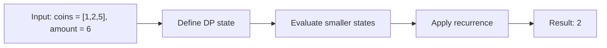

# 322. Coin Change

**Difficulty:** Medium  
**Concept family:** [Take-or-Skip and Knapsack](https://github.com/gaurav1kr/Miscellaneous/blob/main/DSA/DP/DP_Mathematics_Master_Guide_Illustrated/Theory/Chapter-02.md)  
**Problem:** https://leetcode.com/problems/coin-change/  
**Original submission:** https://leetcode.com/submissions/detail/1542478725/

## Understand the mathematics first

Choose the last coin used.

### Problem-specific recurrence

Refer to the source-grounded algorithm walkthrough below for the state transitions used by your implementation. The generic family recurrence has been removed because it may not apply to this problem.

## Code landmarks

- `dp[0] = 0;  // Base case: 0 coins needed for amount 0`
- `dp[i] = min(dp[i], dp[i - coin] + 1);`
- `return dp[amount] == amount + 1 ? -1 : dp[amount];`

## Detailed dry run — Coin Change: minimum number of coins

### Start from the mathematical question

Let C(x) be the minimum number of coins needed to make amount x; C(0)=0, and unreachable amounts have infinite cost.

### Derive the recurrence

```math
C(x)=1+\min_{c\in coins,\ c\le x}C(x-c)
```

**Why the transition is correct:** Classify an optimal solution by its last coin c. Remove that coin: the remainder must be optimally solved or the full solution was not optimal.

### Concrete example

**Input:** `coins = [1,2,5], amount = 6`



**Evaluate the states in dependency order:**

| x | 0 | 1 | 2 | 3 | 4 | 5 | 6 |
|---|---:|---:|---:|---:|---:|---:|---:|
| C(x) | 0 | 1 | 1 | 2 | 2 | 1 | 2 |

**Expected result:** `2`.

### What to remember six months later

Explain (1) what one state means, (2) which earlier states it needs, (3) why those cases are exhaustive, and (4) why the answer is `2` for this input. Then inspect your preserved C++ solution below and match its variables to the mathematical states.

---

## Your original Accepted C++ submission (unaltered)

```cpp
class Solution {
public:
   int coinChange(vector<int>& coins, int amount) {
    vector<int> dp(amount + 1, amount + 1);
    dp[0] = 0;  // Base case: 0 coins needed for amount 0

    for (int coin : coins) {
        for (int i = coin; i <= amount; ++i) {
            dp[i] = min(dp[i], dp[i - coin] + 1);
        }
    }

    return dp[amount] == amount + 1 ? -1 : dp[amount];
}
};
```

## Time and Space Complexity

- **Time:** `Depends on loop nesting and bounds`
- **Auxiliary space:** `Depends on auxiliary arrays/containers`

**Reasoning:** Count how many iterations each loop executes and whether loops are nested; do not assume all nested loops are quadratic.

**Status:** Code-informed complexity guidance; exact tight bounds have not been individually verified.
