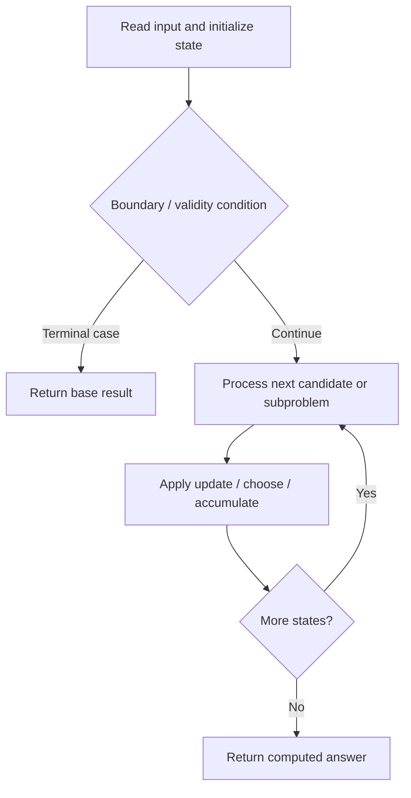

# 329. Longest Increasing Path in a Matrix

**Difficulty:** Hard  
**Concept family:** [Tree, Graph and DAG DP](https://github.com/gaurav1kr/Miscellaneous/blob/main/DSA/DP/DP_Mathematics_Master_Guide_Illustrated/Theory/Chapter-10.md)  
**Problem:** https://leetcode.com/problems/longest-increasing-path-in-a-matrix/  
**Original submission:** https://leetcode.com/submissions/detail/2163962302/

## Understand the mathematics first

This problem belongs to the study family **Tree, Graph and DAG DP**. Start by defining the objective and minimal sufficient state; inspect the code to identify the actual transitions.

### Mathematical starting point

This family includes tree DP, DAG DP, shortest paths, and graph traversal. **There is no single recurrence for all these problems.** Identify the exact state and invariant from the algorithm below. For tree paths, distinguish the value returned to the parent from a complete answer within the subtree; for graph problems, establish whether edges form a DAG or whether shortest-path processing is required.

## Code landmarks

- `if (dp[x][y] != 0)`
- `return dp[x][y];`
- `best = max(best,`

## Source-grounded algorithm walkthrough (expanded coverage)

> **Verification level:** The observations below are extracted from your actual Accepted C++ implementation. The symbolic trace is a **code-reading dry-run worksheet**, not a fabricated numerical run. The generic family formula above is not necessarily this problem's recurrence.

### 1. Identify the actual state and algorithm

**Problem:** 329. Longest Increasing Path in a Matrix. Recursive state transitions are present. Check memoization, state identity, termination, and whether branches are mutually exclusive.

| Role | C++ source line | Evidence from your solution |
|---|---:|---|
| Candidate state / accumulator | 3 | `vector<vector<int> > dp;` |
| Candidate state / accumulator | 9 | `if (dp[x][y] != 0)` |
| Candidate state / accumulator | 10 | `return dp[x][y];` |
| Boundary / termination | 9 | `if (dp[x][y] != 0)` |
| Boundary / termination | 18 | `if (nx >= 0 && nx < m &&` |
| Traversal order | 14 | `for (int k = 0; k < 4; ++k) {` |
| Traversal order | 39 | `for (int i = 0; i < m; ++i) {` |
| Traversal order | 40 | `for (int j = 0; j < n; ++j) {` |
| Transition / update | 12 | `int best = 1;` |
| Transition / update | 22 | `best = max(best,` |
| Transition / update | 27 | `return dp[x][y] = best;` |
| Transition / update | 37 | `int ans = 0;` |
| Return / result | 10 | `return dp[x][y];` |
| Return / result | 27 | `return dp[x][y] = best;` |

### 2. Trace the dependency chain



This is a **control-flow reading diagram**, not a claim about the exact shape of the mathematical state graph. Follow the code line numbers above to draw the actual dependency arrows.

### 3. Symbolic dry-run worksheet

| Stage | State to record | Mathematical question to answer |
|---|---|---|
| Initialize | Inputs, initialized containers/accumulators | What does the initial value mean? |
| First iteration / recursive call | Loop indices, branch, current state | Which predecessor states are available? |
| First update | Before → after for the updated variable | Why is this transition legal? Does it add, minimize, maximize, or overwrite? |
| Next iteration | Updated state and next candidate | Can a value be reused in this traversal order? |
| Finish | Return expression and its value | Why does this correspond to the problem's requested result? |

### 4. Mathematical explanation checklist

1. Define the exact meaning of each state variable, including all indices and constraints.
2. Translate the update expression into a mathematical equation **only after** establishing the state invariant.
3. Prove the transitions are exhaustive and do not double-count or reuse forbidden elements.
4. Check empty input, smallest input, impossible cases, and overflow/modulo behavior.
5. Compute a small numerical example using the actual problem constraints, then compare each row to the original C++.


---

## Your original Accepted C++ submission (unaltered)

```cpp
class Solution {
    int m, n;
    vector<vector<int> > dp;
    
    int dx[4] = {1, -1, 0, 0};
    int dy[4] = {0, 0, 1, -1};

    int dfs(vector<vector<int> >& matrix, int x, int y) {
        if (dp[x][y] != 0)
            return dp[x][y];

        int best = 1;

        for (int k = 0; k < 4; ++k) {
            int nx = x + dx[k];
            int ny = y + dy[k];

            if (nx >= 0 && nx < m &&
                ny >= 0 && ny < n &&
                matrix[nx][ny] > matrix[x][y]) {

                best = max(best,
                           1 + dfs(matrix, nx, ny));
            }
        }

        return dp[x][y] = best;
    }

public:
    int longestIncreasingPath(vector<vector<int> >& matrix) {
        m = matrix.size();
        n = matrix[0].size();

        dp.assign(m, vector<int>(n, 0));

        int ans = 0;

        for (int i = 0; i < m; ++i) {
            for (int j = 0; j < n; ++j) {
                ans = max(ans, dfs(matrix, i, j));
            }
        }

        return ans;
    }
};
```

## Time and Space Complexity

- **Time:** `Depends on table dimensions and transitions per cell`
- **Auxiliary space:** `O(rows × columns) for the allocated table`

**Reasoning:** The two-dimensional table determines memory; time is its state count multiplied by work per state.

**Status:** Code-informed complexity guidance; exact tight bounds have not been individually verified.
