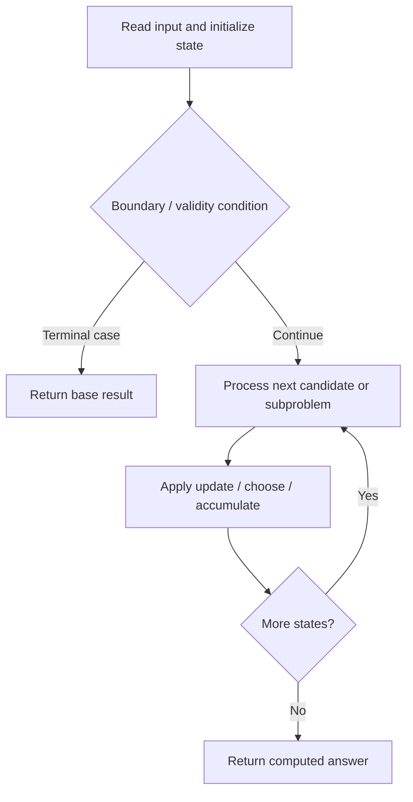

# 337. House Robber III

**Difficulty:** Medium  
**Concept family:** [Take-or-Skip and Knapsack](https://github.com/gaurav1kr/Miscellaneous/blob/main/DSA/DP/DP_Mathematics_Master_Guide_Illustrated/Theory/Chapter-02.md)  
**Problem:** https://leetcode.com/problems/house-robber-iii/  
**Original submission:** https://leetcode.com/submissions/detail/1541468267/

## Understand the mathematics first

At each tree node track selected and unselected cases.

### Related concept template (not necessarily this problem’s recurrence)

`take(u)=value(u)+skip(left)+skip(right); skip(u)=max(take,skip)(left)+max(take,skip)(right)`

**What this template illustrates:** Tree edges replace linear adjacency.

**Derivation exercise:** Define exactly what each state variable means for this problem; list valid choices, base cases, and forbidden transitions. Check the submitted code against that invariant. The family template alone is not a substitute for a problem-specific proof.

## Code landmarks

- `int notRobbed = max(left.first, left.second) + max(right.first, right.second);`
- `return max(result.first, result.second);`

## Source-grounded algorithm walkthrough (expanded coverage)

> **Verification level:** The observations below are extracted from your actual Accepted C++ implementation. The symbolic trace is a **code-reading dry-run worksheet**, not a fabricated numerical run. The generic family formula above is not necessarily this problem's recurrence.

### 1. Identify the actual state and algorithm

**Problem:** 337. House Robber III. This solution does not expose an obvious `dp` or `memo` variable. Derive the algorithmic invariant from the code rather than assuming a DP recurrence.

| Role | C++ source line | Evidence from your solution |
|---|---:|---|
| Candidate state / accumulator | — | No obvious matching statement; inspect the original C++ below. |
| Boundary / termination | 19 | `if (!root) return {0, 0};` |
| Traversal order | — | No obvious matching statement; inspect the original C++ below. |
| Transition / update | 26 | `int notRobbed = max(left.first, left.second) + max(right.first, right.second);` |
| Transition / update | 36 | `return max(result.first, result.second);` |
| Return / result | 19 | `if (!root) return {0, 0};` |
| Return / result | 31 | `return {notRobbed, robbed};` |

### 2. Trace the dependency chain



This is a **control-flow reading diagram**, not a claim about the exact shape of the mathematical state graph. Follow the code line numbers above to draw the actual dependency arrows.

### 3. Symbolic dry-run worksheet

| Stage | State to record | Mathematical question to answer |
|---|---|---|
| Initialize | Inputs, initialized containers/accumulators | What does the initial value mean? |
| First iteration / recursive call | Loop indices, branch, current state | Which predecessor states are available? |
| First update | Before → after for the updated variable | Why is this transition legal? Does it add, minimize, maximize, or overwrite? |
| Next iteration | Updated state and next candidate | Can a value be reused in this traversal order? |
| Finish | Return expression and its value | Why does this correspond to the problem's requested result? |

### 4. Mathematical explanation checklist

1. Define the exact meaning of each state variable, including all indices and constraints.
2. Translate the update expression into a mathematical equation **only after** establishing the state invariant.
3. Prove the transitions are exhaustive and do not double-count or reuse forbidden elements.
4. Check empty input, smallest input, impossible cases, and overflow/modulo behavior.
5. Compute a small numerical example using the actual problem constraints, then compare each row to the original C++.


---

## Your original Accepted C++ submission (unaltered)

```cpp
/**
 * Definition for a binary tree node.
 * struct TreeNode {
 *     int val;
 *     TreeNode *left;
 *     TreeNode *right;
 *     TreeNode() : val(0), left(nullptr), right(nullptr) {}
 *     TreeNode(int x) : val(x), left(nullptr), right(nullptr) {}
 *     TreeNode(int x, TreeNode *left, TreeNode *right) : val(x), left(left), right(right) {}
 * };
 */

class Solution {
public:
    // Helper function to return a pair of values
    // First value: Maximum sum if the current node is NOT robbed
    // Second value: Maximum sum if the current node IS robbed
    pair<int, int> robSub(TreeNode* root) {
        if (!root) return {0, 0};
        
        // Recursively calculate for left and right subtrees
        auto left = robSub(root->left);
        auto right = robSub(root->right);
        
        // If we do not rob the current node, we can take the max of both states (robbed or not) from its children
        int notRobbed = max(left.first, left.second) + max(right.first, right.second);
        
        // If we rob the current node, we cannot rob its immediate children
        int robbed = root->val + left.first + right.first;
        
        return {notRobbed, robbed};
    }
    
    int rob(TreeNode* root) {
        auto result = robSub(root);
        return max(result.first, result.second);
    }
};
```

## Interview self-check

1. What is the smallest state that determines the remaining answer?
2. Why are the transitions exhaustive and valid?
3. What is the exact base case, including empty and impossible cases?
4. What is the time complexity (states × work per state)?
5. Can the memory be compressed without overwriting needed dependencies?
