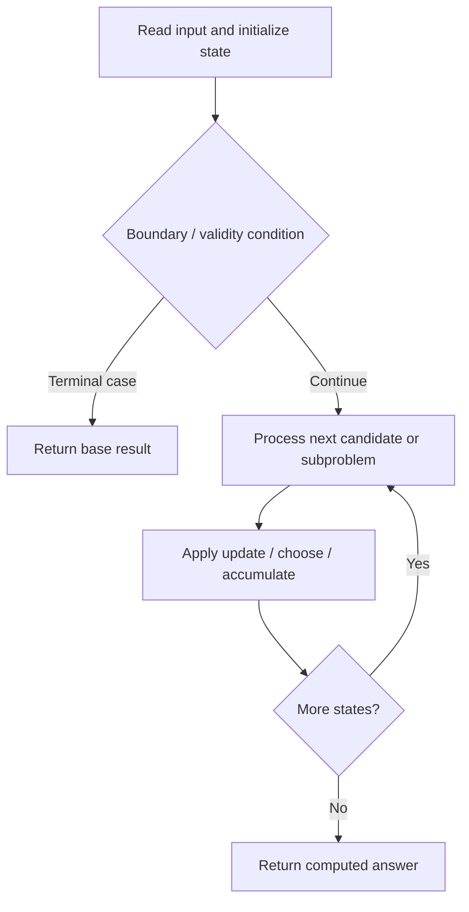

# 3393. Count Paths With the Given XOR Value

**Difficulty:** Medium  
**Concept family:** [Grid Paths and Geometric DP](https://github.com/gaurav1kr/Miscellaneous/blob/main/DSA/DP/DP_Mathematics_Master_Guide_Illustrated/Theory/Chapter-03.md)  
**Problem:** https://leetcode.com/problems/count-paths-with-the-given-xor-value/  
**Original submission:** https://leetcode.com/submissions/detail/2168447014/

## Understand the mathematics first

Carry XOR value as an extra state dimension.

### Related concept template (not necessarily this problem’s recurrence)

$$
W(i,j,x)=W(i-1,j,x XOR grid(i,j))+W(i,j-1,x XOR grid(i,j))
$$

**What this template illustrates:** XOR is invertible: previous XOR = desired XOR XOR current value.

**Derivation exercise:** Define exactly what each state variable means for this problem; list valid choices, base cases, and forbidden transitions. Check the submitted code against that invariant. The family template alone is not a substitute for a problem-specific proof.

## Code landmarks

- `// dp[j][x] = number of paths reaching`
- `dp[0][grid[0][0]] = 1;`
- `curr[x] = dp[j][prev];`

## Source-grounded algorithm walkthrough (expanded coverage)

> **Verification level:** The observations below are extracted from your actual Accepted C++ implementation. The symbolic trace is a **code-reading dry-run worksheet**, not a fabricated numerical run. The generic family formula above is not necessarily this problem's recurrence.

### 1. Identify the actual state and algorithm

**Problem:** 3393. Count Paths With the Given XOR Value. An explicit state table or memo is present. Interpret each index as a mathematical state and every update as a transition.

| Role | C++ source line | Evidence from your solution |
|---|---:|---|
| Candidate state / accumulator | 10 | `vector<array<int, 16>> dp(n);` |
| Candidate state / accumulator | 12 | `dp[0][grid[0][0]] = 1;` |
| Candidate state / accumulator | 26 | `curr[x] = dp[j][prev];` |
| Boundary / termination | 12 | `dp[0][grid[0][0]] = 1;` |
| Boundary / termination | 16 | `if (i == 0 && j == 0)` |
| Boundary / termination | 25 | `if (i > 0) {` |
| Traversal order | 14 | `for (int i = 0; i < m; ++i) {` |
| Traversal order | 15 | `for (int j = 0; j < n; ++j) {` |
| Traversal order | 21 | `for (int x = 0; x < 16; ++x) {` |
| Transition / update | 12 | `dp[0][grid[0][0]] = 1;` |
| Transition / update | 36 | `dp[j] = curr;` |
| Return / result | 40 | `return dp[n-1][k];` |

### 2. Trace the dependency chain



This is a **control-flow reading diagram**, not a claim about the exact shape of the mathematical state graph. Follow the code line numbers above to draw the actual dependency arrows.

### 3. Symbolic dry-run worksheet

| Stage | State to record | Mathematical question to answer |
|---|---|---|
| Initialize | Inputs, initialized containers/accumulators | What does the initial value mean? |
| First iteration / recursive call | Loop indices, branch, current state | Which predecessor states are available? |
| First update | Before → after for the updated variable | Why is this transition legal? Does it add, minimize, maximize, or overwrite? |
| Next iteration | Updated state and next candidate | Can a value be reused in this traversal order? |
| Finish | Return expression and its value | Why does this correspond to the problem's requested result? |

### 4. Mathematical explanation checklist

1. Define the exact meaning of each state variable, including all indices and constraints.
2. Translate the update expression into a mathematical equation **only after** establishing the state invariant.
3. Prove the transitions are exhaustive and do not double-count or reuse forbidden elements.
4. Check empty input, smallest input, impossible cases, and overflow/modulo behavior.
5. Compute a small numerical example using the actual problem constraints, then compare each row to the original C++.


---

## Your original Accepted C++ submission (unaltered)

```cpp
class Solution {
public:
    int countPathsWithXorValue(vector<vector<int>>& grid,
                               int k) {
        const int MOD = 1000000007;
        int m = grid.size(), n = grid[0].size();

        // dp[j][x] = number of paths reaching
        // current row's column j with XOR x
        vector<array<int, 16>> dp(n);

        dp[0][grid[0][0]] = 1;

        for (int i = 0; i < m; ++i) {
            for (int j = 0; j < n; ++j) {
                if (i == 0 && j == 0)
                    continue;

                array<int, 16> curr = {};

                for (int x = 0; x < 16; ++x) {
                    int prev = x ^ grid[i][j];

                    // From top
                    if (i > 0) {
                        curr[x] = dp[j][prev];
                    }

                    // From left
                    if (j > 0) {
                        curr[x] = (curr[x] +
                                   dp[j-1][prev]) % MOD;
                    }
                }

                dp[j] = curr;
            }
        }

        return dp[n-1][k];
    }
};
```

## Interview self-check

1. What is the smallest state that determines the remaining answer?
2. Why are the transitions exhaustive and valid?
3. What is the exact base case, including empty and impossible cases?
4. What is the time complexity (states × work per state)?
5. Can the memory be compressed without overwriting needed dependencies?
