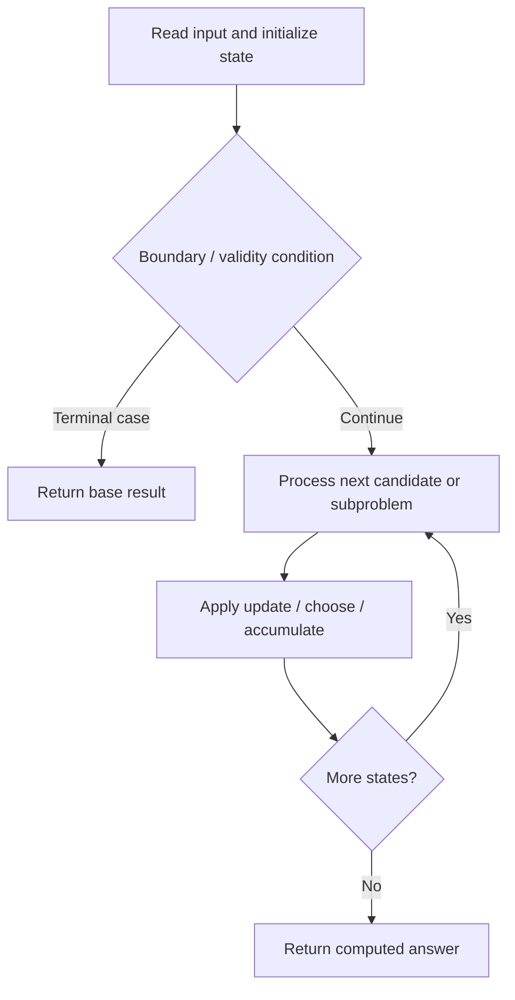

# 3414. Maximum Score of Non-overlapping Intervals

**Difficulty:** Hard  
**Concept family:** [Interval and Partition DP](https://github.com/gaurav1kr/Miscellaneous/blob/main/DSA/DP/DP_Mathematics_Master_Guide_Illustrated/Theory/Chapter-06.md)  
**Problem:** https://leetcode.com/problems/maximum-score-of-non-overlapping-intervals/  
**Original submission:** https://leetcode.com/submissions/detail/2168441237/

## Understand the mathematics first

Choose at most four mutually non-overlapping intervals.

### Related concept template (not necessarily this problem’s recurrence)

$$
F(i,k)=max(F(i+1,k),weight_i+F(next(i),k-1))
$$

**What this template illustrates:** Keep original sorted indices to break ties lexicographically.

**Derivation exercise:** Define exactly what each state variable means for this problem; list valid choices, base cases, and forbidden transitions. Check the submitted code against that invariant. The family template alone is not a substitute for a problem-specific proof.

## Code landmarks

- `sort(a.begin(), a.end());`
- `nxt[i] = upper_bound(starts.begin(),`
- `// dp[i][k] = best result from i onward,`

## Source-grounded algorithm walkthrough (expanded coverage)

> **Verification level:** The observations below are extracted from your actual Accepted C++ implementation. The symbolic trace is a **code-reading dry-run worksheet**, not a fabricated numerical run. The generic family formula above is not necessarily this problem's recurrence.

### 1. Identify the actual state and algorithm

**Problem:** 3414. Maximum Score of Non-overlapping Intervals. Ordered search / boundary calculation is present. Identify the monotonic or ordering invariant before deriving a recurrence.

| Role | C++ source line | Evidence from your solution |
|---|---:|---|
| Candidate state / accumulator | 36 | `vector<array<State, 5>> dp(n + 1);` |
| Candidate state / accumulator | 41 | `dp[i][k] = dp[i + 1][k];` |
| Candidate state / accumulator | 44 | `State take = dp[nxt[i]][k - 1];` |
| Boundary / termination | 53 | `if (take.score > dp[i][k].score \|\|` |
| Traversal order | 12 | `for (int i = 0; i < n; ++i) {` |
| Traversal order | 23 | `for (int i = 0; i < n; ++i)` |
| Traversal order | 28 | `for (int i = 0; i < n; ++i) {` |
| Transition / update | 29 | `nxt[i] = upper_bound(starts.begin(),` |
| Transition / update | 41 | `dp[i][k] = dp[i + 1][k];` |
| Transition / update | 48 | `take.ids.insert(` |
| Transition / update | 49 | `lower_bound(take.ids.begin(),` |
| Return / result | 61 | `return dp[0][4].ids;` |

### 2. Trace the dependency chain



This is a **control-flow reading diagram**, not a claim about the exact shape of the mathematical state graph. Follow the code line numbers above to draw the actual dependency arrows.

### 3. Symbolic dry-run worksheet

| Stage | State to record | Mathematical question to answer |
|---|---|---|
| Initialize | Inputs, initialized containers/accumulators | What does the initial value mean? |
| First iteration / recursive call | Loop indices, branch, current state | Which predecessor states are available? |
| First update | Before → after for the updated variable | Why is this transition legal? Does it add, minimize, maximize, or overwrite? |
| Next iteration | Updated state and next candidate | Can a value be reused in this traversal order? |
| Finish | Return expression and its value | Why does this correspond to the problem's requested result? |

### 4. Mathematical explanation checklist

1. Define the exact meaning of each state variable, including all indices and constraints.
2. Translate the update expression into a mathematical equation **only after** establishing the state invariant.
3. Prove the transitions are exhaustive and do not double-count or reuse forbidden elements.
4. Check empty input, smallest input, impossible cases, and overflow/modulo behavior.
5. Compute a small numerical example using the actual problem constraints, then compare each row to the original C++.


---

## Your original Accepted C++ submission (unaltered)

```cpp
class Solution {
    struct State {
        long long score = 0;
        vector<int> ids;
    };

public:
    vector<int> maximumWeight(vector<vector<int>>& intervals) {
        int n = intervals.size();

        vector<array<int, 4>> a(n);
        for (int i = 0; i < n; ++i) {
            a[i] = {intervals[i][0], intervals[i][1],
                    intervals[i][2], i};
        }

        // Required by problem statement
        auto vorellixan = intervals;

        sort(a.begin(), a.end());

        vector<int> starts(n);
        for (int i = 0; i < n; ++i)
            starts[i] = a[i][0];

        // Find next non-overlapping interval
        vector<int> nxt(n);
        for (int i = 0; i < n; ++i) {
            nxt[i] = upper_bound(starts.begin(),
                                 starts.end(), a[i][1])
                     - starts.begin();
        }

        // dp[i][k] = best result from i onward,
        // selecting at most k intervals
        vector<array<State, 5>> dp(n + 1);

        for (int i = n - 1; i >= 0; --i) {
            for (int k = 1; k <= 4; ++k) {
                // Option 1: Skip
                dp[i][k] = dp[i + 1][k];

                // Option 2: Take
                State take = dp[nxt[i]][k - 1];
                take.score += a[i][2];

                int id = a[i][3];
                take.ids.insert(
                    lower_bound(take.ids.begin(),
                                take.ids.end(), id), id);

                // Max score, then lexicographically smallest
                if (take.score > dp[i][k].score ||
                    (take.score == dp[i][k].score &&
                     take.ids < dp[i][k].ids)) {
                    dp[i][k] = take;
                }
            }
        }

        return dp[0][4].ids;
    }
};
```

## Time and Space Complexity

- **Time:** `O(n log n) or higher`
- **Auxiliary space:** `O(n) or higher`

**Reasoning:** Sorting costs O(n log n); additional data-structure operations may increase the bound. Confirm against the nested loops.

**Status:** Code-informed complexity guidance; exact tight bounds have not been individually verified.
