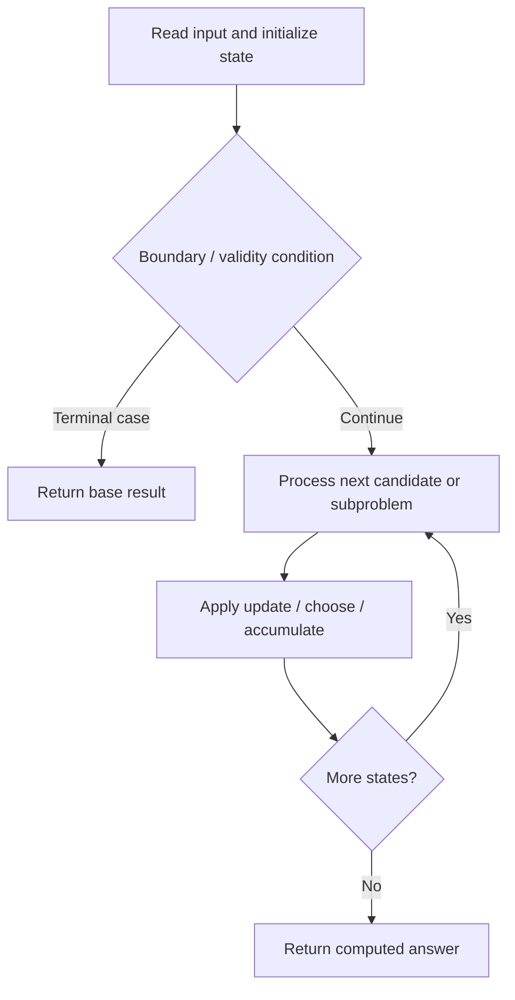

# 3418. Maximum Amount of Money Robot Can Earn

**Difficulty:** Medium  
**Concept family:** [Grid Paths and Geometric DP](https://github.com/gaurav1kr/Miscellaneous/blob/main/DSA/DP/DP_Mathematics_Master_Guide_Illustrated/Theory/Chapter-03.md)  
**Problem:** https://leetcode.com/problems/maximum-amount-of-money-robot-can-earn/  
**Original submission:** https://leetcode.com/submissions/detail/2168426715/

## Understand the mathematics first

Carry remaining neutralizations as an extra state.

### Related concept template (not necessarily this problem’s recurrence)

$$
F(i,j,k)=max(fromTopOrLeft+value, fromTopOrLeftWithOneMoreNeutralization)
$$

**What this template illustrates:** A negative cell may be neutralized at most twice.

**Derivation exercise:** Define exactly what each state variable means for this problem; list valid choices, base cases, and forbidden transitions. Check the submitted code against that invariant. The family template alone is not a substitute for a problem-specific proof.

## Code landmarks

- `// dp[j][k]: max coins at column j`
- `dp[j] = {NEG, NEG, x};`
- `dp[j][1] = 0;`

## Source-grounded algorithm walkthrough (expanded coverage)

> **Verification level:** The observations below are extracted from your actual Accepted C++ implementation. The symbolic trace is a **code-reading dry-run worksheet**, not a fabricated numerical run. The generic family formula above is not necessarily this problem's recurrence.

### 1. Identify the actual state and algorithm

**Problem:** 3418. Maximum Amount of Money Robot Can Earn. An explicit state table or memo is present. Interpret each index as a mathematical state and every update as a transition.

| Role | C++ source line | Evidence from your solution |
|---|---:|---|
| Candidate state / accumulator | 9 | `vector<array<int, 3>> dp(n, {NEG, NEG, NEG});` |
| Candidate state / accumulator | 16 | `dp[j] = {NEG, NEG, x};` |
| Candidate state / accumulator | 18 | `dp[j][1] = 0;` |
| Boundary / termination | 15 | `if (i == 0 && j == 0) {` |
| Boundary / termination | 17 | `if (x < 0)` |
| Boundary / termination | 18 | `dp[j][1] = 0;` |
| Traversal order | 11 | `for (int i = 0; i < m; ++i) {` |
| Traversal order | 12 | `for (int j = 0; j < n; ++j) {` |
| Traversal order | 24 | `for (int k = 0; k < 3; ++k) {` |
| Transition / update | 16 | `dp[j] = {NEG, NEG, x};` |
| Transition / update | 18 | `dp[j][1] = 0;` |
| Transition / update | 28 | `prev[k] = max(prev[k], dp[j-1][k]);` |
| Transition / update | 33 | `dp[j][k] = prev[k] + x;` |
| Return / result | 43 | `return max({dp[n-1][0], dp[n-1][1],` |

### 2. Trace the dependency chain



This is a **control-flow reading diagram**, not a claim about the exact shape of the mathematical state graph. Follow the code line numbers above to draw the actual dependency arrows.

### 3. Symbolic dry-run worksheet

| Stage | State to record | Mathematical question to answer |
|---|---|---|
| Initialize | Inputs, initialized containers/accumulators | What does the initial value mean? |
| First iteration / recursive call | Loop indices, branch, current state | Which predecessor states are available? |
| First update | Before → after for the updated variable | Why is this transition legal? Does it add, minimize, maximize, or overwrite? |
| Next iteration | Updated state and next candidate | Can a value be reused in this traversal order? |
| Finish | Return expression and its value | Why does this correspond to the problem's requested result? |

### 4. Mathematical explanation checklist

1. Define the exact meaning of each state variable, including all indices and constraints.
2. Translate the update expression into a mathematical equation **only after** establishing the state invariant.
3. Prove the transitions are exhaustive and do not double-count or reuse forbidden elements.
4. Check empty input, smallest input, impossible cases, and overflow/modulo behavior.
5. Compute a small numerical example using the actual problem constraints, then compare each row to the original C++.


---

## Your original Accepted C++ submission (unaltered)

```cpp
class Solution {
public:
    int maximumAmount(vector<vector<int>>& coins) {
        int m = coins.size(), n = coins[0].size();
        const int NEG = -1000000000;

        // dp[j][k]: max coins at column j
        // with k neutralizations remaining
        vector<array<int, 3>> dp(n, {NEG, NEG, NEG});

        for (int i = 0; i < m; ++i) {
            for (int j = 0; j < n; ++j) {
                int x = coins[i][j];

                if (i == 0 && j == 0) {
                    dp[j] = {NEG, NEG, x};
                    if (x < 0)
                        dp[j][1] = 0;
                    continue;
                }

                array<int, 3> prev = {NEG, NEG, NEG};

                for (int k = 0; k < 3; ++k) {
                    // From top or left
                    prev[k] = dp[j][k];
                    if (j > 0)
                        prev[k] = max(prev[k], dp[j-1][k]);
                }

                for (int k = 0; k < 3; ++k) {
                    // Accept current cell value
                    dp[j][k] = prev[k] + x;

                    // Neutralize negative cell
                    if (x < 0 && k < 2)
                        dp[j][k] = max(dp[j][k],
                                       prev[k+1]);
                }
            }
        }

        return max({dp[n-1][0], dp[n-1][1],
                    dp[n-1][2]});
    }
};
```

## Time and Space Complexity

- **Time:** `Depends on table dimensions and transitions per cell`
- **Auxiliary space:** `O(rows × columns) for the allocated table`

**Reasoning:** The two-dimensional table determines memory; time is its state count multiplied by work per state.

**Status:** Code-informed complexity guidance; exact tight bounds have not been individually verified.
