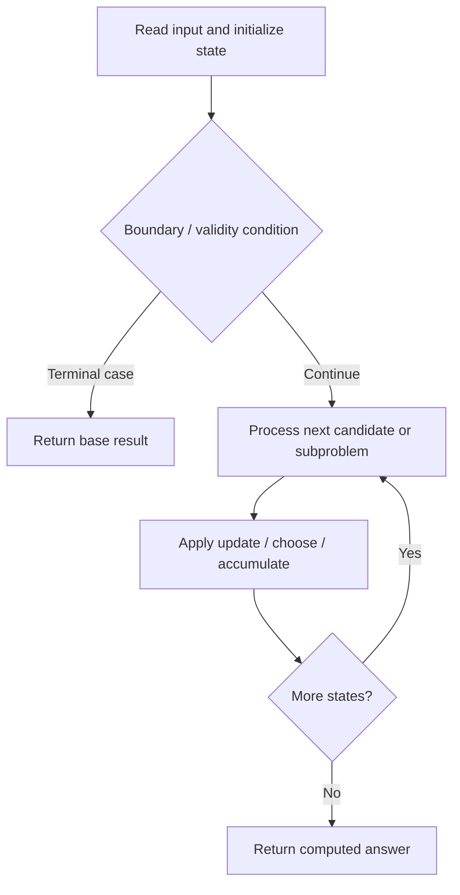

# 3429. Paint House IV

**Difficulty:** Medium  
**Concept family:** [Grid Paths and Geometric DP](https://github.com/gaurav1kr/Miscellaneous/blob/main/DSA/DP/DP_Mathematics_Master_Guide_Illustrated/Theory/Chapter-03.md)  
**Problem:** https://leetcode.com/problems/paint-house-iv/  
**Original submission:** https://leetcode.com/submissions/detail/2167750019/

## Understand the mathematics first

This problem belongs to the study family **Grid Paths and Geometric DP**. Start by defining the objective and minimal sufficient state; inspect the code to identify the actual transitions.

### Problem-specific recurrence

Refer to the source-grounded algorithm walkthrough below for the state transitions used by your implementation. The generic family recurrence has been removed because it may not apply to this problem.

## Code landmarks

- `long long dp[3][3], ndp[3][3];`
- `dp[a][b] = (a == b) ? INF :`
- `ndp[a][b] = min(ndp[a][b],`

## Source-grounded algorithm walkthrough (expanded coverage)

> **Verification level:** The observations below are extracted from your actual Accepted C++ implementation. The symbolic trace is a **code-reading dry-run worksheet**, not a fabricated numerical run. The generic family formula above is not necessarily this problem's recurrence.

### 1. Identify the actual state and algorithm

**Problem:** 3429. Paint House IV. An explicit state table or memo is present. Interpret each index as a mathematical state and every update as a transition.

| Role | C++ source line | Evidence from your solution |
|---|---:|---|
| Candidate state / accumulator | 5 | `long long dp[3][3], ndp[3][3];` |
| Candidate state / accumulator | 9 | `dp[a][b] = (a == b) ? INF :` |
| Candidate state / accumulator | 23 | `dp[x][y] + cost[i][a]` |
| Boundary / termination | 16 | `if (a == b) continue;` |
| Boundary / termination | 20 | `if (a == x \|\| b == y) continue;` |
| Traversal order | 7 | `for (int a = 0; a < 3; ++a)` |
| Traversal order | 8 | `for (int b = 0; b < 3; ++b)` |
| Traversal order | 12 | `for (int i = 1; i < n / 2; ++i) {` |
| Transition / update | 9 | `dp[a][b] = (a == b) ? INF :` |
| Transition / update | 22 | `ndp[a][b] = min(ndp[a][b],` |
| Transition / update | 32 | `dp[a][b] = ndp[a][b];` |
| Transition / update | 35 | `long long ans = INF;` |
| Return / result | 40 | `return ans;` |

### 2. Trace the dependency chain



This is a **control-flow reading diagram**, not a claim about the exact shape of the mathematical state graph. Follow the code line numbers above to draw the actual dependency arrows.

### 3. Symbolic dry-run worksheet

| Stage | State to record | Mathematical question to answer |
|---|---|---|
| Initialize | Inputs, initialized containers/accumulators | What does the initial value mean? |
| First iteration / recursive call | Loop indices, branch, current state | Which predecessor states are available? |
| First update | Before → after for the updated variable | Why is this transition legal? Does it add, minimize, maximize, or overwrite? |
| Next iteration | Updated state and next candidate | Can a value be reused in this traversal order? |
| Finish | Return expression and its value | Why does this correspond to the problem's requested result? |

### 4. Mathematical explanation checklist

1. Define the exact meaning of each state variable, including all indices and constraints.
2. Translate the update expression into a mathematical equation **only after** establishing the state invariant.
3. Prove the transitions are exhaustive and do not double-count or reuse forbidden elements.
4. Check empty input, smallest input, impossible cases, and overflow/modulo behavior.
5. Compute a small numerical example using the actual problem constraints, then compare each row to the original C++.


---

## Your original Accepted C++ submission (unaltered)

```cpp
class Solution {
public:
    long long minCost(int n, vector<vector<int>>& cost) {
        const long long INF = 1LL << 60;
        long long dp[3][3], ndp[3][3];

        for (int a = 0; a < 3; ++a)
            for (int b = 0; b < 3; ++b)
                dp[a][b] = (a == b) ? INF :
                    (long long)cost[0][a] + cost[n-1][b];

        for (int i = 1; i < n / 2; ++i) {
            for (int a = 0; a < 3; ++a) {
                for (int b = 0; b < 3; ++b) {
                    ndp[a][b] = INF;
                    if (a == b) continue;

                    for (int x = 0; x < 3; ++x) {
                        for (int y = 0; y < 3; ++y) {
                            if (a == x || b == y) continue;

                            ndp[a][b] = min(ndp[a][b],
                                dp[x][y] + cost[i][a]
                                         + cost[n-1-i][b]);
                        }
                    }
                }
            }

            for (int a = 0; a < 3; ++a)
                for (int b = 0; b < 3; ++b)
                    dp[a][b] = ndp[a][b];
        }

        long long ans = INF;
        for (int a = 0; a < 3; ++a)
            for (int b = 0; b < 3; ++b)
                ans = min(ans, dp[a][b]);

        return ans;
    }
};
```

## Time and Space Complexity

- **Time:** `Depends on table dimensions and transitions per cell`
- **Auxiliary space:** `O(rows × columns) for the allocated table`

**Reasoning:** The two-dimensional table determines memory; time is its state count multiplied by work per state.

**Status:** Code-informed complexity guidance; exact tight bounds have not been individually verified.
