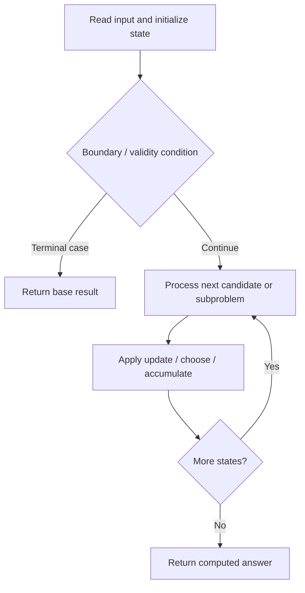

# 3441. Minimum Cost Good Caption

**Difficulty:** Hard  
**Concept family:** [String Matching and Sequence Alignment](https://github.com/gaurav1kr/Miscellaneous/blob/main/DSA/DP/DP_Mathematics_Master_Guide_Illustrated/Theory/Chapter-04.md)  
**Problem:** https://leetcode.com/problems/minimum-cost-good-caption/  
**Original submission:** https://leetcode.com/submissions/detail/2167747014/

## Understand the mathematics first

This problem belongs to the study family **String Matching and Sequence Alignment**. Start by defining the objective and minimal sufficient state; inspect the code to identify the actual transitions.

### Related concept template (not necessarily this problem’s recurrence)

$$
D(i,j)=\min(D(i-1,j)+1,D(i,j-1)+1,D(i-1,j-1)+[a_i\ne b_j])
$$

**What this template illustrates:** The three alternatives correspond to delete, insert and substitute. In matching/counting variants, the aggregation changes.

**Derivation exercise:** Define exactly what each state variable means for this problem; list valid choices, base cases, and forbidden transitions. Check the submitted code against that invariant. The family template alone is not a substitute for a problem-specific proof.

## Code landmarks

- `// dp[i][c][k]:`
- `dp[n][c][0] = INF;`
- `dp[n][c][1] = INF;`

## Source-grounded algorithm walkthrough (expanded coverage)

> **Verification level:** The observations below are extracted from your actual Accepted C++ implementation. The symbolic trace is a **code-reading dry-run worksheet**, not a fabricated numerical run. The generic family formula above is not necessarily this problem's recurrence.

### 1. Identify the actual state and algorithm

**Problem:** 3441. Minimum Cost Good Caption. An explicit state table or memo is present. Interpret each index as a mathematical state and every update as a transition.

| Role | C++ source line | Evidence from your solution |
|---|---:|---|
| Candidate state / accumulator | 13 | `vector<array<array<int, 3>, 26>> dp(n + 1);` |
| Candidate state / accumulator | 16 | `dp[n][c][0] = INF;` |
| Candidate state / accumulator | 17 | `dp[n][c][1] = INF;` |
| Boundary / termination | 5 | `if (n < 3) return "";` |
| Boundary / termination | 18 | `dp[n][c][2] = 0;` |
| Boundary / termination | 50 | `if (cost < total) {` |
| Traversal order | 15 | `for (int c = 0; c < 26; ++c) {` |
| Traversal order | 21 | `for (int i = n - 1; i >= 0; --i) {` |
| Traversal order | 24 | `for (int c = 0; c < 26; ++c) {` |
| Transition / update | 16 | `dp[n][c][0] = INF;` |
| Transition / update | 17 | `dp[n][c][1] = INF;` |
| Transition / update | 18 | `dp[n][c][2] = 0;` |
| Transition / update | 22 | `int best = INF;` |
| Return / result | 5 | `if (n < 3) return "";` |
| Return / result | 89 | `return ans;` |

### 2. Trace the dependency chain



This is a **control-flow reading diagram**, not a claim about the exact shape of the mathematical state graph. Follow the code line numbers above to draw the actual dependency arrows.

### 3. Symbolic dry-run worksheet

| Stage | State to record | Mathematical question to answer |
|---|---|---|
| Initialize | Inputs, initialized containers/accumulators | What does the initial value mean? |
| First iteration / recursive call | Loop indices, branch, current state | Which predecessor states are available? |
| First update | Before → after for the updated variable | Why is this transition legal? Does it add, minimize, maximize, or overwrite? |
| Next iteration | Updated state and next candidate | Can a value be reused in this traversal order? |
| Finish | Return expression and its value | Why does this correspond to the problem's requested result? |

### 4. Mathematical explanation checklist

1. Define the exact meaning of each state variable, including all indices and constraints.
2. Translate the update expression into a mathematical equation **only after** establishing the state invariant.
3. Prove the transitions are exhaustive and do not double-count or reuse forbidden elements.
4. Check empty input, smallest input, impossible cases, and overflow/modulo behavior.
5. Compute a small numerical example using the actual problem constraints, then compare each row to the original C++.


---

## Your original Accepted C++ submission (unaltered)

```cpp
class Solution {
public:
    string minCostGoodCaption(string caption) {
        int n = caption.size();
        if (n < 3) return "";

        const int INF = 1e9;
        string xylovantra = caption;

        // dp[i][c][k]:
        // Minimum suffix cost given previous character c
        // and run length k (1, 2, or 3+).
        vector<array<array<int, 3>, 26>> dp(n + 1);

        for (int c = 0; c < 26; ++c) {
            dp[n][c][0] = INF;
            dp[n][c][1] = INF;
            dp[n][c][2] = 0;
        }

        for (int i = n - 1; i >= 0; --i) {
            int best = INF;

            for (int c = 0; c < 26; ++c) {
                int cost = abs(caption[i] - 'a' - c);
                best = min(best, cost + dp[i+1][c][0]);
            }

            for (int c = 0; c < 26; ++c) {
                int cost = abs(caption[i] - 'a' - c);

                dp[i][c][0] = cost + dp[i+1][c][1];
                dp[i][c][1] = cost + dp[i+1][c][2];

                dp[i][c][2] = min(
                    cost + dp[i+1][c][2],
                    best
                );
            }
        }

        // Choose lexicographically smallest optimal first char.
        int total = INF;
        int prev = -1, len = 0;

        for (int c = 0; c < 26; ++c) {
            int cost = abs(caption[0] - 'a' - c)
                     + dp[1][c][0];

            if (cost < total) {
                total = cost;
                prev = c;
            }
        }

        string ans(1, char('a' + prev));
        len = 1;

        for (int i = 1; i < n; ++i) {
            int bestCost = INF;
            int chosen = -1;

            for (int c = 0; c < 26; ++c) {
                if (len < 3 && c != prev)
                    continue;

                int nextLen = (c == prev)
                            ? min(3, len + 1)
                            : 1;

                int cost = abs(caption[i] - 'a' - c)
                         + dp[i+1][c][nextLen - 1];

                if (cost < bestCost) {
                    bestCost = cost;
                    chosen = c;
                }
            }

            ans += char('a' + chosen);

            len = (chosen == prev)
                ? min(3, len + 1)
                : 1;

            prev = chosen;
        }

        return ans;
    }
};
```

## Time and Space Complexity

- **Time:** `Depends on loop nesting and bounds`
- **Auxiliary space:** `Depends on auxiliary arrays/containers`

**Reasoning:** Count how many iterations each loop executes and whether loops are nested; do not assume all nested loops are quadratic.

**Status:** Code-informed complexity guidance; exact tight bounds have not been individually verified.
