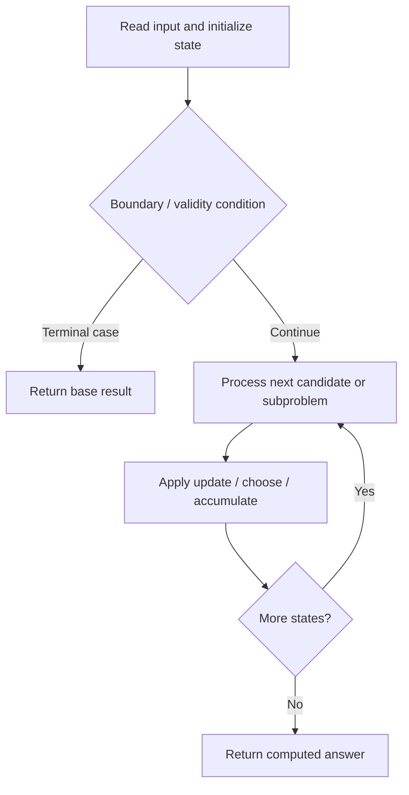

# 3444. Minimum Increments for Target Multiples in an Array

**Difficulty:** Hard  
**Concept family:** [Take-or-Skip and Knapsack](https://github.com/gaurav1kr/Miscellaneous/blob/main/DSA/DP/DP_Mathematics_Master_Guide_Illustrated/Theory/Chapter-02.md)  
**Problem:** https://leetcode.com/problems/minimum-increments-for-target-multiples-in-an-array/  
**Original submission:** https://leetcode.com/submissions/detail/2167659629/

## Understand the mathematics first

This problem belongs to the study family **Take-or-Skip and Knapsack**. Start by defining the objective and minimal sufficient state; inspect the code to identify the actual transitions.

### Related concept template (not necessarily this problem’s recurrence)

$$
F(i,c)=\max(F(i-1,c),v_i+F(i-1,c-w_i))
$$

**What this template illustrates:** Only use the take branch when the remaining capacity is feasible. Counting versions use addition; feasibility versions use logical OR.

**Derivation exercise:** Define exactly what each state variable means for this problem; list valid choices, base cases, and forbidden transitions. Check the submitted code against that invariant. The family template alone is not a substitute for a problem-specific proof.

## Code landmarks

- `dp[0] = 0;`
- `if (dp[mask] == INF) continue;`
- `dp[mask | sub] = min(`

## Source-grounded algorithm walkthrough (expanded coverage)

> **Verification level:** The observations below are extracted from your actual Accepted C++ implementation. The symbolic trace is a **code-reading dry-run worksheet**, not a fabricated numerical run. The generic family formula above is not necessarily this problem's recurrence.

### 1. Identify the actual state and algorithm

**Problem:** 3444. Minimum Increments for Target Multiples in an Array. An explicit state table or memo is present. Interpret each index as a mathematical state and every update as a transition.

| Role | C++ source line | Evidence from your solution |
|---|---:|---|
| Candidate state / accumulator | 20 | `vector<long long> dp(N, INF);` |
| Candidate state / accumulator | 21 | `dp[0] = 0;` |
| Candidate state / accumulator | 32 | `if (dp[mask] == INF) continue;` |
| Boundary / termination | 21 | `dp[0] = 0;` |
| Boundary / termination | 32 | `if (dp[mask] == INF) continue;` |
| Traversal order | 10 | `for (int mask = 1; mask < N; ++mask) {` |
| Traversal order | 23 | `for (int x : nums) {` |
| Traversal order | 26 | `for (int mask = 1; mask < N; ++mask) {` |
| Transition / update | 21 | `dp[0] = 0;` |
| Transition / update | 32 | `if (dp[mask] == INF) continue;` |
| Transition / update | 38 | `dp[mask \| sub] = min(` |
| Return / result | 46 | `return (int)dp[N - 1];` |

### 2. Trace the dependency chain



This is a **control-flow reading diagram**, not a claim about the exact shape of the mathematical state graph. Follow the code line numbers above to draw the actual dependency arrows.

### 3. Symbolic dry-run worksheet

| Stage | State to record | Mathematical question to answer |
|---|---|---|
| Initialize | Inputs, initialized containers/accumulators | What does the initial value mean? |
| First iteration / recursive call | Loop indices, branch, current state | Which predecessor states are available? |
| First update | Before → after for the updated variable | Why is this transition legal? Does it add, minimize, maximize, or overwrite? |
| Next iteration | Updated state and next candidate | Can a value be reused in this traversal order? |
| Finish | Return expression and its value | Why does this correspond to the problem's requested result? |

### 4. Mathematical explanation checklist

1. Define the exact meaning of each state variable, including all indices and constraints.
2. Translate the update expression into a mathematical equation **only after** establishing the state invariant.
3. Prove the transitions are exhaustive and do not double-count or reuse forbidden elements.
4. Check empty input, smallest input, impossible cases, and overflow/modulo behavior.
5. Compute a small numerical example using the actual problem constraints, then compare each row to the original C++.


---

## Your original Accepted C++ submission (unaltered)

```cpp
class Solution {
public:
    int minimumIncrements(vector<int>& nums, vector<int>& target) {
        int m = target.size();
        int N = 1 << m;
        const long long INF = LLONG_MAX / 4;

        vector<long long> lcm(N, 1);

        for (int mask = 1; mask < N; ++mask) {
            int bit = __builtin_ctz(mask);
            int prev = mask & (mask - 1);

            long long a = lcm[prev];
            long long b = target[bit];

            lcm[mask] = a / __gcd(a, b) * b;
        }

        vector<long long> dp(N, INF);
        dp[0] = 0;

        for (int x : nums) {
            vector<long long> cost(N, 0);

            for (int mask = 1; mask < N; ++mask) {
                long long L = lcm[mask];
                cost[mask] = (L - x % L) % L;
            }

            for (int mask = N - 1; mask >= 0; --mask) {
                if (dp[mask] == INF) continue;

                int remaining = (N - 1) ^ mask;

                for (int sub = remaining; sub;
                     sub = (sub - 1) & remaining) {
                    dp[mask | sub] = min(
                        dp[mask | sub],
                        dp[mask] + cost[sub]
                    );
                }
            }
        }

        return (int)dp[N - 1];
    }
};
```

## Time and Space Complexity

- **Time:** `Depends on loop nesting and bounds`
- **Auxiliary space:** `Depends on auxiliary arrays/containers`

**Reasoning:** Count how many iterations each loop executes and whether loops are nested; do not assume all nested loops are quadratic.

**Status:** Code-informed complexity guidance; exact tight bounds have not been individually verified.
