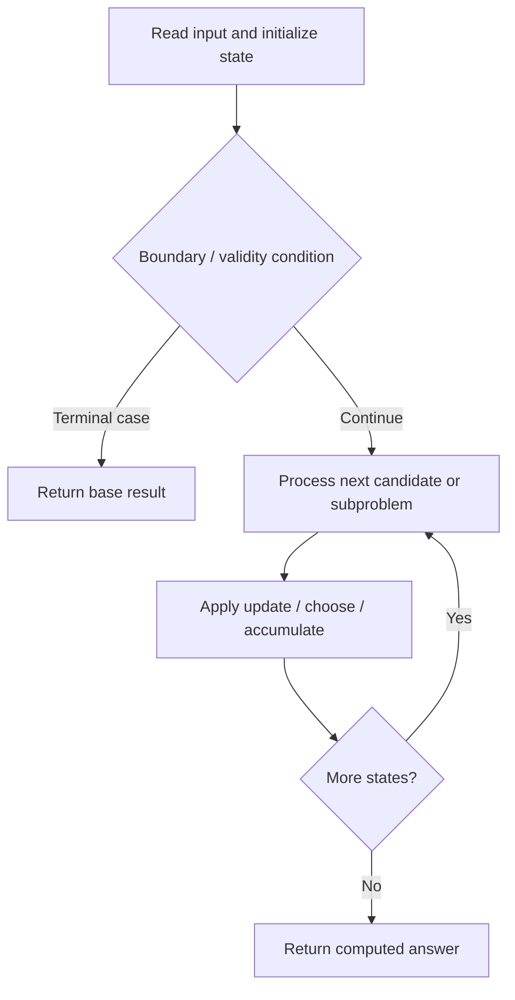

# 3448. Count Substrings Divisible By Last Digit

**Difficulty:** Hard  
**Concept family:** [Digit DP, Counting and Probability](https://github.com/gaurav1kr/Miscellaneous/blob/main/DSA/DP/DP_Mathematics_Master_Guide_Illustrated/Theory/Chapter-11.md)  
**Problem:** https://leetcode.com/problems/count-substrings-divisible-by-last-digit/  
**Original submission:** https://leetcode.com/submissions/detail/2167657242/

## Understand the mathematics first

This problem belongs to the study family **Digit DP, Counting and Probability**. Start by defining the objective and minimal sufficient state; inspect the code to identify the actual transitions.

### Problem-specific recurrence

Refer to the source-grounded algorithm walkthrough below for the state transitions used by your implementation. The generic family recurrence has been removed because it may not apply to this problem.

## Code landmarks

- `int dp[10][10] = {};`
- `next[d][(r * 10 + digit) % d] += dp[d][r];`
- `dp[d][r] = next[d][r];`

## Source-grounded algorithm walkthrough (expanded coverage)

> **Verification level:** The observations below are extracted from your actual Accepted C++ implementation. The symbolic trace is a **code-reading dry-run worksheet**, not a fabricated numerical run. The generic family formula above is not necessarily this problem's recurrence.

### 1. Identify the actual state and algorithm

**Problem:** 3448. Count Substrings Divisible By Last Digit. An explicit state table or memo is present. Interpret each index as a mathematical state and every update as a transition.

| Role | C++ source line | Evidence from your solution |
|---|---:|---|
| Candidate state / accumulator | 4 | `int dp[10][10] = {};` |
| Candidate state / accumulator | 5 | `long long ans = 0;` |
| Candidate state / accumulator | 15 | `next[d][(r * 10 + digit) % d] += dp[d][r];` |
| Boundary / termination | 23 | `if (digit != 0)` |
| Traversal order | 7 | `for (char ch : s) {` |
| Traversal order | 11 | `for (int d = 1; d <= 9; ++d) {` |
| Traversal order | 14 | `for (int r = 0; r < d; ++r) {` |
| Transition / update | 4 | `int dp[10][10] = {};` |
| Transition / update | 5 | `long long ans = 0;` |
| Transition / update | 21 | `dp[d][r] = next[d][r];` |
| Transition / update | 24 | `ans += dp[digit][0];` |
| Return / result | 27 | `return ans;` |

### 2. Trace the dependency chain



This is a **control-flow reading diagram**, not a claim about the exact shape of the mathematical state graph. Follow the code line numbers above to draw the actual dependency arrows.

### 3. Symbolic dry-run worksheet

| Stage | State to record | Mathematical question to answer |
|---|---|---|
| Initialize | Inputs, initialized containers/accumulators | What does the initial value mean? |
| First iteration / recursive call | Loop indices, branch, current state | Which predecessor states are available? |
| First update | Before → after for the updated variable | Why is this transition legal? Does it add, minimize, maximize, or overwrite? |
| Next iteration | Updated state and next candidate | Can a value be reused in this traversal order? |
| Finish | Return expression and its value | Why does this correspond to the problem's requested result? |

### 4. Mathematical explanation checklist

1. Define the exact meaning of each state variable, including all indices and constraints.
2. Translate the update expression into a mathematical equation **only after** establishing the state invariant.
3. Prove the transitions are exhaustive and do not double-count or reuse forbidden elements.
4. Check empty input, smallest input, impossible cases, and overflow/modulo behavior.
5. Compute a small numerical example using the actual problem constraints, then compare each row to the original C++.


---

## Your original Accepted C++ submission (unaltered)

```cpp
class Solution {
public:
    long long countSubstrings(string s) {
        int dp[10][10] = {};
        long long ans = 0;

        for (char ch : s) {
            int digit = ch - '0';
            int next[10][10] = {};

            for (int d = 1; d <= 9; ++d) {
                ++next[d][digit % d];

                for (int r = 0; r < d; ++r) {
                    next[d][(r * 10 + digit) % d] += dp[d][r];
                }
            }

            for (int d = 1; d <= 9; ++d)
                for (int r = 0; r < d; ++r)
                    dp[d][r] = next[d][r];

            if (digit != 0)
                ans += dp[digit][0];
        }

        return ans;
    }
};
```

## Time and Space Complexity

- **Time:** `Depends on loop nesting and bounds`
- **Auxiliary space:** `Depends on auxiliary arrays/containers`

**Reasoning:** Count how many iterations each loop executes and whether loops are nested; do not assume all nested loops are quadratic.

**Status:** Code-informed complexity guidance; exact tight bounds have not been individually verified.
