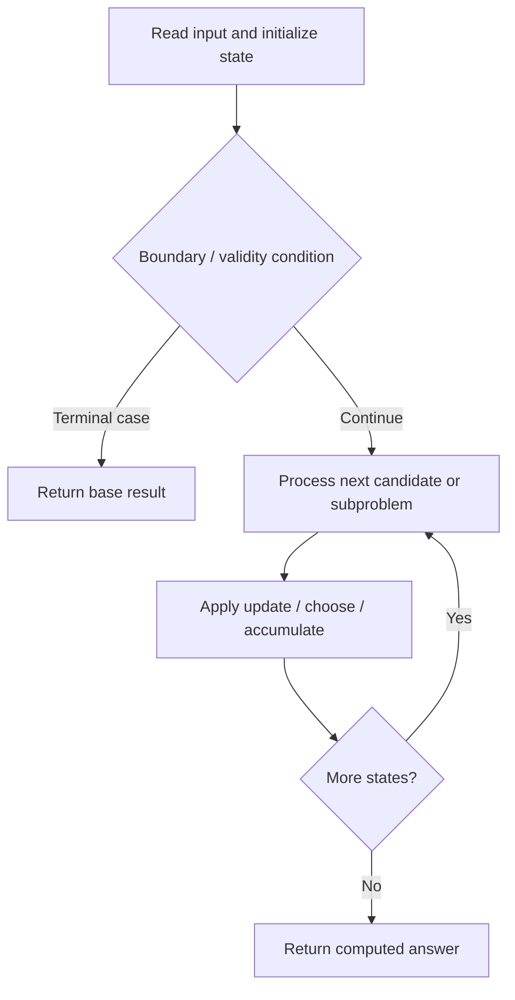

# 3458. Select K Disjoint Special Substrings

**Difficulty:** Medium  
**Concept family:** [Digit DP, Counting and Probability](https://github.com/gaurav1kr/Miscellaneous/blob/main/DSA/DP/DP_Mathematics_Master_Guide_Illustrated/Theory/Chapter-11.md)  
**Problem:** https://leetcode.com/problems/select-k-disjoint-special-substrings/  
**Original submission:** https://leetcode.com/submissions/detail/2167656151/

## Understand the mathematics first

This problem belongs to the study family **Digit DP, Counting and Probability**. Start by defining the objective and minimal sufficient state; inspect the code to identify the actual transitions.

### Related concept template (not necessarily this problem’s recurrence)

$$
bestEnding(i)=\max(a_i,a_i+bestEnding(i-1))
$$

**What this template illustrates:** This is Kadane’s recurrence; other problems in this group may use greedy, stacks, two pointers, prefix sums, or a specialized optimization—not necessarily DP.

**Derivation exercise:** Define exactly what each state variable means for this problem; list valid choices, base cases, and forbidden transitions. Check the submitted code against that invariant. The family template alone is not a substitute for a problem-specific proof.

## Code landmarks

- `first[c] = min(first[c], i);`
- `r = max(r, last[x]);`
- `sort(intervals.begin(), intervals.end());`

## Source-grounded algorithm walkthrough (expanded coverage)

> **Verification level:** The observations below are extracted from your actual Accepted C++ implementation. The symbolic trace is a **code-reading dry-run worksheet**, not a fabricated numerical run. The generic family formula above is not necessarily this problem's recurrence.

### 1. Identify the actual state and algorithm

**Problem:** 3458. Select K Disjoint Special Substrings. This solution does not expose an obvious `dp` or `memo` variable. Derive the algorithmic invariant from the code rather than assuming a DP recurrence.

| Role | C++ source line | Evidence from your solution |
|---|---:|---|
| Candidate state / accumulator | — | No obvious matching statement; inspect the original C++ below. |
| Boundary / termination | 4 | `if (k == 0) return true;` |
| Boundary / termination | 21 | `if (last[c] == -1) continue;` |
| Boundary / termination | 29 | `if (first[x] < l) {` |
| Traversal order | 12 | `for (int i = 0; i < n; ++i) {` |
| Traversal order | 20 | `for (int c = 0; c < 26; ++c) {` |
| Traversal order | 26 | `for (int i = l; i <= r; ++i) {` |
| Transition / update | 14 | `first[c] = min(first[c], i);` |
| Transition / update | 34 | `r = max(r, last[x]);` |
| Transition / update | 38 | `intervals.push_back({r, l});` |
| Return / result | 4 | `if (k == 0) return true;` |
| Return / result | 48 | `if (--k == 0) return true;` |

### 2. Trace the dependency chain



This is a **control-flow reading diagram**, not a claim about the exact shape of the mathematical state graph. Follow the code line numbers above to draw the actual dependency arrows.

### 3. Symbolic dry-run worksheet

| Stage | State to record | Mathematical question to answer |
|---|---|---|
| Initialize | Inputs, initialized containers/accumulators | What does the initial value mean? |
| First iteration / recursive call | Loop indices, branch, current state | Which predecessor states are available? |
| First update | Before → after for the updated variable | Why is this transition legal? Does it add, minimize, maximize, or overwrite? |
| Next iteration | Updated state and next candidate | Can a value be reused in this traversal order? |
| Finish | Return expression and its value | Why does this correspond to the problem's requested result? |

### 4. Mathematical explanation checklist

1. Define the exact meaning of each state variable, including all indices and constraints.
2. Translate the update expression into a mathematical equation **only after** establishing the state invariant.
3. Prove the transitions are exhaustive and do not double-count or reuse forbidden elements.
4. Check empty input, smallest input, impossible cases, and overflow/modulo behavior.
5. Compute a small numerical example using the actual problem constraints, then compare each row to the original C++.


---

## Your original Accepted C++ submission (unaltered)

```cpp
class Solution {
public:
    bool maxSubstringLength(string s, int k) {
        if (k == 0) return true;

        int n = s.size();
        int first[26], last[26];

        fill(first, first + 26, n);
        fill(last, last + 26, -1);

        for (int i = 0; i < n; ++i) {
            int c = s[i] - 'a';
            first[c] = min(first[c], i);
            last[c] = i;
        }

        vector<pair<int, int>> intervals;

        for (int c = 0; c < 26; ++c) {
            if (last[c] == -1) continue;

            int l = first[c], r = last[c];
            bool valid = true;

            for (int i = l; i <= r; ++i) {
                int x = s[i] - 'a';

                if (first[x] < l) {
                    valid = false;
                    break;
                }

                r = max(r, last[x]);
            }

            if (valid && (l != 0 || r != n - 1))
                intervals.push_back({r, l});
        }

        sort(intervals.begin(), intervals.end());

        int end = -1;

        for (auto &p : intervals) {
            if (p.second > end) {
                end = p.first;
                if (--k == 0) return true;
            }
        }

        return false;
    }
};
```

## Time and Space Complexity

- **Time:** `At least O(n log n) for sorting; total depends on later work`
- **Auxiliary space:** `Depends on auxiliary containers`

**Reasoning:** Sorting alone costs O(n log n); inspect any subsequent nested passes for a tighter bound.

**Status:** Code-informed complexity guidance; exact tight bounds have not been individually verified.
