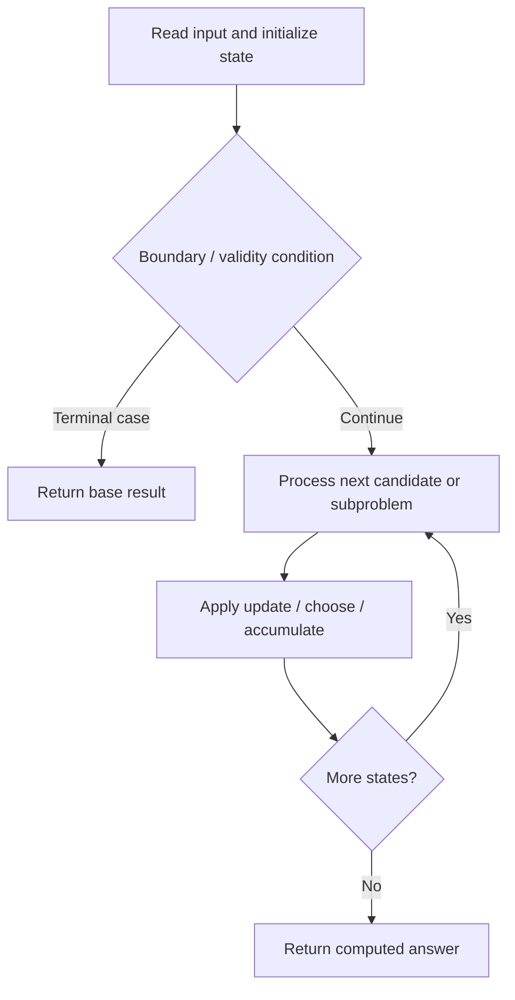

# 3459. Length of Longest V-Shaped Diagonal Segment

**Difficulty:** Hard  
**Concept family:** [Grid Paths and Geometric DP](https://github.com/gaurav1kr/Miscellaneous/blob/main/DSA/DP/DP_Mathematics_Master_Guide_Illustrated/Theory/Chapter-03.md)  
**Problem:** https://leetcode.com/problems/length-of-longest-v-shaped-diagonal-segment/  
**Original submission:** https://leetcode.com/submissions/detail/2167654194/

## Understand the mathematics first

This problem belongs to the study family **Grid Paths and Geometric DP**. Start by defining the objective and minimal sufficient state; inspect the code to identify the actual transitions.

### Problem-specific recurrence

Refer to the source-grounded algorithm walkthrough below for the state transitions used by your implementation. The generic family recurrence has been removed because it may not apply to this problem.

## Code landmarks

- `if (dp[id] != -1)`
- `return dp[id];`
- `ans = max(ans, 1 + dfs(grid, x, y, d, turn));`

## Source-grounded algorithm walkthrough (expanded coverage)

> **Verification level:** The observations below are extracted from your actual Accepted C++ implementation. The symbolic trace is a **code-reading dry-run worksheet**, not a fabricated numerical run. The generic family formula above is not necessarily this problem's recurrence.

### 1. Identify the actual state and algorithm

**Problem:** 3459. Length of Longest V-Shaped Diagonal Segment. Recursive state transitions are present. Check memoization, state identity, termination, and whether branches are mutually exclusive.

| Role | C++ source line | Evidence from your solution |
|---|---:|---|
| Candidate state / accumulator | 5 | `vector<int> dp;` |
| Candidate state / accumulator | 11 | `if (dp[id] != -1)` |
| Candidate state / accumulator | 12 | `return dp[id];` |
| Boundary / termination | 11 | `if (dp[id] != -1)` |
| Boundary / termination | 19 | `if (x >= 0 && x < n && y >= 0 && y < m &&` |
| Boundary / termination | 23 | `if (turn) {` |
| Traversal order | 44 | `for (int i = 0; i < n; ++i) {` |
| Traversal order | 45 | `for (int j = 0; j < m; ++j) {` |
| Traversal order | 48 | `for (int d = 0; d < 4; ++d)` |
| Transition / update | 15 | `int ans = 1;` |
| Transition / update | 21 | `ans = max(ans, 1 + dfs(grid, x, y, d, turn));` |
| Transition / update | 30 | `ans = max(ans, 1 + dfs(grid, x, y, nd, 0));` |
| Transition / update | 33 | `return dp[id] = ans;` |
| Return / result | 12 | `return dp[id];` |
| Return / result | 33 | `return dp[id] = ans;` |

### 2. Trace the dependency chain



This is a **control-flow reading diagram**, not a claim about the exact shape of the mathematical state graph. Follow the code line numbers above to draw the actual dependency arrows.

### 3. Symbolic dry-run worksheet

| Stage | State to record | Mathematical question to answer |
|---|---|---|
| Initialize | Inputs, initialized containers/accumulators | What does the initial value mean? |
| First iteration / recursive call | Loop indices, branch, current state | Which predecessor states are available? |
| First update | Before → after for the updated variable | Why is this transition legal? Does it add, minimize, maximize, or overwrite? |
| Next iteration | Updated state and next candidate | Can a value be reused in this traversal order? |
| Finish | Return expression and its value | Why does this correspond to the problem's requested result? |

### 4. Mathematical explanation checklist

1. Define the exact meaning of each state variable, including all indices and constraints.
2. Translate the update expression into a mathematical equation **only after** establishing the state invariant.
3. Prove the transitions are exhaustive and do not double-count or reuse forbidden elements.
4. Check empty input, smallest input, impossible cases, and overflow/modulo behavior.
5. Compute a small numerical example using the actual problem constraints, then compare each row to the original C++.


---

## Your original Accepted C++ submission (unaltered)

```cpp
class Solution {
    int n, m;
    int dr[4] = {1, 1, -1, -1};
    int dc[4] = {1, -1, -1, 1};
    vector<int> dp;

    int dfs(vector<vector<int>>& grid, int r, int c,
            int d, int turn) {
        int id = ((r * m + c) * 4 + d) * 2 + turn;

        if (dp[id] != -1)
            return dp[id];

        int next = grid[r][c] == 1 ? 2 : 2 - grid[r][c];
        int ans = 1;

        int x = r + dr[d], y = c + dc[d];

        if (x >= 0 && x < n && y >= 0 && y < m &&
            grid[x][y] == next)
            ans = max(ans, 1 + dfs(grid, x, y, d, turn));

        if (turn) {
            int nd = (d + 1) % 4;
            x = r + dr[nd];
            y = c + dc[nd];

            if (x >= 0 && x < n && y >= 0 && y < m &&
                grid[x][y] == next)
                ans = max(ans, 1 + dfs(grid, x, y, nd, 0));
        }

        return dp[id] = ans;
    }

public:
    int lenOfVDiagonal(vector<vector<int>>& grid) {
        n = grid.size();
        m = grid[0].size();

        dp.assign(n * m * 8, -1);
        int ans = 0;

        for (int i = 0; i < n; ++i) {
            for (int j = 0; j < m; ++j) {
                if (grid[i][j] != 1) continue;

                for (int d = 0; d < 4; ++d)
                    ans = max(ans, dfs(grid, i, j, d, 1));
            }
        }

        return ans;
    }
};
```

## Time and Space Complexity

- **Time:** `Depends on table dimensions and transitions per cell`
- **Auxiliary space:** `O(rows × columns) for the allocated table`

**Reasoning:** The two-dimensional table determines memory; time is its state count multiplied by work per state.

**Status:** Code-informed complexity guidance; exact tight bounds have not been individually verified.
