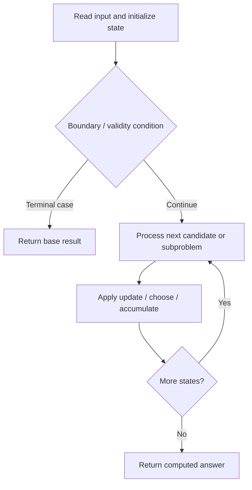

# 3980. Minimum Operations to Transform Binary String

**Difficulty:** Medium  
**Concept family:** [State Machines and Stock DP](https://github.com/gaurav1kr/Miscellaneous/blob/main/DSA/DP/DP_Mathematics_Master_Guide_Illustrated/Theory/Chapter-08.md)  
**Problem:** https://leetcode.com/problems/minimum-operations-to-transform-binary-string/  
**Original submission:** https://leetcode.com/submissions/detail/2163828147/

## Understand the mathematics first

This problem belongs to the study family **State Machines and Stock DP**. Start by defining the objective and minimal sufficient state; inspect the code to identify the actual transitions.

### Problem-specific recurrence

Refer to the source-grounded algorithm walkthrough below for the state transitions used by your implementation. The generic family recurrence has been removed because it may not apply to this problem.

## Code landmarks

- `next0 = min(next0, dp0);`
- `next0 = min(next0, dp0 + 1);`
- `next1 = min(next1, dp0 + cost);`

## Source-grounded algorithm walkthrough (expanded coverage)

> **Verification level:** The observations below are extracted from your actual Accepted C++ implementation. The symbolic trace is a **code-reading dry-run worksheet**, not a fabricated numerical run. The generic family formula above is not necessarily this problem's recurrence.

### 1. Identify the actual state and algorithm

**Problem:** 3980. Minimum Operations to Transform Binary String. This solution does not expose an obvious `dp` or `memo` variable. Derive the algorithmic invariant from the code rather than assuming a DP recurrence.

| Role | C++ source line | Evidence from your solution |
|---|---:|---|
| Candidate state / accumulator | — | No obvious matching statement; inspect the original C++ below. |
| Boundary / termination | 15 | `if (dp0 < INF) {` |
| Boundary / termination | 20 | `if (cur == tar)` |
| Boundary / termination | 22 | `else if (cur == 0 && tar == 1)` |
| Traversal order | 10 | `for (int i = 0; i < n; ++i) {` |
| Transition / update | 21 | `next0 = min(next0, dp0);` |
| Transition / update | 23 | `next0 = min(next0, dp0 + 1);` |
| Transition / update | 33 | `next1 = min(next1, dp0 + cost);` |
| Transition / update | 45 | `next0 = min(next0, dp1);` |
| Return / result | 70 | `return dp0 == INF ? -1 : dp0;` |

### 2. Trace the dependency chain



This is a **control-flow reading diagram**, not a claim about the exact shape of the mathematical state graph. Follow the code line numbers above to draw the actual dependency arrows.

### 3. Symbolic dry-run worksheet

| Stage | State to record | Mathematical question to answer |
|---|---|---|
| Initialize | Inputs, initialized containers/accumulators | What does the initial value mean? |
| First iteration / recursive call | Loop indices, branch, current state | Which predecessor states are available? |
| First update | Before → after for the updated variable | Why is this transition legal? Does it add, minimize, maximize, or overwrite? |
| Next iteration | Updated state and next candidate | Can a value be reused in this traversal order? |
| Finish | Return expression and its value | Why does this correspond to the problem's requested result? |

### 4. Mathematical explanation checklist

1. Define the exact meaning of each state variable, including all indices and constraints.
2. Translate the update expression into a mathematical equation **only after** establishing the state invariant.
3. Prove the transitions are exhaustive and do not double-count or reuse forbidden elements.
4. Check empty input, smallest input, impossible cases, and overflow/modulo behavior.
5. Compute a small numerical example using the actual problem constraints, then compare each row to the original C++.


---

## Your original Accepted C++ submission (unaltered)

```cpp
class Solution {
public:
    int minOperations(string s1, string s2) {
        const int INF = 1e9;
        int n = s1.size();

        int dp0 = 0;
        int dp1 = INF;

        for (int i = 0; i < n; ++i) {
            int next0 = INF;
            int next1 = INF;

            // Current bit is original s1[i]
            if (dp0 < INF) {
                int cur = s1[i] - '0';
                int tar = s2[i] - '0';

                // Don't use pair operation
                if (cur == tar)
                    next0 = min(next0, dp0);
                else if (cur == 0 && tar == 1)
                    next0 = min(next0, dp0 + 1);

                // Use 11 -> 00 on i, i+1
                if (i + 1 < n) {
                    int cost = 1;

                    if (cur == 0) ++cost;
                    if (s1[i + 1] == '0') ++cost;
                    if (tar == 1) ++cost;

                    next1 = min(next1, dp0 + cost);
                }
            }

            // Current bit was already changed to 0
            // by pair operation from previous position
            if (dp1 < INF) {
                int cur = 0;
                int tar = s2[i] - '0';

                // Don't use pair operation
                if (cur == tar)
                    next0 = min(next0, dp1);
                else // 0 -> 1
                    next0 = min(next0, dp1 + 1);

                // Use pair operation on i, i+1
                if (i + 1 < n) {
                    int cost = 1;

                    // cur is 0, so first make it 1
                    ++cost;

                    if (s1[i + 1] == '0')
                        ++cost;

                    if (tar == 1)
                        ++cost;

                    next1 = min(next1, dp1 + cost);
                }
            }

            dp0 = next0;
            dp1 = next1;
        }

        return dp0 == INF ? -1 : dp0;
    }
};
```

## Time and Space Complexity

- **Time:** `Depends on loop nesting and bounds`
- **Auxiliary space:** `Depends on auxiliary arrays/containers`

**Reasoning:** Count how many iterations each loop executes and whether loops are nested; do not assume all nested loops are quadratic.

**Status:** Code-informed complexity guidance; exact tight bounds have not been individually verified.
