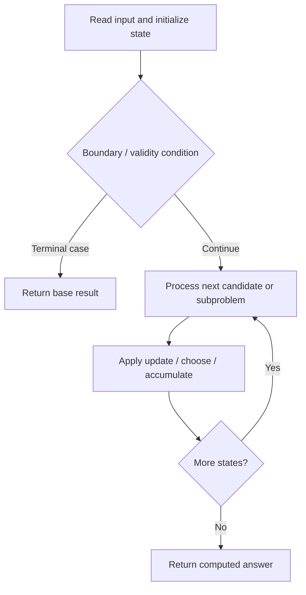

# 3981. Count Distinct Ways to Form Target from Two Strings

**Difficulty:** Hard  
**Concept family:** [String Matching and Sequence Alignment](https://github.com/gaurav1kr/Miscellaneous/blob/main/DSA/DP/DP_Mathematics_Master_Guide_Illustrated/Theory/Chapter-04.md)  
**Problem:** https://leetcode.com/problems/count-distinct-ways-to-form-target-from-two-strings/  
**Original submission:** https://leetcode.com/submissions/detail/2163815845/

## Understand the mathematics first

This problem belongs to the study family **String Matching and Sequence Alignment**. Start by defining the objective and minimal sufficient state; inspect the code to identify the actual transitions.

### Problem-specific recurrence

Refer to the source-grounded algorithm walkthrough below for the state transitions used by your implementation. The generic family recurrence has been removed because it may not apply to this problem.

## Code landmarks

- `dp[0][0] = 1;`
- `(col[i - 1][j] + dp[i - 1][j]) % MOD;`
- `(row[i][j - 1] + dp[i][j - 1]) % MOD;`

## Source-grounded algorithm walkthrough (expanded coverage)

> **Verification level:** The observations below are extracted from your actual Accepted C++ implementation. The symbolic trace is a **code-reading dry-run worksheet**, not a fabricated numerical run. The generic family formula above is not necessarily this problem's recurrence.

### 1. Identify the actual state and algorithm

**Problem:** 3981. Count Distinct Ways to Form Target from Two Strings. An explicit state table or memo is present. Interpret each index as a mathematical state and every update as a transition.

| Role | C++ source line | Evidence from your solution |
|---|---:|---|
| Candidate state / accumulator | 9 | `vector<vector<long long> > dp(n + 1,` |
| Candidate state / accumulator | 12 | `dp[0][0] = 1;` |
| Candidate state / accumulator | 26 | `(col[i - 1][j] + dp[i - 1][j]) % MOD;` |
| Boundary / termination | 12 | `dp[0][0] = 1;` |
| Boundary / termination | 45 | `if (i > 0 && word1[i - 1] == c)` |
| Boundary / termination | 49 | `if (j > 0 && word2[j - 1] == c)` |
| Traversal order | 14 | `for (char c : target) {` |
| Traversal order | 23 | `for (int j = 0; j <= m; ++j) {` |
| Traversal order | 24 | `for (int i = 1; i <= n; ++i) {` |
| Transition / update | 12 | `dp[0][0] = 1;` |
| Transition / update | 59 | `long long ans = 0;` |
| Transition / update | 64 | `ans = (ans + dp[i][j]) % MOD;` |
| Return / result | 68 | `return ans;` |

### 2. Trace the dependency chain



This is a **control-flow reading diagram**, not a claim about the exact shape of the mathematical state graph. Follow the code line numbers above to draw the actual dependency arrows.

### 3. Symbolic dry-run worksheet

| Stage | State to record | Mathematical question to answer |
|---|---|---|
| Initialize | Inputs, initialized containers/accumulators | What does the initial value mean? |
| First iteration / recursive call | Loop indices, branch, current state | Which predecessor states are available? |
| First update | Before → after for the updated variable | Why is this transition legal? Does it add, minimize, maximize, or overwrite? |
| Next iteration | Updated state and next candidate | Can a value be reused in this traversal order? |
| Finish | Return expression and its value | Why does this correspond to the problem's requested result? |

### 4. Mathematical explanation checklist

1. Define the exact meaning of each state variable, including all indices and constraints.
2. Translate the update expression into a mathematical equation **only after** establishing the state invariant.
3. Prove the transitions are exhaustive and do not double-count or reuse forbidden elements.
4. Check empty input, smallest input, impossible cases, and overflow/modulo behavior.
5. Compute a small numerical example using the actual problem constraints, then compare each row to the original C++.


---

## Your original Accepted C++ submission (unaltered)

```cpp
class Solution {
public:
    int interleaveCharacters(string word1, string word2, string target) {
        const int MOD = 1000000007;

        int n = word1.size();
        int m = word2.size();

        vector<vector<long long> > dp(n + 1,
                                      vector<long long>(m + 1, 0));

        dp[0][0] = 1;

        for (char c : target) {

            vector<vector<long long> > col(n + 1,
                                           vector<long long>(m + 1, 0));

            vector<vector<long long> > row(n + 1,
                                           vector<long long>(m + 1, 0));

            // Column prefix
            for (int j = 0; j <= m; ++j) {
                for (int i = 1; i <= n; ++i) {
                    col[i][j] =
                        (col[i - 1][j] + dp[i - 1][j]) % MOD;
                }
            }

            // Row prefix
            for (int i = 0; i <= n; ++i) {
                for (int j = 1; j <= m; ++j) {
                    row[i][j] =
                        (row[i][j - 1] + dp[i][j - 1]) % MOD;
                }
            }

            vector<vector<long long> > ndp(n + 1,
                                           vector<long long>(m + 1, 0));

            for (int i = 0; i <= n; ++i) {
                for (int j = 0; j <= m; ++j) {

                    // Take current character from word1
                    if (i > 0 && word1[i - 1] == c)
                        ndp[i][j] += col[i][j];

                    // Take current character from word2
                    if (j > 0 && word2[j - 1] == c)
                        ndp[i][j] += row[i][j];

                    ndp[i][j] %= MOD;
                }
            }

            dp.swap(ndp);
        }

        long long ans = 0;

        // Must use at least one character from both strings
        for (int i = 1; i <= n; ++i) {
            for (int j = 1; j <= m; ++j) {
                ans = (ans + dp[i][j]) % MOD;
            }
        }

        return ans;
    }
};
```

## Time and Space Complexity

- **Time:** `Depends on table dimensions and transitions per cell`
- **Auxiliary space:** `O(rows × columns) for the allocated table`

**Reasoning:** The two-dimensional table determines memory; time is its state count multiplied by work per state.

**Status:** Code-informed complexity guidance; exact tight bounds have not been individually verified.
