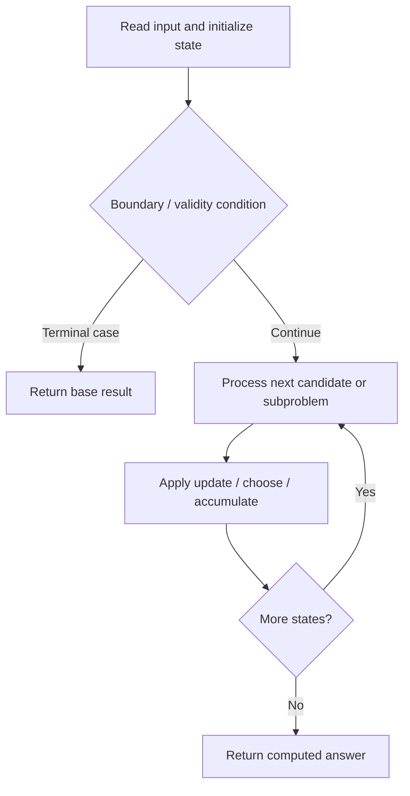

# 3984. Divisible Game

**Difficulty:** Medium  
**Concept family:** [State Machines and Stock DP](https://github.com/gaurav1kr/Miscellaneous/blob/main/DSA/DP/DP_Mathematics_Master_Guide_Illustrated/Theory/Chapter-08.md)  
**Problem:** https://leetcode.com/problems/divisible-game/  
**Original submission:** https://leetcode.com/submissions/detail/2163804968/

## Understand the mathematics first

This problem belongs to the study family **State Machines and Stock DP**. Start by defining the objective and minimal sufficient state; inspect the code to identify the actual transitions.

### Problem-specific recurrence

Refer to the source-grounded algorithm walkthrough below for the state transitions used by your implementation. The generic family recurrence has been removed because it may not apply to this problem.

## Code landmarks

- `while (n % p == 0)`
- `best = max(best, curr);`

## Source-grounded algorithm walkthrough (expanded coverage)

> **Verification level:** The observations below are extracted from your actual Accepted C++ implementation. The symbolic trace is a **code-reading dry-run worksheet**, not a fabricated numerical run. The generic family formula above is not necessarily this problem's recurrence.

### 1. Identify the actual state and algorithm

**Problem:** 3984. Divisible Game. This solution does not expose an obvious `dp` or `memo` variable. Derive the algorithmic invariant from the code rather than assuming a DP recurrence.

| Role | C++ source line | Evidence from your solution |
|---|---:|---|
| Candidate state / accumulator | 33 | `long long best = LLONG_MIN;` |
| Boundary / termination | 12 | `if (n % p == 0) {` |
| Boundary / termination | 20 | `if (n > 1)` |
| Boundary / termination | 25 | `if (primes.empty())` |
| Traversal order | 8 | `for (int x : nums) {` |
| Traversal order | 11 | `for (int p = 2; 1LL * p * p <= n; ++p) {` |
| Traversal order | 15 | `while (n % p == 0)` |
| Transition / update | 13 | `primes.insert(p);` |
| Transition / update | 21 | `primes.insert(n);` |
| Transition / update | 26 | `primes.insert(2);` |
| Transition / update | 33 | `long long best = LLONG_MIN;` |
| Return / result | 54 | `return ((bestScore % MOD + MOD) % MOD * bestK) % MOD;` |

### 2. Trace the dependency chain



This is a **control-flow reading diagram**, not a claim about the exact shape of the mathematical state graph. Follow the code line numbers above to draw the actual dependency arrows.

### 3. Symbolic dry-run worksheet

| Stage | State to record | Mathematical question to answer |
|---|---|---|
| Initialize | Inputs, initialized containers/accumulators | What does the initial value mean? |
| First iteration / recursive call | Loop indices, branch, current state | Which predecessor states are available? |
| First update | Before → after for the updated variable | Why is this transition legal? Does it add, minimize, maximize, or overwrite? |
| Next iteration | Updated state and next candidate | Can a value be reused in this traversal order? |
| Finish | Return expression and its value | Why does this correspond to the problem's requested result? |

### 4. Mathematical explanation checklist

1. Define the exact meaning of each state variable, including all indices and constraints.
2. Translate the update expression into a mathematical equation **only after** establishing the state invariant.
3. Prove the transitions are exhaustive and do not double-count or reuse forbidden elements.
4. Check empty input, smallest input, impossible cases, and overflow/modulo behavior.
5. Compute a small numerical example using the actual problem constraints, then compare each row to the original C++.


---

## Your original Accepted C++ submission (unaltered)

```cpp
class Solution {
public:
    int divisibleGame(vector<int>& nums) {
        const long long MOD = 1000000007;
        set<int> primes;

        // Collect unique prime factors
        for (int x : nums) {
            int n = x;

            for (int p = 2; 1LL * p * p <= n; ++p) {
                if (n % p == 0) {
                    primes.insert(p);

                    while (n % p == 0)
                        n /= p;
                }
            }

            if (n > 1)
                primes.insert(n);
        }

        // Important for nums containing only 1
        if (primes.empty())
            primes.insert(2);

        long long bestScore = LLONG_MIN;
        int bestK = 2;

        for (int k : primes) {
            long long curr = 0;
            long long best = LLONG_MIN;

            // Kadane
            for (int x : nums) {
                long long val = (x % k == 0) ? x : -x;

                curr += val;
                best = max(best, curr);

                if (curr < 0)
                    curr = 0;
            }

            // set is ascending, so first k for best score
            // automatically gives smallest k
            if (best > bestScore) {
                bestScore = best;
                bestK = k;
            }
        }

        return ((bestScore % MOD + MOD) % MOD * bestK) % MOD;
    }
};
```

## Time and Space Complexity

- **Time:** `Depends on operations (typically O(log n) per ordered-container operation)`
- **Auxiliary space:** `Depends on number of stored entries`

**Reasoning:** An ordered container or heap introduces logarithmic insertion, lookup, or removal costs; multiply by operation count.

**Status:** Code-informed complexity guidance; exact tight bounds have not been individually verified.
