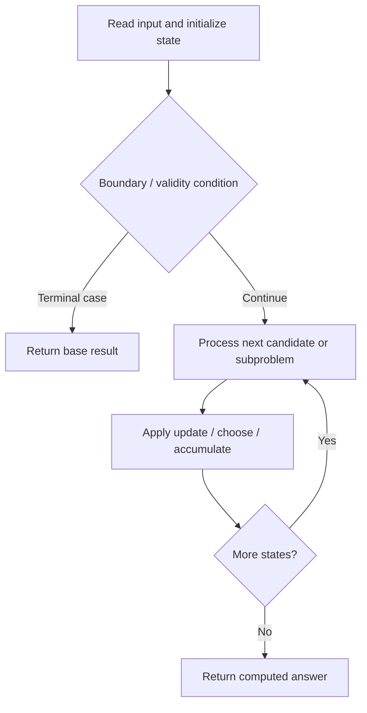

# 4016. Maximum Area of Two Non-Overlapping Square Submatrices

**Difficulty:** Medium  
**Concept family:** [Grid Paths and Geometric DP](https://github.com/gaurav1kr/Miscellaneous/blob/main/DSA/DP/DP_Mathematics_Master_Guide_Illustrated/Theory/Chapter-03.md)  
**Problem:** https://leetcode.com/problems/maximum-area-of-two-non-overlapping-square-submatrices/  
**Original submission:** https://leetcode.com/submissions/detail/2163650018/

## Understand the mathematics first

This problem belongs to the study family **Grid Paths and Geometric DP**. Start by defining the objective and minimal sufficient state; inspect the code to identify the actual transitions.

### Problem-specific recurrence

Refer to the source-grounded algorithm walkthrough below for the state transitions used by your implementation. The generic family recurrence has been removed because it may not apply to this problem.

## Code landmarks

- `minRow = min(minRow, r);`
- `maxRow = max(maxRow, r);`
- `minCol = min(minCol, c);`

## Source-grounded algorithm walkthrough (expanded coverage)

> **Verification level:** The observations below are extracted from your actual Accepted C++ implementation. The symbolic trace is a **code-reading dry-run worksheet**, not a fabricated numerical run. The generic family formula above is not necessarily this problem's recurrence.

### 1. Identify the actual state and algorithm

**Problem:** 4016. Maximum Area of Two Non-Overlapping Square Submatrices. This solution does not expose an obvious `dp` or `memo` variable. Derive the algorithmic invariant from the code rather than assuming a DP recurrence.

| Role | C++ source line | Evidence from your solution |
|---|---:|---|
| Candidate state / accumulator | 4 | `vector<vector<int> > prefix;` |
| Candidate state / accumulator | 22 | `int count = 0;` |
| Candidate state / accumulator | 85 | `int best = 0;` |
| Boundary / termination | 28 | `if (getSum(r, c,` |
| Boundary / termination | 43 | `if (count < 2)` |
| Boundary / termination | 44 | `return false;` |
| Traversal order | 24 | `for (int r = 0; r + k <= m; ++r) {` |
| Traversal order | 25 | `for (int c = 0; c + k <= n; ++c) {` |
| Traversal order | 68 | `for (int r = 0; r < m; ++r) {` |
| Transition / update | 22 | `int count = 0;` |
| Transition / update | 34 | `minRow = min(minRow, r);` |
| Transition / update | 35 | `maxRow = max(maxRow, r);` |
| Transition / update | 37 | `minCol = min(minCol, c);` |
| Return / result | 9 | `return prefix[r2 + 1][c2 + 1]` |
| Return / result | 44 | `return false;` |

### 2. Trace the dependency chain



This is a **control-flow reading diagram**, not a claim about the exact shape of the mathematical state graph. Follow the code line numbers above to draw the actual dependency arrows.

### 3. Symbolic dry-run worksheet

| Stage | State to record | Mathematical question to answer |
|---|---|---|
| Initialize | Inputs, initialized containers/accumulators | What does the initial value mean? |
| First iteration / recursive call | Loop indices, branch, current state | Which predecessor states are available? |
| First update | Before → after for the updated variable | Why is this transition legal? Does it add, minimize, maximize, or overwrite? |
| Next iteration | Updated state and next candidate | Can a value be reused in this traversal order? |
| Finish | Return expression and its value | Why does this correspond to the problem's requested result? |

### 4. Mathematical explanation checklist

1. Define the exact meaning of each state variable, including all indices and constraints.
2. Translate the update expression into a mathematical equation **only after** establishing the state invariant.
3. Prove the transitions are exhaustive and do not double-count or reuse forbidden elements.
4. Check empty input, smallest input, impossible cases, and overflow/modulo behavior.
5. Compute a small numerical example using the actual problem constraints, then compare each row to the original C++.


---

## Your original Accepted C++ submission (unaltered)

```cpp
class Solution {
private:
    int m, n;
    vector<vector<int> > prefix;

    // Sum of rectangle:
    // [r1, c1] -> [r2, c2], inclusive
    int getSum(int r1, int c1, int r2, int c2) {
        return prefix[r2 + 1][c2 + 1]
             - prefix[r1][c2 + 1]
             - prefix[r2 + 1][c1]
             + prefix[r1][c1];
    }

    bool possible(int k) {
        int minRow = m;
        int maxRow = -1;

        int minCol = n;
        int maxCol = -1;

        int count = 0;

        for (int r = 0; r + k <= m; ++r) {
            for (int c = 0; c + k <= n; ++c) {

                // Check if entire k x k square is 1.
                if (getSum(r, c,
                           r + k - 1,
                           c + k - 1) == k * k) {

                    ++count;

                    minRow = min(minRow, r);
                    maxRow = max(maxRow, r);

                    minCol = min(minCol, c);
                    maxCol = max(maxCol, c);
                }
            }
        }

        if (count < 2)
            return false;

        // Two squares separated vertically
        if (maxRow - minRow >= k)
            return true;

        // Two squares separated horizontally
        if (maxCol - minCol >= k)
            return true;

        return false;
    }

public:
    int maxArea(vector<vector<int> >& mat) {
        m = mat.size();
        n = mat[0].size();

        // --------------------------------
        // Build 2D prefix sum
        // --------------------------------
        prefix.assign(m + 1,
                      vector<int>(n + 1, 0));

        for (int r = 0; r < m; ++r) {
            for (int c = 0; c < n; ++c) {

                prefix[r + 1][c + 1] =
                    mat[r][c]
                    + prefix[r][c + 1]
                    + prefix[r + 1][c]
                    - prefix[r][c];
            }
        }

        // --------------------------------
        // Binary search side length
        // --------------------------------
        int low = 1;
        int high = min(m, n);

        int best = 0;

        while (low <= high) {

            int mid = low + (high - low) / 2;

            if (possible(mid)) {
                best = mid;
                low = mid + 1;
            }
            else {
                high = mid - 1;
            }
        }

        return best * best;
    }
};
```

## Time and Space Complexity

- **Time:** `Depends on table dimensions and transitions per cell`
- **Auxiliary space:** `O(rows × columns) for the allocated table`

**Reasoning:** The two-dimensional table determines memory; time is its state count multiplied by work per state.

**Status:** Code-informed complexity guidance; exact tight bounds have not been individually verified.
