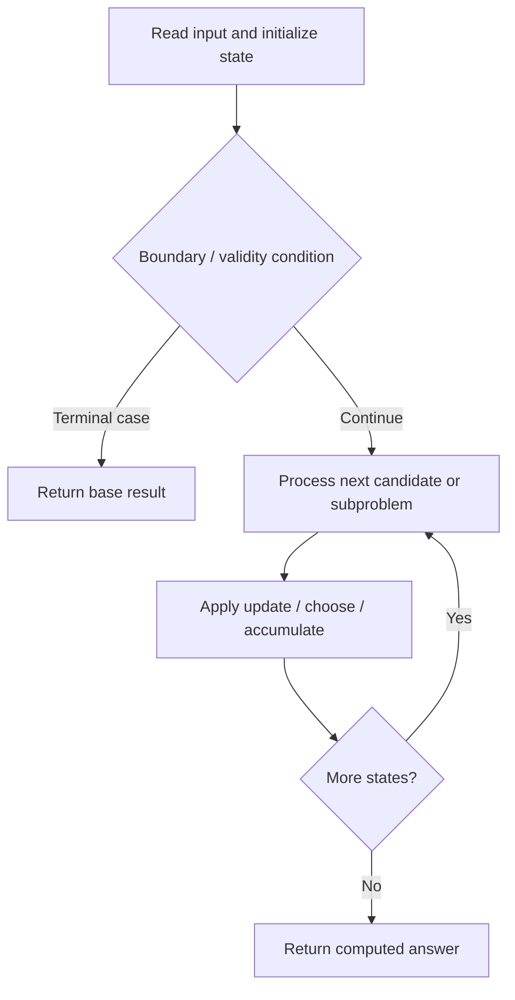
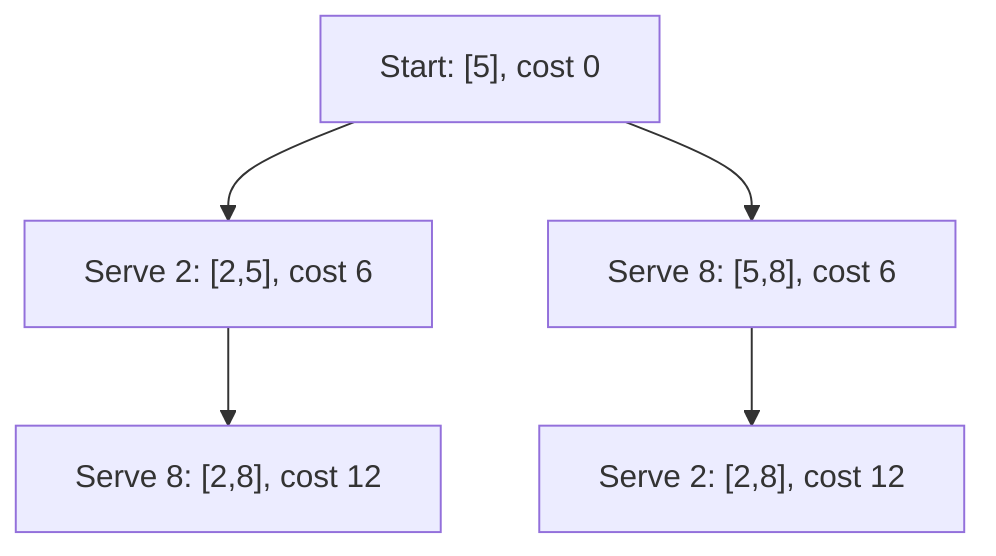

# 4023. Elevator Requests II

**Difficulty:** Hard  
**Concept family:** [Scheduling and Weighted Intervals](https://github.com/gaurav1kr/Miscellaneous/blob/main/DSA/DP/DP_Mathematics_Master_Guide_Illustrated/Theory/Chapter-07.md)  
**Problem:** https://leetcode.com/problems/elevator-requests-ii/  
**Original submission:** https://leetcode.com/submissions/detail/2163649209/

## Understand the mathematics first

This problem belongs to the study family **Scheduling and Weighted Intervals**. Start by defining the objective and minimal sufficient state; inspect the code to identify the actual transitions.

### Related concept template (not necessarily this problem’s recurrence)

$$
F(i,k)=\max(F(i+1,k),w_i+F(next(i),k-1))
$$

**What this template illustrates:** For inclusive intervals, compatibility requires next.start > current.end. Binary search can find next(i).

**Derivation exercise:** Define exactly what each state variable means for this problem; list valid choices, base cases, and forbidden transitions. Check the submitted code against that invariant. The family template alone is not a substitute for a problem-specific proof.

## Code landmarks

- `sort(a.begin(), a.end());`
- `int s = lower_bound(a.begin(), a.end(),`
- `// dp[l][r][0] -> currently at a[l]`

## Source-grounded algorithm walkthrough (expanded coverage)

> **Verification level:** The observations below are extracted from your actual Accepted C++ implementation. The symbolic trace is a **code-reading dry-run worksheet**, not a fabricated numerical run. The generic family formula above is not necessarily this problem's recurrence.

### 1. Identify the actual state and algorithm

**Problem:** 4023. Elevator Requests II. Ordered search / boundary calculation is present. Identify the monotonic or ordering invariant before deriving a recurrence.

| Role | C++ source line | Evidence from your solution |
|---|---:|---|
| Candidate state / accumulator | 32 | `vector<vector<array<long long, 2> > > dp(` |
| Candidate state / accumulator | 39 | `dp[s][s][0] = 0;` |
| Candidate state / accumulator | 40 | `dp[s][s][1] = 0;` |
| Boundary / termination | 9 | `if (x != start)` |
| Boundary / termination | 16 | `if (m == 0)` |
| Boundary / termination | 17 | `return 0;` |
| Traversal order | 8 | `for (int x : requests) {` |
| Traversal order | 43 | `for (int len = 1; len <= sz; ++len) {` |
| Traversal order | 51 | `for (int l = 0; l + len - 1 < sz; ++l) {` |
| Transition / update | 10 | `a.push_back(x);` |
| Transition / update | 20 | `a.push_back(start);` |
| Transition / update | 25 | `int s = lower_bound(a.begin(), a.end(),` |
| Transition / update | 39 | `dp[s][s][0] = 0;` |
| Return / result | 17 | `return 0;` |
| Return / result | 121 | `return min(dp[0][sz - 1][0],` |

### 2. Trace the dependency chain



This is a **control-flow reading diagram**, not a claim about the exact shape of the mathematical state graph. Follow the code line numbers above to draw the actual dependency arrows.

### 3. Symbolic dry-run worksheet

| Stage | State to record | Mathematical question to answer |
|---|---|---|
| Initialize | Inputs, initialized containers/accumulators | What does the initial value mean? |
| First iteration / recursive call | Loop indices, branch, current state | Which predecessor states are available? |
| First update | Before → after for the updated variable | Why is this transition legal? Does it add, minimize, maximize, or overwrite? |
| Next iteration | Updated state and next candidate | Can a value be reused in this traversal order? |
| Finish | Return expression and its value | Why does this correspond to the problem's requested result? |

### 4. Mathematical explanation checklist

1. Define the exact meaning of each state variable, including all indices and constraints.
2. Translate the update expression into a mathematical equation **only after** establishing the state invariant.
3. Prove the transitions are exhaustive and do not double-count or reuse forbidden elements.
4. Check empty input, smallest input, impossible cases, and overflow/modulo behavior.
5. Compute a small numerical example using the actual problem constraints, then compare each row to the original C++.


### Verified example — Elevator Requests II

The submitted code sorts the requested floors together with the starting floor, and uses an **interval DP**, not weighted interval scheduling.

**Input:** `n = 10, start = 5, requests = [2,8]` (the code does not otherwise use `n`). Sorted floors are `[2,5,8]`, and `s=1` is the starting-floor index.

`dp[l][r][side]` is the minimum weighted accumulated waiting/travel cost after serving all requested floors in sorted interval `[l,r]`, ending at its left (`side=0`) or right (`side=1`) boundary. Each unit of travel while `remaining` requests wait adds `remaining` to the objective.

| Expansion | Remaining before travel | Distance | Additional cost | Total cost |
|---|---:|---:|---:|---:|
| Start at 5 | 2 | 0 | 0 | 0 |
| 5 → 2 | 2 | 3 | 6 | 6 |
| 2 → 8 | 1 | 6 | 6 | **12** |
| 5 → 8 | 2 | 3 | 6 | 6 |
| 8 → 2 | 1 | 6 | 6 | **12** |

**Answer: 12** for this input. The correct transitions extend `[l,r]` left or right, multiply travel distance by the number of requests still waiting, and choose the minimum. This is a counterexample to applying the page's generic scheduling template to the actual problem.




---

## Your original Accepted C++ submission (unaltered)

```cpp
class Solution {
public:
    long long elevatorRequests(int n, int start,
                               vector<int>& requests) {
        // Remove start because its request is fulfilled at time 0.
        vector<long long> a;

        for (int x : requests) {
            if (x != start)
                a.push_back(x);
        }

        int m = (int)a.size();

        // All requests already fulfilled.
        if (m == 0)
            return 0;

        // Insert starting floor.
        a.push_back(start);
        sort(a.begin(), a.end());

        int sz = m + 1;

        int s = lower_bound(a.begin(), a.end(),
                            (long long)start) - a.begin();

        const long long INF = LLONG_MAX / 4;

        // dp[l][r][0] -> currently at a[l]
        // dp[l][r][1] -> currently at a[r]
        vector<vector<array<long long, 2> > > dp(
            sz,
            vector<array<long long, 2> >(
                sz, array<long long, 2>{INF, INF}
            )
        );

        dp[s][s][0] = 0;
        dp[s][s][1] = 0;

        // Current interval length.
        for (int len = 1; len <= sz; ++len) {

            // Number of actual requests already served.
            int served = len - 1;

            // Requests that are still waiting.
            int remaining = m - served;

            for (int l = 0; l + len - 1 < sz; ++l) {

                int r = l + len - 1;

                // Interval must contain start.
                if (l > s || r < s)
                    continue;

                // -----------------------------------
                // Expand LEFT: include a[l-1]
                // -----------------------------------
                if (l > 0) {

                    // Currently at left endpoint.
                    if (dp[l][r][0] != INF) {

                        long long dist =
                            a[l] - a[l - 1];

                        dp[l - 1][r][0] =
                            min(dp[l - 1][r][0],
                                dp[l][r][0]
                                + dist * remaining);
                    }

                    // Currently at right endpoint.
                    if (dp[l][r][1] != INF) {

                        long long dist =
                            a[r] - a[l - 1];

                        dp[l - 1][r][0] =
                            min(dp[l - 1][r][0],
                                dp[l][r][1]
                                + dist * remaining);
                    }
                }

                // -----------------------------------
                // Expand RIGHT: include a[r+1]
                // -----------------------------------
                if (r + 1 < sz) {

                    // Currently at left endpoint.
                    if (dp[l][r][0] != INF) {

                        long long dist =
                            a[r + 1] - a[l];

                        dp[l][r + 1][1] =
                            min(dp[l][r + 1][1],
                                dp[l][r][0]
                                + dist * remaining);
                    }

                    // Currently at right endpoint.
                    if (dp[l][r][1] != INF) {

                        long long dist =
                            a[r + 1] - a[r];

                        dp[l][r + 1][1] =
                            min(dp[l][r + 1][1],
                                dp[l][r][1]
                                + dist * remaining);
                    }
                }
            }
        }

        return min(dp[0][sz - 1][0],
                   dp[0][sz - 1][1]);
    }
};
```

## Interview self-check

1. What is the smallest state that determines the remaining answer?
2. Why are the transitions exhaustive and valid?
3. What is the exact base case, including empty and impossible cases?
4. What is the time complexity (states × work per state)?
5. Can the memory be compressed without overwriting needed dependencies?
