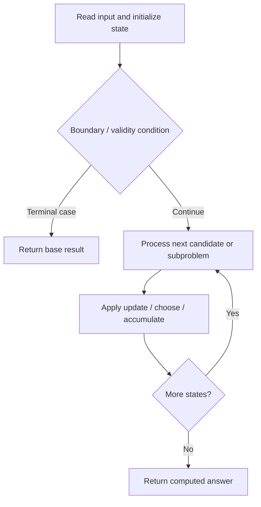
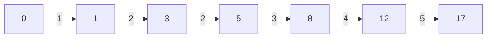

# 403. Frog Jump

**Difficulty:** Hard  
**Concept family:** [Grid Paths and Geometric DP](https://github.com/gaurav1kr/Miscellaneous/blob/main/DSA/DP/DP_Mathematics_Master_Guide_Illustrated/Theory/Chapter-03.md)  
**Problem:** https://leetcode.com/problems/frog-jump/  
**Original submission:** https://leetcode.com/submissions/detail/1408976320/

## Understand the mathematics first

This problem belongs to the study family **Grid Paths and Geometric DP**. Start by defining the objective and minimal sufficient state; inspect the code to identify the actual transitions.

### Related concept template (not necessarily this problem’s recurrence)

$$
F(i,j)=F(i-1,j)+F(i,j-1)
$$

**What this template illustrates:** For minimum cost paths, replace + of paths with min of predecessor costs, then add the current cell cost. Obstacles contribute zero ways.

**Derivation exercise:** Define exactly what each state variable means for this problem; list valid choices, base cases, and forbidden transitions. Check the submitted code against that invariant. The family template alone is not a substitute for a problem-specific proof.

## Code landmarks

Read the loops, recursion, and boundary conditions in the original code.

## Source-grounded algorithm walkthrough (expanded coverage)

> **Verification level:** The observations below are extracted from your actual Accepted C++ implementation. The symbolic trace is a **code-reading dry-run worksheet**, not a fabricated numerical run. The generic family formula above is not necessarily this problem's recurrence.

### 1. Identify the actual state and algorithm

**Problem:** 403. Frog Jump. This solution does not expose an obvious `dp` or `memo` variable. Derive the algorithmic invariant from the code rather than assuming a DP recurrence.

| Role | C++ source line | Evidence from your solution |
|---|---:|---|
| Candidate state / accumulator | — | No obvious matching statement; inspect the original C++ below. |
| Boundary / termination | — | No obvious matching statement; inspect the original C++ below. |
| Traversal order | 8 | `for(int i = 1; i < stones.size(); ++i){` |
| Traversal order | 11 | `for(auto it : mp[stone]){` |
| Transition / update | 12 | `mp[stone + it].insert(it);` |
| Transition / update | 13 | `mp[stone + it + 1].insert(it + 1);` |
| Transition / update | 14 | `mp[stone + it - 1].insert(it - 1);` |
| Return / result | 18 | `return mp[stones.back()].size() != 0;` |

### 2. Trace the dependency chain



This is a **control-flow reading diagram**, not a claim about the exact shape of the mathematical state graph. Follow the code line numbers above to draw the actual dependency arrows.

### 3. Symbolic dry-run worksheet

| Stage | State to record | Mathematical question to answer |
|---|---|---|
| Initialize | Inputs, initialized containers/accumulators | What does the initial value mean? |
| First iteration / recursive call | Loop indices, branch, current state | Which predecessor states are available? |
| First update | Before → after for the updated variable | Why is this transition legal? Does it add, minimize, maximize, or overwrite? |
| Next iteration | Updated state and next candidate | Can a value be reused in this traversal order? |
| Finish | Return expression and its value | Why does this correspond to the problem's requested result? |

### 4. Mathematical explanation checklist

1. Define the exact meaning of each state variable, including all indices and constraints.
2. Translate the update expression into a mathematical equation **only after** establishing the state invariant.
3. Prove the transitions are exhaustive and do not double-count or reuse forbidden elements.
4. Check empty input, smallest input, impossible cases, and overflow/modulo behavior.
5. Compute a small numerical example using the actual problem constraints, then compare each row to the original C++.


### Verified example — Frog Jump

**Input:** `stones = [0,1,3,5,6,8,12,17]`. The map `mp[position]` contains jump lengths that can land at that position; the implementation seeds `mp[1]={1}`.

| Stone reached | Reachable incoming jump lengths | Outgoing candidate jumps (lengths) |
|---|---|---|
| 1 | {1} | 1, 2 (zero discarded by nonzero-distance stones) |
| 3 | {2} | 1, 2, 3 |
| 5 | {2} | 1, 2, 3 |
| 6 | {1,3} | from 1: 1,2; from 3: 2,3,4 |
| 8 | {2,3} | 1,2,3,4 |
| 12 | {4} | 3,4,5 |
| 17 | {5} | destination reached |

One valid sequence is `0 → 1 → 3 → 5 → 8 → 12 → 17` with jump lengths `1,2,2,3,4,5`. **Answer: true.**



**Mathematical invariant:** for every `p` in the map, `mp[p]` stores jump lengths corresponding to candidate landings at position `p` from reachable stones. For each actual stone and incoming jump `k`, next jumps are `k−1`, `k`, or `k+1` (positive only for actual moves). This is a reachability DP over `(position, previous jump length)`, **not** the generic grid-path recurrence shown earlier in the page.


---

## Your original Accepted C++ submission (unaltered)

```cpp
class Solution {
public:
    bool canCross(vector<int>& stones) {
        unordered_map<int, unordered_set<int>> mp;

        mp[stones[0] + 1] = {1};

        for(int i = 1; i < stones.size(); ++i){
            int stone = stones[i];

            for(auto it : mp[stone]){
                mp[stone + it].insert(it);
                mp[stone + it + 1].insert(it + 1);
                mp[stone + it - 1].insert(it - 1);
            }
        }

        return mp[stones.back()].size() != 0;
    }
};
```

## Time and Space Complexity

- **Time:** `O(n²) expected`
- **Auxiliary space:** `O(n²)`

**Reasoning:** Up to O(n) distinct jump lengths can be propagated for each stone; hash operations are expected constant time.

**Basis:** Analyzed algorithm structure in the preserved C++ submission.
