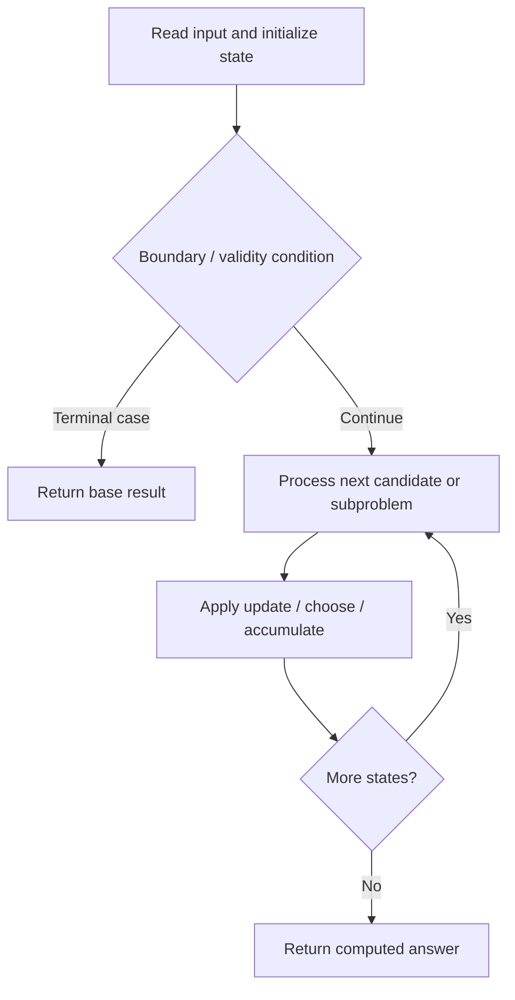

# 4058. Maximum Pulse Value After One Subarray Rotation

**Difficulty:** Medium  
**Concept family:** [Digit DP, Counting and Probability](https://github.com/gaurav1kr/Miscellaneous/blob/main/DSA/DP/DP_Mathematics_Master_Guide_Illustrated/Theory/Chapter-11.md)  
**Problem:** https://leetcode.com/problems/maximum-pulse-value-after-one-subarray-rotation/  
**Original submission:** https://leetcode.com/submissions/detail/2163642024/

## Understand the mathematics first

This problem belongs to the study family **Digit DP, Counting and Probability**. Start by defining the objective and minimal sufficient state; inspect the code to identify the actual transitions.

### Problem-specific recurrence

Refer to the source-grounded algorithm walkthrough below for the state transitions used by your implementation. The generic family recurrence has been removed because it may not apply to this problem.

## Code landmarks

- `max(maxSame[l % 2], P[l + 1]);`
- `max(maxDiff[l % 2], P[l]);`
- `maxGain = max(maxGain, gain);`

## Source-grounded algorithm walkthrough (expanded coverage)

> **Verification level:** The observations below are extracted from your actual Accepted C++ implementation. The symbolic trace is a **code-reading dry-run worksheet**, not a fabricated numerical run. The generic family formula above is not necessarily this problem's recurrence.

### 1. Identify the actual state and algorithm

**Problem:** 4058. Maximum Pulse Value After One Subarray Rotation. This solution does not expose an obvious `dp` or `memo` variable. Derive the algorithmic invariant from the code rather than assuming a DP recurrence.

| Role | C++ source line | Evidence from your solution |
|---|---:|---|
| Candidate state / accumulator | — | No obvious matching statement; inspect the original C++ below. |
| Boundary / termination | 10 | `if (i % 2 == 0)` |
| Boundary / termination | 46 | `if (maxSame[r % 2] != NEG) {` |
| Boundary / termination | 59 | `if (maxDiff[opposite] != NEG) {` |
| Traversal order | 9 | `for (int i = 0; i < n; ++i) {` |
| Traversal order | 30 | `for (int r = 1; r < n; ++r) {` |
| Transition / update | 37 | `max(maxSame[l % 2], P[l + 1]);` |
| Transition / update | 40 | `max(maxDiff[l % 2], P[l]);` |
| Transition / update | 50 | `maxGain = max(maxGain, gain);` |
| Transition / update | 63 | `maxGain = max(maxGain, gain);` |
| Return / result | 67 | `return original + maxGain;` |

### 2. Trace the dependency chain



This is a **control-flow reading diagram**, not a claim about the exact shape of the mathematical state graph. Follow the code line numbers above to draw the actual dependency arrows.

### 3. Symbolic dry-run worksheet

| Stage | State to record | Mathematical question to answer |
|---|---|---|
| Initialize | Inputs, initialized containers/accumulators | What does the initial value mean? |
| First iteration / recursive call | Loop indices, branch, current state | Which predecessor states are available? |
| First update | Before → after for the updated variable | Why is this transition legal? Does it add, minimize, maximize, or overwrite? |
| Next iteration | Updated state and next candidate | Can a value be reused in this traversal order? |
| Finish | Return expression and its value | Why does this correspond to the problem's requested result? |

### 4. Mathematical explanation checklist

1. Define the exact meaning of each state variable, including all indices and constraints.
2. Translate the update expression into a mathematical equation **only after** establishing the state invariant.
3. Prove the transitions are exhaustive and do not double-count or reuse forbidden elements.
4. Check empty input, smallest input, impossible cases, and overflow/modulo behavior.
5. Compute a small numerical example using the actual problem constraints, then compare each row to the original C++.


---

## Your original Accepted C++ submission (unaltered)

```cpp
class Solution {
public:
    long long maxValue(vector<int>& nums) {
        int n = nums.size();

        // Alternating prefix sum
        vector<long long> P(n + 1, 0);

        for (int i = 0; i < n; ++i) {
            if (i % 2 == 0)
                P[i + 1] = P[i] + nums[i];
            else
                P[i + 1] = P[i] - nums[i];
        }

        long long original = P[n];
        long long maxGain = 0;

        const long long NEG = LLONG_MIN / 4;

        // For same parity:
        // we need max P[l+1]
        long long maxSame[2] = {NEG, NEG};

        // For different parity:
        // we need max P[l]
        long long maxDiff[2] = {NEG, NEG};

        // Scan r from left to right.
        for (int r = 1; r < n; ++r) {

            // Before processing r, add l = r-1.
            // This guarantees l < r.
            int l = r - 1;

            maxSame[l % 2] =
                max(maxSame[l % 2], P[l + 1]);

            maxDiff[l % 2] =
                max(maxDiff[l % 2], P[l]);

            // ---------------------------------
            // Case 1: l and r same parity
            // gain = 2 * (P[l+1] - P[r+1])
            // ---------------------------------
            if (maxSame[r % 2] != NEG) {
                long long gain =
                    2LL * (maxSame[r % 2] - P[r + 1]);

                maxGain = max(maxGain, gain);
            }

            // ---------------------------------
            // Case 2: l and r different parity
            // gain = 2 * (P[l] - P[r+1])
            // ---------------------------------
            int opposite = 1 - (r % 2);

            if (maxDiff[opposite] != NEG) {
                long long gain =
                    2LL * (maxDiff[opposite] - P[r + 1]);

                maxGain = max(maxGain, gain);
            }
        }

        return original + maxGain;
    }
};
```

## Time and Space Complexity

- **Time:** `Depends on loop nesting and bounds`
- **Auxiliary space:** `Depends on auxiliary arrays/containers`

**Reasoning:** Count how many iterations each loop executes and whether loops are nested; do not assume all nested loops are quadratic.

**Status:** Code-informed complexity guidance; exact tight bounds have not been individually verified.
