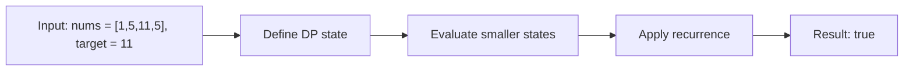

# 416. Partition Equal Subset Sum

**Difficulty:** Medium  
**Concept family:** [Take-or-Skip and Knapsack](https://github.com/gaurav1kr/Miscellaneous/blob/main/DSA/DP/DP_Mathematics_Master_Guide_Illustrated/Theory/Chapter-02.md)  
**Problem:** https://leetcode.com/problems/partition-equal-subset-sum/  
**Original submission:** https://leetcode.com/submissions/detail/1542032034/

## Understand the mathematics first

Each number is included or excluded.

### Problem-specific recurrence

Refer to the source-grounded algorithm walkthrough below for the state transitions used by your implementation. The generic family recurrence has been removed because it may not apply to this problem.

## Code landmarks

- `dp[0] = true; // Base case: subset with sum 0 is always possible`
- `dp[j] = dp[j] || dp[j - num];`
- `return dp[target];`

## Detailed dry run — Subset sum: boolean feasibility

### Start from the mathematical question

Let P(i,s) indicate whether some subset of the first i values sums to s.

### Derive the recurrence

```math
P(i,s)=P(i-1,s)\lor P(i-1,s-a_i)
```

**Why the transition is correct:** Each item is either absent or present once. When using a 1D array, iterate sums backward to prevent reusing the same item.

### Concrete example

**Input:** `nums = [1,5,11,5], target = 11`



**Evaluate the states in dependency order:**

| Considered values | Newly reachable sums (examples) | Is 11 reachable? |
|---|---|---|
| [] | {0} | No |
| [1] | {0,1} | No |
| [1,5] | {0,1,5,6} | No |
| [1,5,11] | includes 11 | Yes |
| [1,5,11,5] | includes 11 | Yes |

**Expected result:** `true`.

### What to remember six months later

Explain (1) what one state means, (2) which earlier states it needs, (3) why those cases are exhaustive, and (4) why the answer is `true` for this input. Then inspect your preserved C++ solution below and match its variables to the mathematical states.

---

## Your original Accepted C++ submission (unaltered)

```cpp
class Solution {
public:
    bool canPartition(vector<int>& nums) {
        int totalSum = accumulate(nums.begin(), nums.end(), 0);

        // If the total sum is odd, we cannot partition into two equal subsets
        if (totalSum % 2 != 0) {
            return false;
        }

        int target = totalSum / 2;
        vector<bool> dp(target + 1, false);
        dp[0] = true; // Base case: subset with sum 0 is always possible

        for (int num : nums) {
            for (int j = target; j >= num; --j) {
                dp[j] = dp[j] || dp[j - num];
            }
        }

        return dp[target];
    }
};
```

## Time and Space Complexity

- **Time:** `Depends on loop nesting and bounds`
- **Auxiliary space:** `Depends on auxiliary arrays/containers`

**Reasoning:** Count how many iterations each loop executes and whether loops are nested; do not assume all nested loops are quadratic.

**Status:** Code-informed complexity guidance; exact tight bounds have not been individually verified.
