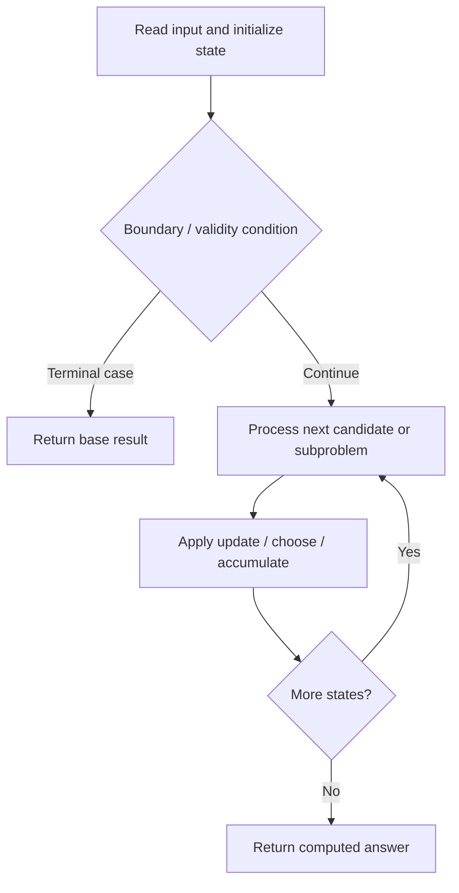

# 42. Trapping Rain Water

**Difficulty:** Hard  
**Concept family:** [Digit DP, Counting and Probability](https://github.com/gaurav1kr/Miscellaneous/blob/main/DSA/DP/DP_Mathematics_Master_Guide_Illustrated/Theory/Chapter-11.md)  
**Problem:** https://leetcode.com/problems/trapping-rain-water/  
**Original submission:** https://leetcode.com/submissions/detail/381258301/

## Understand the mathematics first

Water above a bar is bounded by the lower of its highest walls.

### Problem-specific recurrence

Refer to the source-grounded algorithm walkthrough below for the state transitions used by your implementation. The generic family recurrence has been removed because it may not apply to this problem.

## Code landmarks

- `while (lo <= hi)`

## Source-grounded algorithm walkthrough (expanded coverage)

> **Verification level:** The observations below are extracted from your actual Accepted C++ implementation. The symbolic trace is a **code-reading dry-run worksheet**, not a fabricated numerical run. The generic family formula above is not necessarily this problem's recurrence.

### 1. Identify the actual state and algorithm

**Problem:** 42. Trapping Rain Water. This solution does not expose an obvious `dp` or `memo` variable. Derive the algorithmic invariant from the code rather than assuming a DP recurrence.

| Role | C++ source line | Evidence from your solution |
|---|---:|---|
| Candidate state / accumulator | — | No obvious matching statement; inspect the original C++ below. |
| Boundary / termination | 13 | `if (arr[lo] < arr[hi])` |
| Boundary / termination | 15 | `if (arr[lo] > left_max)` |
| Boundary / termination | 27 | `if (arr[hi] > right_max)` |
| Traversal order | 11 | `while (lo <= hi)` |
| Transition / update | — | No obvious matching statement; inspect the original C++ below. |
| Return / result | 34 | `return result;` |

### 2. Trace the dependency chain



This is a **control-flow reading diagram**, not a claim about the exact shape of the mathematical state graph. Follow the code line numbers above to draw the actual dependency arrows.

### 3. Symbolic dry-run worksheet

| Stage | State to record | Mathematical question to answer |
|---|---|---|
| Initialize | Inputs, initialized containers/accumulators | What does the initial value mean? |
| First iteration / recursive call | Loop indices, branch, current state | Which predecessor states are available? |
| First update | Before → after for the updated variable | Why is this transition legal? Does it add, minimize, maximize, or overwrite? |
| Next iteration | Updated state and next candidate | Can a value be reused in this traversal order? |
| Finish | Return expression and its value | Why does this correspond to the problem's requested result? |

### 4. Mathematical explanation checklist

1. Define the exact meaning of each state variable, including all indices and constraints.
2. Translate the update expression into a mathematical equation **only after** establishing the state invariant.
3. Prove the transitions are exhaustive and do not double-count or reuse forbidden elements.
4. Check empty input, smallest input, impossible cases, and overflow/modulo behavior.
5. Compute a small numerical example using the actual problem constraints, then compare each row to the original C++.


---

## Your original Accepted C++ submission (unaltered)

```cpp
class Solution 
{
public:
    int trap(vector<int>& arr) 
    {
        int n= arr.size() ;
        int result = 0; 
        int left_max = 0, right_max = 0; 
        int lo = 0, hi = n - 1; 

        while (lo <= hi) 
        { 
            if (arr[lo] < arr[hi]) 
            { 
                if (arr[lo] > left_max) 
                {
                    left_max = arr[lo]; 
                }
                else
                {
                    result += left_max - arr[lo]; 
                }
                lo++; 
            } 
            else 
            { 
                if (arr[hi] > right_max) 
                    right_max = arr[hi]; 
                else
                    result += right_max - arr[hi]; 
                hi--; 
            } 
        } 
        return result;     
    }
};
```

## Time and Space Complexity

- **Time:** `Depends on input size and control flow`
- **Auxiliary space:** `Depends on auxiliary allocations / recursion depth`

**Reasoning:** The exact asymptotic bound requires examining the complete control flow and allocations in the preserved C++ code.

**Status:** Code-informed complexity guidance; exact tight bounds have not been individually verified.
