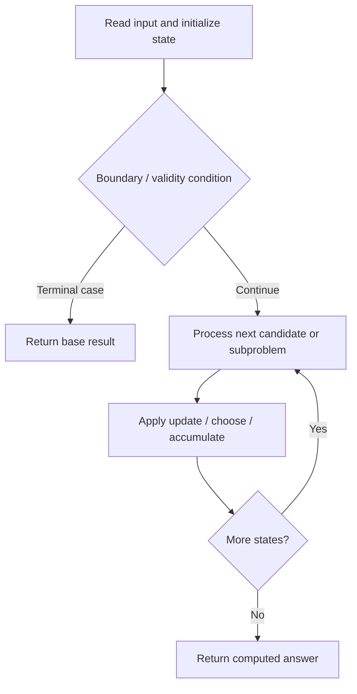

# 44. Wildcard Matching

**Difficulty:** Hard  
**Concept family:** [String Matching and Sequence Alignment](https://github.com/gaurav1kr/Miscellaneous/blob/main/DSA/DP/DP_Mathematics_Master_Guide_Illustrated/Theory/Chapter-04.md)  
**Problem:** https://leetcode.com/problems/wildcard-matching/  
**Original submission:** https://leetcode.com/submissions/detail/1536213174/

## Understand the mathematics first

This problem belongs to the study family **String Matching and Sequence Alignment**. Start by defining the objective and minimal sufficient state; inspect the code to identify the actual transitions.

### Problem-specific recurrence

Refer to the source-grounded algorithm walkthrough below for the state transitions used by your implementation. The generic family recurrence has been removed because it may not apply to this problem.

## Code landmarks

- `// DP table where dp[i][j] means if s[0..i-1] matches p[0..j-1]`
- `dp[0][0] = true;`
- `dp[0][j] = dp[0][j - 1];`

## Source-grounded algorithm walkthrough (expanded coverage)

> **Verification level:** The observations below are extracted from your actual Accepted C++ implementation. The symbolic trace is a **code-reading dry-run worksheet**, not a fabricated numerical run. The generic family formula above is not necessarily this problem's recurrence.

### 1. Identify the actual state and algorithm

**Problem:** 44. Wildcard Matching. An explicit state table or memo is present. Interpret each index as a mathematical state and every update as a transition.

| Role | C++ source line | Evidence from your solution |
|---|---:|---|
| Candidate state / accumulator | 7 | `vector<vector<bool>> dp(n + 1, vector<bool>(m + 1, false));` |
| Candidate state / accumulator | 10 | `dp[0][0] = true;` |
| Candidate state / accumulator | 15 | `dp[0][j] = dp[0][j - 1];` |
| Boundary / termination | 10 | `dp[0][0] = true;` |
| Boundary / termination | 14 | `if (p[j - 1] == '*') {` |
| Boundary / termination | 22 | `if (p[j - 1] == s[i - 1] \|\| p[j - 1] == '?') {` |
| Traversal order | 13 | `for (int j = 1; j <= m; ++j) {` |
| Traversal order | 20 | `for (int i = 1; i <= n; ++i) {` |
| Traversal order | 21 | `for (int j = 1; j <= m; ++j) {` |
| Transition / update | 10 | `dp[0][0] = true;` |
| Transition / update | 15 | `dp[0][j] = dp[0][j - 1];` |
| Transition / update | 23 | `dp[i][j] = dp[i - 1][j - 1];` |
| Transition / update | 25 | `dp[i][j] = dp[i - 1][j] \|\| dp[i][j - 1];` |
| Return / result | 30 | `return dp[n][m];` |

### 2. Trace the dependency chain



This is a **control-flow reading diagram**, not a claim about the exact shape of the mathematical state graph. Follow the code line numbers above to draw the actual dependency arrows.

### 3. Symbolic dry-run worksheet

| Stage | State to record | Mathematical question to answer |
|---|---|---|
| Initialize | Inputs, initialized containers/accumulators | What does the initial value mean? |
| First iteration / recursive call | Loop indices, branch, current state | Which predecessor states are available? |
| First update | Before → after for the updated variable | Why is this transition legal? Does it add, minimize, maximize, or overwrite? |
| Next iteration | Updated state and next candidate | Can a value be reused in this traversal order? |
| Finish | Return expression and its value | Why does this correspond to the problem's requested result? |

### 4. Mathematical explanation checklist

1. Define the exact meaning of each state variable, including all indices and constraints.
2. Translate the update expression into a mathematical equation **only after** establishing the state invariant.
3. Prove the transitions are exhaustive and do not double-count or reuse forbidden elements.
4. Check empty input, smallest input, impossible cases, and overflow/modulo behavior.
5. Compute a small numerical example using the actual problem constraints, then compare each row to the original C++.


---

## Your original Accepted C++ submission (unaltered)

```cpp
class Solution {
public:
    bool isMatch(string s, string p) {
        int n = s.size(), m = p.size();
        
        // DP table where dp[i][j] means if s[0..i-1] matches p[0..j-1]
        vector<vector<bool>> dp(n + 1, vector<bool>(m + 1, false));
        
        // Base case: empty string matches empty pattern
        dp[0][0] = true;

        // Handle cases where the pattern starts with '*' characters
        for (int j = 1; j <= m; ++j) {
            if (p[j - 1] == '*') {
                dp[0][j] = dp[0][j - 1];
            }
        }

        // Fill the DP table
        for (int i = 1; i <= n; ++i) {
            for (int j = 1; j <= m; ++j) {
                if (p[j - 1] == s[i - 1] || p[j - 1] == '?') {
                    dp[i][j] = dp[i - 1][j - 1];
                } else if (p[j - 1] == '*') {
                    dp[i][j] = dp[i - 1][j] || dp[i][j - 1];
                }
            }
        }

        return dp[n][m];
    }
};
```

## Time and Space Complexity

- **Time:** `Depends on table dimensions and transitions per cell`
- **Auxiliary space:** `O(rows × columns) for the allocated table`

**Reasoning:** The two-dimensional table determines memory; time is its state count multiplied by work per state.

**Status:** Code-informed complexity guidance; exact tight bounds have not been individually verified.
