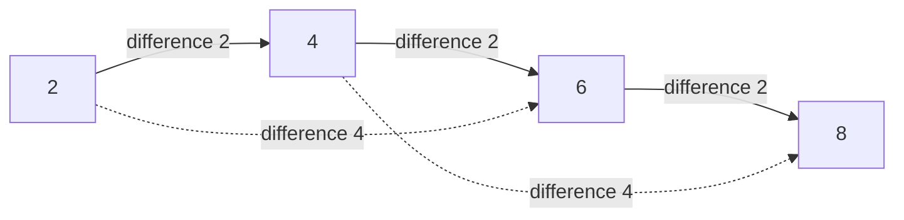
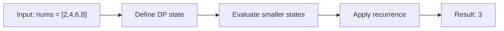

# 446. Arithmetic Slices II - Subsequence

**Difficulty:** Hard  
**Concept family:** [Subsequence and Ordering DP](https://github.com/gaurav1kr/Miscellaneous/blob/main/DSA/DP/DP_Mathematics_Master_Guide_Illustrated/Theory/Chapter-05.md)  
**Problem:** https://leetcode.com/problems/arithmetic-slices-ii-subsequence/  
**Original submission:** https://leetcode.com/submissions/detail/1591362719/

## Understand the mathematics first

**Question:** Count arithmetic *subsequences* of length at least 3. Elements need not be adjacent, but their original order must be preserved.

### 1. Why the ordinary LIS formula does not work

LIS only asks whether values increase. Here the consecutive **difference must stay equal**. Therefore, the state must remember both the ending index and the difference.

### 2. Define the state

Let `dp[i][d]` be the number of arithmetic subsequences of length **at least 2** that end at index `i` and have common difference `d`.

The state includes length-2 pairs to allow future extension. Such pairs are **not yet counted in the answer**.

### 3. Derive the recurrence

For every `j < i`, compute `d = nums[i] - nums[j]`.

- The pair `(nums[j], nums[i])` creates **one** new length-2 sequence.
- Every existing arithmetic subsequence ending at `j` with difference `d` can be extended by `nums[i]`. There are `dp[j][d]` such sequences, and each extended sequence has length at least 3.

Therefore, for each predecessor `j`:


```text
dp[i][d] \mathrel{+}= 1 + dp[j][d]
```


Only extensions of existing sequences contribute to the result:


```text
answer \mathrel{+}= dp[j][d]
```


The difference uses `long long` to avoid overflow when subtracting extreme `int` values.

### 4. Visual traversal: `[2, 4, 6, 8]`



Walk through all predecessor pairs in increasing `i`:

| `i` | `j` | `d` | `dp[j][d]` before update | `dp[i][d]` after update | New valid subsequences |
|---|---|---:|---:|---:|---|
| 1 (4) | 0 (2) | 2 | 0 | 1 | None: pair only |
| 2 (6) | 0 (2) | 4 | 0 | 1 | None |
| 2 (6) | 1 (4) | 2 | 1 | 2 | `[2,4,6]` |
| 3 (8) | 0 (2) | 6 | 0 | 1 | None |
| 3 (8) | 1 (4) | 4 | 0 | 1 | None |
| 3 (8) | 2 (6) | 2 | 2 | 3 | `[4,6,8]`, `[2,4,6,8]` |

**Answer = 3** arithmetic subsequences of length at least three.

### 5. Connect the mathematics to your C++ code

- `dp[j].count(diff) ? dp[j][diff] : 0` reads the number of extendable sequences.
- `dp[i][diff] += count + 1` stores extensions **plus** the newly created pair.
- `res += count` counts only valid length-3-or-longer sequences, not pairs.

**Complexity:** O(n²) expected time using hash maps; O(n²) worst-case space for stored index/difference states.

**Interview recognition clue:** If a subsequence depends on the *difference between consecutive chosen elements*, `dp[i]` alone is insufficient; add the difference to the state.

## Code landmarks

- `int count = dp[j].count(diff) ? dp[j][diff] : 0;`
- `dp[i][diff] += count + 1;`

## Detailed dry run — Arithmetic subsequences: difference-indexed counts

### Start from the mathematical question

Let D(i,d) count length-at-least-2 arithmetic subsequences ending at index i with common difference d.

### Derive the recurrence

```math
D(i,d)\mathrel{+}=1+D(j,d)\quad\text{for each }j<i,\ d=a_i-a_j
```

**Why the transition is correct:** The +1 creates a new pair, while D(j,d) extends existing pairs/subsequences. Only the extensions count as length-at-least-3 answers.

### Concrete example

**Input:** `nums = [2,4,6,8]`



**Evaluate the states in dependency order:**

| i (value) | j (value) | Difference | D(j,d) | D(i,d) after | Answer added |
|---|---|---:|---:|---:|---:|
| 1 (4) | 0 (2) | 2 | 0 | 1 | 0 |
| 2 (6) | 0 (2) | 4 | 0 | 1 | 0 |
| 2 (6) | 1 (4) | 2 | 1 | 2 | 1 |
| 3 (8) | 0 (2) | 6 | 0 | 1 | 0 |
| 3 (8) | 1 (4) | 4 | 0 | 1 | 0 |
| 3 (8) | 2 (6) | 2 | 2 | 3 | 2 |

**Expected result:** `3`.

### What to remember six months later

Explain (1) what one state means, (2) which earlier states it needs, (3) why those cases are exhaustive, and (4) why the answer is `3` for this input. Then inspect your preserved C++ solution below and match its variables to the mathematical states.

---

## Your original Accepted C++ submission (unaltered)

```cpp
#include <vector>
#include <unordered_map>
using namespace std;

class Solution {
public:
    int numberOfArithmeticSlices(vector<int>& nums) {
        int n = nums.size(), res = 0;
        vector<unordered_map<long long, int>> dp(n);

        for (int i = 1; i < n; i++) {
            for (int j = 0; j < i; j++) {
                long long diff = (long long)nums[i] - nums[j];
                int count = dp[j].count(diff) ? dp[j][diff] : 0;
                dp[i][diff] += count + 1;
                res += count;
            }
        }
        return res;
    }
};
```

## Time and Space Complexity

- **Time:** `O(n²) expected`
- **Auxiliary space:** `O(n²)`

**Reasoning:** Every pair (j,i) is examined once; difference maps may store O(n²) entries overall.

**Basis:** Analyzed algorithm structure in the preserved C++ submission.
