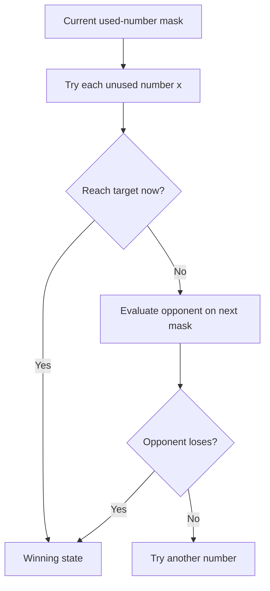
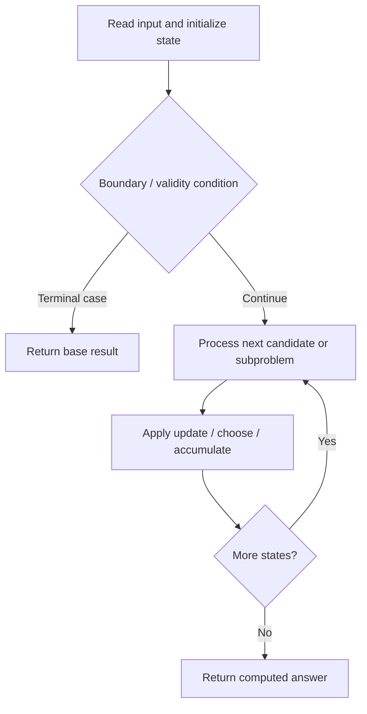

# 464. Can I Win

**Difficulty:** Medium  
**Concept family:** [Bitmask, Assignment and Subset DP](https://github.com/gaurav1kr/Miscellaneous/blob/main/DSA/DP/DP_Mathematics_Master_Guide_Illustrated/Theory/Chapter-09.md)  
**Problem:** https://leetcode.com/problems/can-i-win/  
**Original submission:** https://leetcode.com/submissions/detail/2163971091/

## Understand the mathematics first

This problem belongs to the study family **Bitmask, Assignment and Subset DP**. Start by defining the objective and minimal sufficient state; inspect the code to identify the actual transitions.

### Problem-specific recurrence

Refer to the source-grounded algorithm walkthrough below for the state transitions used by your implementation. The generic family recurrence has been removed because it may not apply to this problem.

## Code landmarks

- `if (memo[mask] != 0)`
- `return memo[mask] == 1;`
- `memo[mask] = 1;`

## Worked mathematical walkthrough (illustrated)

**State:** Win(mask): whether current player can force a win from used-number set mask.

**Transition:** `Win(mask)=OR over legal x of [x>=remaining OR NOT Win(mask with x used)]`

**Why:** The state is the set of already chosen numbers. A winning move either finishes immediately or leaves the opponent in a losing state.



**Hand calculation:** Numbers 1..3, target 4: first player chooses 1,2,or 3; examine each reply and whether it lets the opponent force a win.

**Six-month revision test:** Without looking at the code, reconstruct the state, enumerate the legal choices, and justify why this transition does not miss or double-count any answer.

---

## Source-grounded algorithm walkthrough (expanded coverage)

> **Verification level:** The observations below are extracted from your actual Accepted C++ implementation. The symbolic trace is a **code-reading dry-run worksheet**, not a fabricated numerical run. The generic family formula above is not necessarily this problem's recurrence.

### 1. Identify the actual state and algorithm

**Problem:** 464. Can I Win. Recursive state transitions are present. Check memoization, state identity, termination, and whether branches are mutually exclusive.

| Role | C++ source line | Evidence from your solution |
|---|---:|---|
| Candidate state / accumulator | 3 | `vector<int> memo;  // 0 unknown, 1 win, -1 lose` |
| Candidate state / accumulator | 6 | `if (memo[mask] != 0)` |
| Candidate state / accumulator | 7 | `return memo[mask] == 1;` |
| Boundary / termination | 6 | `if (memo[mask] != 0)` |
| Boundary / termination | 13 | `if (mask & bit)` |
| Boundary / termination | 18 | `if (i >= remaining \|\|` |
| Traversal order | 9 | `for (int i = 1; i <= n; ++i) {` |
| Transition / update | 7 | `return memo[mask] == 1;` |
| Transition / update | 21 | `memo[mask] = 1;` |
| Transition / update | 26 | `memo[mask] = -1;` |
| Transition / update | 40 | `int sum = n * (n + 1) / 2;` |
| Return / result | 7 | `return memo[mask] == 1;` |
| Return / result | 22 | `return true;` |

### 2. Trace the dependency chain



This is a **control-flow reading diagram**, not a claim about the exact shape of the mathematical state graph. Follow the code line numbers above to draw the actual dependency arrows.

### 3. Symbolic dry-run worksheet

| Stage | State to record | Mathematical question to answer |
|---|---|---|
| Initialize | Inputs, initialized containers/accumulators | What does the initial value mean? |
| First iteration / recursive call | Loop indices, branch, current state | Which predecessor states are available? |
| First update | Before → after for the updated variable | Why is this transition legal? Does it add, minimize, maximize, or overwrite? |
| Next iteration | Updated state and next candidate | Can a value be reused in this traversal order? |
| Finish | Return expression and its value | Why does this correspond to the problem's requested result? |

### 4. Mathematical explanation checklist

1. Define the exact meaning of each state variable, including all indices and constraints.
2. Translate the update expression into a mathematical equation **only after** establishing the state invariant.
3. Prove the transitions are exhaustive and do not double-count or reuse forbidden elements.
4. Check empty input, smallest input, impossible cases, and overflow/modulo behavior.
5. Compute a small numerical example using the actual problem constraints, then compare each row to the original C++.


---

## Your original Accepted C++ submission (unaltered)

```cpp
class Solution {
    int n;
    vector<int> memo;  // 0 unknown, 1 win, -1 lose

    bool dfs(int mask, int remaining) {
        if (memo[mask] != 0)
            return memo[mask] == 1;

        for (int i = 1; i <= n; ++i) {
            int bit = 1 << (i - 1);

            // Already used
            if (mask & bit)
                continue;

            // Case 1: Pick i and win immediately
            // Case 2: Pick i and put opponent in losing state
            if (i >= remaining ||
                !dfs(mask | bit, remaining - i)) {

                memo[mask] = 1;
                return true;
            }
        }

        memo[mask] = -1;
        return false;
    }

public:
    bool canIWin(int maxChoosableInteger, int desiredTotal) {
        n = maxChoosableInteger;

        if (desiredTotal <= 0)
            return true;

        if (n >= desiredTotal)
            return true;

        int sum = n * (n + 1) / 2;

        if (sum < desiredTotal)
            return false;

        memo.assign(1 << n, 0);

        return dfs(0, desiredTotal);
    }
};
```

## Time and Space Complexity

- **Time:** `O(number of reachable states × work per state), if memoized`
- **Auxiliary space:** `O(number of memoized states + recursion depth)`

**Reasoning:** Count distinct memo keys and transitions. Without effective memoization, recursive branching can be exponential.

**Status:** Code-informed complexity guidance; exact tight bounds have not been individually verified.
