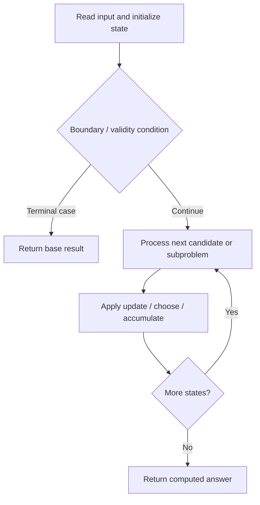

# 466. Count The Repetitions

**Difficulty:** Hard  
**Concept family:** [String Matching and Sequence Alignment](https://github.com/gaurav1kr/Miscellaneous/blob/main/DSA/DP/DP_Mathematics_Master_Guide_Illustrated/Theory/Chapter-04.md)  
**Problem:** https://leetcode.com/problems/count-the-repetitions/  
**Original submission:** https://leetcode.com/submissions/detail/1610633747/

## Understand the mathematics first

This problem belongs to the study family **String Matching and Sequence Alignment**. Start by defining the objective and minimal sufficient state; inspect the code to identify the actual transitions.

### Related concept template (not necessarily this problem’s recurrence)

$$
D(i,j)=\min(D(i-1,j)+1,D(i,j-1)+1,D(i-1,j-1)+[a_i\ne b_j])
$$

**What this template illustrates:** The three alternatives correspond to delete, insert and substitute. In matching/counting variants, the aggregation changes.

**Derivation exercise:** Define exactly what each state variable means for this problem; list valid choices, base cases, and forbidden transitions. Check the submitted code against that invariant. The family template alone is not a substitute for a problem-specific proof.

## Code landmarks

Read the loops, recursion, and boundary conditions in the original code.

## Source-grounded algorithm walkthrough (expanded coverage)

> **Verification level:** The observations below are extracted from your actual Accepted C++ implementation. The symbolic trace is a **code-reading dry-run worksheet**, not a fabricated numerical run. The generic family formula above is not necessarily this problem's recurrence.

### 1. Identify the actual state and algorithm

**Problem:** 466. Count The Repetitions. This solution does not expose an obvious `dp` or `memo` variable. Derive the algorithmic invariant from the code rather than assuming a DP recurrence.

| Role | C++ source line | Evidence from your solution |
|---|---:|---|
| Candidate state / accumulator | 11 | `unordered_map<int, pair<int, int>> visited;` |
| Candidate state / accumulator | 12 | `int j = 0, count = 0;` |
| Candidate state / accumulator | 24 | `int start = visited[j].first;` |
| Boundary / termination | 15 | `if (c == s2[j]) ++j;` |
| Boundary / termination | 16 | `if (j == len2) {` |
| Boundary / termination | 23 | `if (visited.count(j)) {` |
| Traversal order | 13 | `for (int k = 1; k <= n1; ++k) {` |
| Traversal order | 14 | `for (char c : s1) {` |
| Transition / update | 12 | `int j = 0, count = 0;` |
| Return / result | 29 | `return (repeatCount[start] + patternCount * (repeatCount[k] - repeatCount[start]) + repeatCount[start + suffix] ...` |
| Return / result | 33 | `return repeatCount[n1] / n2;` |

### 2. Trace the dependency chain



This is a **control-flow reading diagram**, not a claim about the exact shape of the mathematical state graph. Follow the code line numbers above to draw the actual dependency arrows.

### 3. Symbolic dry-run worksheet

| Stage | State to record | Mathematical question to answer |
|---|---|---|
| Initialize | Inputs, initialized containers/accumulators | What does the initial value mean? |
| First iteration / recursive call | Loop indices, branch, current state | Which predecessor states are available? |
| First update | Before → after for the updated variable | Why is this transition legal? Does it add, minimize, maximize, or overwrite? |
| Next iteration | Updated state and next candidate | Can a value be reused in this traversal order? |
| Finish | Return expression and its value | Why does this correspond to the problem's requested result? |

### 4. Mathematical explanation checklist

1. Define the exact meaning of each state variable, including all indices and constraints.
2. Translate the update expression into a mathematical equation **only after** establishing the state invariant.
3. Prove the transitions are exhaustive and do not double-count or reuse forbidden elements.
4. Check empty input, smallest input, impossible cases, and overflow/modulo behavior.
5. Compute a small numerical example using the actual problem constraints, then compare each row to the original C++.


---

## Your original Accepted C++ submission (unaltered)

```cpp
#include <string>
#include <unordered_map>

using namespace std;

class Solution {
public:
    int getMaxRepetitions(string s1, int n1, string s2, int n2) {
        int len1 = s1.size(), len2 = s2.size();
        vector<int> repeatCount(n1 + 1), nextIndex(n1 + 1);
        unordered_map<int, pair<int, int>> visited;
        int j = 0, count = 0;
        for (int k = 1; k <= n1; ++k) {
            for (char c : s1) {
                if (c == s2[j]) ++j;
                if (j == len2) {
                    ++count;
                    j = 0;
                }
            }
            repeatCount[k] = count;
            nextIndex[k] = j;
            if (visited.count(j)) {
                int start = visited[j].first;
                int prefixCount = visited[j].second;
                int patternLength = k - start;
                int patternCount = (n1 - start) / patternLength;
                int suffix = (n1 - start) % patternLength;
                return (repeatCount[start] + patternCount * (repeatCount[k] - repeatCount[start]) + repeatCount[start + suffix] - repeatCount[start]) / n2;
            }
            visited[j] = {k, count};
        }
        return repeatCount[n1] / n2;
    }
};
```

## Time and Space Complexity

- **Time:** `Depends on operations (typically O(log n) per ordered-container operation)`
- **Auxiliary space:** `Depends on number of stored entries`

**Reasoning:** An ordered container or heap introduces logarithmic insertion, lookup, or removal costs; multiply by operation count.

**Status:** Code-informed complexity guidance; exact tight bounds have not been individually verified.
