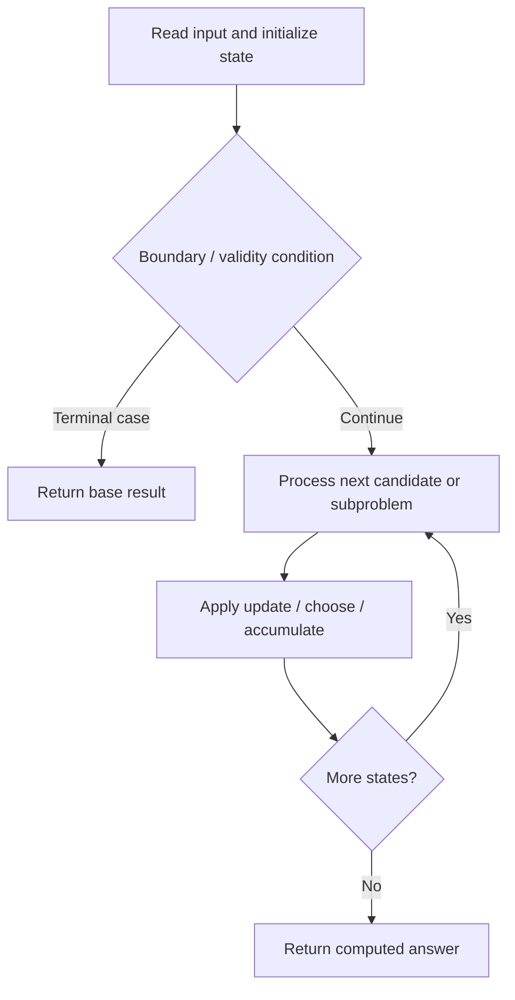

# 472. Concatenated Words

**Difficulty:** Hard  
**Concept family:** [String Matching and Sequence Alignment](https://github.com/gaurav1kr/Miscellaneous/blob/main/DSA/DP/DP_Mathematics_Master_Guide_Illustrated/Theory/Chapter-04.md)  
**Problem:** https://leetcode.com/problems/concatenated-words/  
**Original submission:** https://leetcode.com/submissions/detail/1012902243/

## Understand the mathematics first

This problem belongs to the study family **String Matching and Sequence Alignment**. Start by defining the objective and minimal sufficient state; inspect the code to identify the actual transitions.

### Related concept template (not necessarily this problem’s recurrence)

$$
D(i,j)=\min(D(i-1,j)+1,D(i,j-1)+1,D(i-1,j-1)+[a_i\ne b_j])
$$

**What this template illustrates:** The three alternatives correspond to delete, insert and substitute. In matching/counting variants, the aggregation changes.

**Derivation exercise:** Define exactly what each state variable means for this problem; list valid choices, base cases, and forbidden transitions. Check the submitted code against that invariant. The family template alone is not a substitute for a problem-specific proof.

## Code landmarks

- `dp[0]=1;`
- `if(!dp[i])continue;`
- `dp[j]=1;`

## Source-grounded algorithm walkthrough (expanded coverage)

> **Verification level:** The observations below are extracted from your actual Accepted C++ implementation. The symbolic trace is a **code-reading dry-run worksheet**, not a fabricated numerical run. The generic family formula above is not necessarily this problem's recurrence.

### 1. Identify the actual state and algorithm

**Problem:** 472. Concatenated Words. An explicit state table or memo is present. Interpret each index as a mathematical state and every update as a transition.

| Role | C++ source line | Evidence from your solution |
|---|---:|---|
| Candidate state / accumulator | 5 | `vector<string>ans;` |
| Candidate state / accumulator | 8 | `vector<bool>dp(n+1,false);` |
| Candidate state / accumulator | 9 | `dp[0]=1;` |
| Boundary / termination | 9 | `dp[0]=1;` |
| Boundary / termination | 11 | `if(!dp[i])continue;` |
| Boundary / termination | 13 | `if(j-i<n and word_set.count(w.substr(i,j-i)))` |
| Traversal order | 6 | `for(auto w:words){` |
| Traversal order | 10 | `for(int i=0;i<n;i++){` |
| Traversal order | 12 | `for(int j=i+1;j<=n;j++){` |
| Transition / update | 9 | `dp[0]=1;` |
| Transition / update | 14 | `dp[j]=1;` |
| Transition / update | 17 | `if(dp[n]==1)ans.push_back(w);` |
| Return / result | 19 | `return ans;` |

### 2. Trace the dependency chain



This is a **control-flow reading diagram**, not a claim about the exact shape of the mathematical state graph. Follow the code line numbers above to draw the actual dependency arrows.

### 3. Symbolic dry-run worksheet

| Stage | State to record | Mathematical question to answer |
|---|---|---|
| Initialize | Inputs, initialized containers/accumulators | What does the initial value mean? |
| First iteration / recursive call | Loop indices, branch, current state | Which predecessor states are available? |
| First update | Before → after for the updated variable | Why is this transition legal? Does it add, minimize, maximize, or overwrite? |
| Next iteration | Updated state and next candidate | Can a value be reused in this traversal order? |
| Finish | Return expression and its value | Why does this correspond to the problem's requested result? |

### 4. Mathematical explanation checklist

1. Define the exact meaning of each state variable, including all indices and constraints.
2. Translate the update expression into a mathematical equation **only after** establishing the state invariant.
3. Prove the transitions are exhaustive and do not double-count or reuse forbidden elements.
4. Check empty input, smallest input, impossible cases, and overflow/modulo behavior.
5. Compute a small numerical example using the actual problem constraints, then compare each row to the original C++.


---

## Your original Accepted C++ submission (unaltered)

```cpp
class Solution {
public:
    vector<string> findAllConcatenatedWordsInADict(vector<string>& words) {
        unordered_set<string>word_set(words.begin(),words.end());
        vector<string>ans;
        for(auto w:words){
            int n=w.size();
            vector<bool>dp(n+1,false);
            dp[0]=1;
            for(int i=0;i<n;i++){
                if(!dp[i])continue;
                for(int j=i+1;j<=n;j++){
                    if(j-i<n and word_set.count(w.substr(i,j-i)))
                    dp[j]=1;
                }
            }
            if(dp[n]==1)ans.push_back(w);
        }
       return ans;
    }
};
```

## Time and Space Complexity

- **Time:** `Depends on operations (typically O(log n) per ordered-container operation)`
- **Auxiliary space:** `Depends on number of stored entries`

**Reasoning:** An ordered container or heap introduces logarithmic insertion, lookup, or removal costs; multiply by operation count.

**Status:** Code-informed complexity guidance; exact tight bounds have not been individually verified.
