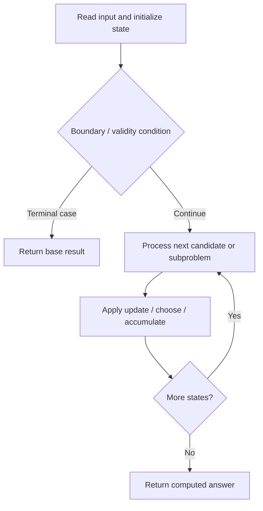

# 474. Ones and Zeroes

**Difficulty:** Medium  
**Concept family:** [Take-or-Skip and Knapsack](https://github.com/gaurav1kr/Miscellaneous/blob/main/DSA/DP/DP_Mathematics_Master_Guide_Illustrated/Theory/Chapter-02.md)  
**Problem:** https://leetcode.com/problems/ones-and-zeroes/  
**Original submission:** https://leetcode.com/submissions/detail/2163976769/

## Understand the mathematics first

This problem belongs to the study family **Take-or-Skip and Knapsack**. Start by defining the objective and minimal sufficient state; inspect the code to identify the actual transitions.

### Related concept template (not necessarily this problem’s recurrence)

$$
F(i,c)=\max(F(i-1,c),v_i+F(i-1,c-w_i))
$$

**What this template illustrates:** Only use the take branch when the remaining capacity is feasible. Counting versions use addition; feasibility versions use logical OR.

**Derivation exercise:** Define exactly what each state variable means for this problem; list valid choices, base cases, and forbidden transitions. Check the submitted code against that invariant. The family template alone is not a substitute for a problem-specific proof.

## Code landmarks

- `dp[i][j] = max(dp[i][j],`
- `1 + dp[i - zeros][j - ones]);`
- `return dp[m][n];`

## Source-grounded algorithm walkthrough (expanded coverage)

> **Verification level:** The observations below are extracted from your actual Accepted C++ implementation. The symbolic trace is a **code-reading dry-run worksheet**, not a fabricated numerical run. The generic family formula above is not necessarily this problem's recurrence.

### 1. Identify the actual state and algorithm

**Problem:** 474. Ones and Zeroes. An explicit state table or memo is present. Interpret each index as a mathematical state and every update as a transition.

| Role | C++ source line | Evidence from your solution |
|---|---:|---|
| Candidate state / accumulator | 4 | `vector<vector<int> > dp(m + 1, vector<int>(n + 1, 0));` |
| Candidate state / accumulator | 19 | `dp[i][j] = max(dp[i][j],` |
| Candidate state / accumulator | 20 | `1 + dp[i - zeros][j - ones]);` |
| Boundary / termination | 10 | `if (c == '0')` |
| Traversal order | 6 | `for (const string& s : strs) {` |
| Traversal order | 9 | `for (char c : s) {` |
| Traversal order | 17 | `for (int i = m; i >= zeros; --i) {` |
| Transition / update | 19 | `dp[i][j] = max(dp[i][j],` |
| Return / result | 25 | `return dp[m][n];` |

### 2. Trace the dependency chain



This is a **control-flow reading diagram**, not a claim about the exact shape of the mathematical state graph. Follow the code line numbers above to draw the actual dependency arrows.

### 3. Symbolic dry-run worksheet

| Stage | State to record | Mathematical question to answer |
|---|---|---|
| Initialize | Inputs, initialized containers/accumulators | What does the initial value mean? |
| First iteration / recursive call | Loop indices, branch, current state | Which predecessor states are available? |
| First update | Before → after for the updated variable | Why is this transition legal? Does it add, minimize, maximize, or overwrite? |
| Next iteration | Updated state and next candidate | Can a value be reused in this traversal order? |
| Finish | Return expression and its value | Why does this correspond to the problem's requested result? |

### 4. Mathematical explanation checklist

1. Define the exact meaning of each state variable, including all indices and constraints.
2. Translate the update expression into a mathematical equation **only after** establishing the state invariant.
3. Prove the transitions are exhaustive and do not double-count or reuse forbidden elements.
4. Check empty input, smallest input, impossible cases, and overflow/modulo behavior.
5. Compute a small numerical example using the actual problem constraints, then compare each row to the original C++.


---

## Your original Accepted C++ submission (unaltered)

```cpp
class Solution {
public:
    int findMaxForm(vector<string>& strs, int m, int n) {
        vector<vector<int> > dp(m + 1, vector<int>(n + 1, 0));

        for (const string& s : strs) {
            int zeros = 0, ones = 0;

            for (char c : s) {
                if (c == '0')
                    ++zeros;
                else
                    ++ones;
            }

            // Reverse traversal => each string used only once
            for (int i = m; i >= zeros; --i) {
                for (int j = n; j >= ones; --j) {
                    dp[i][j] = max(dp[i][j],
                                   1 + dp[i - zeros][j - ones]);
                }
            }
        }

        return dp[m][n];
    }
};
```

## Time and Space Complexity

- **Time:** `Depends on table dimensions and transitions per cell`
- **Auxiliary space:** `O(rows × columns) for the allocated table`

**Reasoning:** The two-dimensional table determines memory; time is its state count multiplied by work per state.

**Status:** Code-informed complexity guidance; exact tight bounds have not been individually verified.
