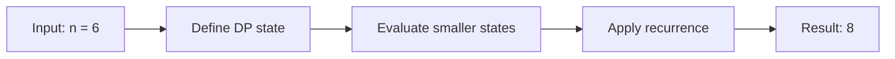

# 509. Fibonacci Number

**Difficulty:** Easy  
**Concept family:** [Mathematical Recurrences and Combinatorics](https://github.com/gaurav1kr/Miscellaneous/blob/main/DSA/DP/DP_Mathematics_Master_Guide_Illustrated/Theory/Chapter-01.md)  
**Problem:** https://leetcode.com/problems/fibonacci-number/  
**Original submission:** https://leetcode.com/submissions/detail/1588120295/

## Understand the mathematics first

This problem belongs to the study family **Mathematical Recurrences and Combinatorics**. Start by defining the objective and minimal sufficient state; inspect the code to identify the actual transitions.

### Related concept template (not necessarily this problem’s recurrence)

$$
F(n)=\sum_{c\in Choices(n)}F(next(n,c))
$$

**What this template illustrates:** For counting, add disjoint cases. For optimization, replace sum with min or max. Base cases must express empty structures correctly.

**Derivation exercise:** Define exactly what each state variable means for this problem; list valid choices, base cases, and forbidden transitions. Check the submitted code against that invariant. The family template alone is not a substitute for a problem-specific proof.

## Code landmarks

Read the loops, recursion, and boundary conditions in the original code.

## Detailed dry run — Fibonacci: build from two smaller answers

### Start from the mathematical question

Let F(n) be the nth Fibonacci number, with F(0)=0 and F(1)=1.

### Derive the recurrence

```math
F(n)=F(n-1)+F(n-2)
```

**Why the transition is correct:** Each sequence ends with a contribution from its previous two terms; no choices are involved.

### Concrete example

**Input:** `n = 6`



**Evaluate the states in dependency order:**

| n | 0 | 1 | 2 | 3 | 4 | 5 | 6 |
|---|---:|---:|---:|---:|---:|---:|---:|
| F(n) | 0 | 1 | 1 | 2 | 3 | 5 | 8 |

**Expected result:** `8`.

### What to remember six months later

Explain (1) what one state means, (2) which earlier states it needs, (3) why those cases are exhaustive, and (4) why the answer is `8` for this input. Then inspect your preserved C++ solution below and match its variables to the mathematical states.

---

## Your original Accepted C++ submission (unaltered)

```cpp
class Solution {
public:
    int fib(int n) {
        if (n <= 1) return n;
        int a = 0, b = 1, c;
        for (int i = 2; i <= n; ++i) {
            c = a + b;
            a = b;
            b = c;
        }
        return b;
    }
};
```

## Interview self-check

1. What is the smallest state that determines the remaining answer?
2. Why are the transitions exhaustive and valid?
3. What is the exact base case, including empty and impossible cases?
4. What is the time complexity (states × work per state)?
5. Can the memory be compressed without overwriting needed dependencies?
