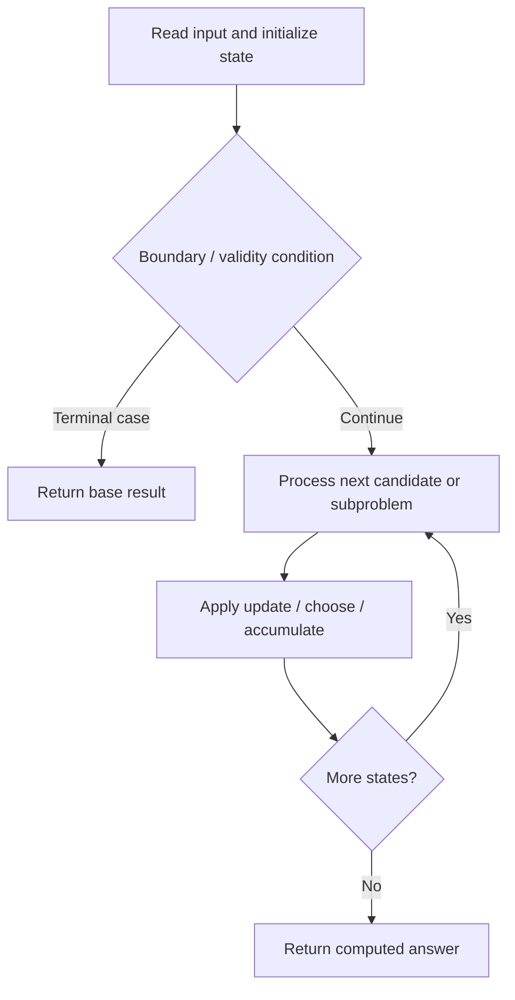

# 514. Freedom Trail

**Difficulty:** Hard  
**Concept family:** [Grid Paths and Geometric DP](https://github.com/gaurav1kr/Miscellaneous/blob/main/DSA/DP/DP_Mathematics_Master_Guide_Illustrated/Theory/Chapter-03.md)  
**Problem:** https://leetcode.com/problems/freedom-trail/  
**Original submission:** https://leetcode.com/submissions/detail/1595388676/

## Understand the mathematics first

This problem belongs to the study family **Grid Paths and Geometric DP**. Start by defining the objective and minimal sufficient state; inspect the code to identify the actual transitions.

### Related concept template (not necessarily this problem’s recurrence)

$$
F(i,j)=F(i-1,j)+F(i,j-1)
$$

**What this template illustrates:** For minimum cost paths, replace + of paths with min of predecessor costs, then add the current cell cost. Obstacles contribute zero ways.

**Derivation exercise:** Define exactly what each state variable means for this problem; list valid choices, base cases, and forbidden transitions. Check the submitted code against that invariant. The family template alone is not a substitute for a problem-specific proof.

## Code landmarks

- `if (dp[i][j] != -1) return dp[i][j];`
- `int dist = min(abs(i - k), m - abs(i - k));`
- `res = min(res, dist + dfs(k, j + 1));`

## Source-grounded algorithm walkthrough (expanded coverage)

> **Verification level:** The observations below are extracted from your actual Accepted C++ implementation. The symbolic trace is a **code-reading dry-run worksheet**, not a fabricated numerical run. The generic family formula above is not necessarily this problem's recurrence.

### 1. Identify the actual state and algorithm

**Problem:** 514. Freedom Trail. Recursive state transitions are present. Check memoization, state identity, termination, and whether branches are mutually exclusive.

| Role | C++ source line | Evidence from your solution |
|---|---:|---|
| Candidate state / accumulator | 11 | `vector<vector<int>> dp(m, vector<int>(n, -1));` |
| Candidate state / accumulator | 18 | `if (dp[i][j] != -1) return dp[i][j];` |
| Candidate state / accumulator | 19 | `int res = INT_MAX;` |
| Boundary / termination | 17 | `if (j == n) return 0;` |
| Boundary / termination | 18 | `if (dp[i][j] != -1) return dp[i][j];` |
| Traversal order | 13 | `for (int i = 0; i < m; ++i)` |
| Traversal order | 20 | `for (int k : pos[key[j]]) {` |
| Transition / update | 14 | `pos[ring[i]].push_back(i);` |
| Transition / update | 19 | `int res = INT_MAX;` |
| Transition / update | 21 | `int dist = min(abs(i - k), m - abs(i - k));` |
| Transition / update | 22 | `res = min(res, dist + dfs(k, j + 1));` |
| Return / result | 17 | `if (j == n) return 0;` |
| Return / result | 18 | `if (dp[i][j] != -1) return dp[i][j];` |

### 2. Trace the dependency chain



This is a **control-flow reading diagram**, not a claim about the exact shape of the mathematical state graph. Follow the code line numbers above to draw the actual dependency arrows.

### 3. Symbolic dry-run worksheet

| Stage | State to record | Mathematical question to answer |
|---|---|---|
| Initialize | Inputs, initialized containers/accumulators | What does the initial value mean? |
| First iteration / recursive call | Loop indices, branch, current state | Which predecessor states are available? |
| First update | Before → after for the updated variable | Why is this transition legal? Does it add, minimize, maximize, or overwrite? |
| Next iteration | Updated state and next candidate | Can a value be reused in this traversal order? |
| Finish | Return expression and its value | Why does this correspond to the problem's requested result? |

### 4. Mathematical explanation checklist

1. Define the exact meaning of each state variable, including all indices and constraints.
2. Translate the update expression into a mathematical equation **only after** establishing the state invariant.
3. Prove the transitions are exhaustive and do not double-count or reuse forbidden elements.
4. Check empty input, smallest input, impossible cases, and overflow/modulo behavior.
5. Compute a small numerical example using the actual problem constraints, then compare each row to the original C++.


---

## Your original Accepted C++ submission (unaltered)

```cpp
#include <string>
#include <vector>
#include <unordered_map>

using namespace std;

class Solution {
public:
    int findRotateSteps(string ring, string key) {
        int m = ring.size(), n = key.size();
        vector<vector<int>> dp(m, vector<int>(n, -1));
        unordered_map<char, vector<int>> pos;
        for (int i = 0; i < m; ++i)
            pos[ring[i]].push_back(i);

        function<int(int, int)> dfs = [&](int i, int j) -> int {
            if (j == n) return 0;
            if (dp[i][j] != -1) return dp[i][j];
            int res = INT_MAX;
            for (int k : pos[key[j]]) {
                int dist = min(abs(i - k), m - abs(i - k));
                res = min(res, dist + dfs(k, j + 1));
            }
            return dp[i][j] = res + 1;
        };

        return dfs(0, 0);
    }
};
```

## Time and Space Complexity

- **Time:** `Depends on operations (typically O(log n) per ordered-container operation)`
- **Auxiliary space:** `Depends on number of stored entries`

**Reasoning:** An ordered container or heap introduces logarithmic insertion, lookup, or removal costs; multiply by operation count.

**Status:** Code-informed complexity guidance; exact tight bounds have not been individually verified.
