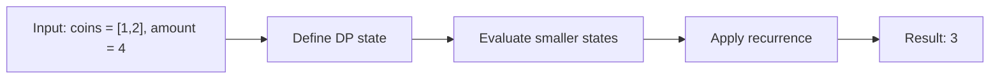

# 518. Coin Change II

**Difficulty:** Medium  
**Concept family:** [Take-or-Skip and Knapsack](https://github.com/gaurav1kr/Miscellaneous/blob/main/DSA/DP/DP_Mathematics_Master_Guide_Illustrated/Theory/Chapter-02.md)  
**Problem:** https://leetcode.com/problems/coin-change-ii/  
**Original submission:** https://leetcode.com/submissions/detail/1538695276/

## Understand the mathematics first

Count combinations by deciding how many of each denomination to use.

### Related concept template (not necessarily this problem’s recurrence)

$$
W(i,a)=W(i-1,a)+W(i,a-coin_i)
$$

**What this template illustrates:** The iteration order avoids counting different coin orders separately.

**Derivation exercise:** Define exactly what each state variable means for this problem; list valid choices, base cases, and forbidden transitions. Check the submitted code against that invariant. The family template alone is not a substitute for a problem-specific proof.

## Code landmarks

- `dp[0] = 1; // Base case: one way to make amount 0`
- `dp[i] += dp[i - coin];`
- `if (dp[i] > INT_MAX) dp[i] = INT_MAX;`

## Detailed dry run — Coin Change II: count combinations without permutations

### Start from the mathematical question

Let W(i,x) count ways to make x using only the first i coin types. W(i,0)=1.

### Derive the recurrence

```math
W(i,x)=W(i-1,x)+W(i,x-c_i)
```

**Why the transition is correct:** Either use no copy of the current coin or use at least one. Processing coin types outside the amount loop avoids counting the same combination in different orders.

### Concrete example

**Input:** `coins = [1,2], amount = 4`



**Evaluate the states in dependency order:**

| Coin types allowed | x=0 | x=1 | x=2 | x=3 | x=4 |
|---|---:|---:|---:|---:|---:|
| none | 1 | 0 | 0 | 0 | 0 |
| {1} | 1 | 1 | 1 | 1 | 1 |
| {1,2} | 1 | 1 | 2 | 2 | 3 |

**Expected result:** `3`.

### What to remember six months later

Explain (1) what one state means, (2) which earlier states it needs, (3) why those cases are exhaustive, and (4) why the answer is `3` for this input. Then inspect your preserved C++ solution below and match its variables to the mathematical states.

---

## Your original Accepted C++ submission (unaltered)

```cpp
class Solution {
public:
    int change(int amount, vector<int>& coins) {
        vector<long long> dp(amount + 1, 0); // Use long long to prevent overflow
        dp[0] = 1; // Base case: one way to make amount 0

        for (int coin : coins) {
            for (int i = coin; i <= amount; ++i) {
                dp[i] += dp[i - coin];
                // Handle overflow
                if (dp[i] > INT_MAX) dp[i] = INT_MAX;
            }
        }

        return dp[amount] > INT_MAX ? 0 : static_cast<int>(dp[amount]); // Return within int limits
    }
};
```

## Time and Space Complexity

- **Time:** `Depends on loop nesting and bounds`
- **Auxiliary space:** `Depends on auxiliary arrays/containers`

**Reasoning:** Count how many iterations each loop executes and whether loops are nested; do not assume all nested loops are quadratic.

**Status:** Code-informed complexity guidance; exact tight bounds have not been individually verified.
