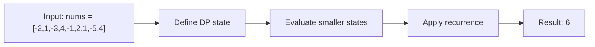

# 53. Maximum Subarray

**Difficulty:** Medium  
**Concept family:** [Digit DP, Counting and Probability](https://github.com/gaurav1kr/Miscellaneous/blob/main/DSA/DP/DP_Mathematics_Master_Guide_Illustrated/Theory/Chapter-11.md)  
**Problem:** https://leetcode.com/problems/maximum-subarray/  
**Original submission:** https://leetcode.com/submissions/detail/1588369208/

## Understand the mathematics first

A maximum subarray ending at i either starts here or extends the previous one.

### Problem-specific recurrence

Refer to the source-grounded algorithm walkthrough below for the state transitions used by your implementation. The generic family recurrence has been removed because it may not apply to this problem.

## Code landmarks

- `currentSum = max(nums[i], currentSum + nums[i]);`
- `maxSum = max(maxSum, currentSum);`

## Detailed dry run — Kadane: optimal subarray ending here

### Start from the mathematical question

Let E(i) be the largest sum of a nonempty contiguous subarray ending exactly at index i.

### Derive the recurrence

```math
E(i)=\max(a_i,\ E(i-1)+a_i)
```

**Why the transition is correct:** Every subarray ending at i either starts at i or extends a subarray ending at i−1.

### Concrete example

**Input:** `nums = [-2,1,-3,4,-1,2,1,-5,4]`



**Evaluate the states in dependency order:**

| i | a[i] | Best ending at i | Best seen |
|---|---:|---:|---:|
| 0 | -2 | -2 | -2 |
| 1 | 1 | max(1,-1)=1 | 1 |
| 2 | -3 | max(-3,-2)=-2 | 1 |
| 3 | 4 | max(4,2)=4 | 4 |
| 4 | -1 | max(-1,3)=3 | 4 |
| 5 | 2 | max(2,5)=5 | 5 |
| 6 | 1 | max(1,6)=6 | 6 |
| 7 | -5 | max(-5,1)=1 | 6 |
| 8 | 4 | max(4,5)=5 | 6 |

**Expected result:** `6`.

### What to remember six months later

Explain (1) what one state means, (2) which earlier states it needs, (3) why those cases are exhaustive, and (4) why the answer is `6` for this input. Then inspect your preserved C++ solution below and match its variables to the mathematical states.

---

## Your original Accepted C++ submission (unaltered)

```cpp
#include <vector>

using namespace std;

class Solution {
public:
    int maxSubArray(vector<int>& nums) {
        int maxSum = nums[0], currentSum = nums[0];
        for (int i = 1; i < nums.size(); i++) {
            currentSum = max(nums[i], currentSum + nums[i]);
            maxSum = max(maxSum, currentSum);
        }
        return maxSum;
    }
};
```

## Time and Space Complexity

- **Time:** `Depends on loop nesting and bounds`
- **Auxiliary space:** `Depends on auxiliary arrays/containers`

**Reasoning:** Count how many iterations each loop executes and whether loops are nested; do not assume all nested loops are quadratic.

**Status:** Code-informed complexity guidance; exact tight bounds have not been individually verified.
