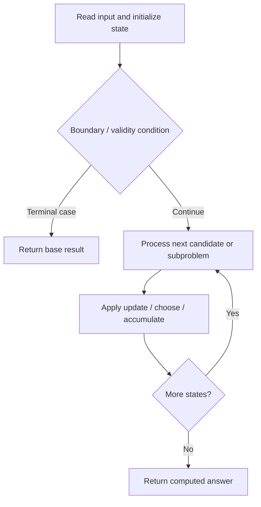

# 542. 01 Matrix

**Difficulty:** Medium  
**Concept family:** [Tree, Graph and DAG DP](https://github.com/gaurav1kr/Miscellaneous/blob/main/DSA/DP/DP_Mathematics_Master_Guide_Illustrated/Theory/Chapter-10.md)  
**Problem:** https://leetcode.com/problems/01-matrix/  
**Original submission:** https://leetcode.com/submissions/detail/1536039227/

## Understand the mathematics first

This problem belongs to the study family **Tree, Graph and DAG DP**. Start by defining the objective and minimal sufficient state; inspect the code to identify the actual transitions.

### Mathematical starting point

This family includes tree DP, DAG DP, shortest paths, and graph traversal. **There is no single recurrence for all these problems.** Identify the exact state and invariant from the algorithm below. For tree paths, distinguish the value returned to the parent from a complete answer within the subtree; for graph problems, establish whether edges form a DAG or whether shortest-path processing is required.

## Code landmarks

- `while (!q.empty()) {`

## Source-grounded algorithm walkthrough (expanded coverage)

> **Verification level:** The observations below are extracted from your actual Accepted C++ implementation. The symbolic trace is a **code-reading dry-run worksheet**, not a fabricated numerical run. The generic family formula above is not necessarily this problem's recurrence.

### 1. Identify the actual state and algorithm

**Problem:** 542. 01 Matrix. This solution does not expose an obvious `dp` or `memo` variable. Derive the algorithmic invariant from the code rather than assuming a DP recurrence.

| Role | C++ source line | Evidence from your solution |
|---|---:|---|
| Candidate state / accumulator | 5 | `vector<vector<int>> dist(rows, vector<int>(cols, INT_MAX));` |
| Boundary / termination | 11 | `if (mat[i][j] == 0) {` |
| Boundary / termination | 31 | `if (newRow >= 0 && newRow < rows && newCol >= 0 && newCol < cols) {` |
| Boundary / termination | 32 | `if (dist[newRow][newCol] > dist[curRow][curCol] + 1) {` |
| Traversal order | 9 | `for (int i = 0; i < rows; i++) {` |
| Traversal order | 10 | `for (int j = 0; j < cols; j++) {` |
| Traversal order | 22 | `while (!q.empty()) {` |
| Transition / update | — | No obvious matching statement; inspect the original C++ below. |
| Return / result | 40 | `return dist;` |

### 2. Trace the dependency chain



This is a **control-flow reading diagram**, not a claim about the exact shape of the mathematical state graph. Follow the code line numbers above to draw the actual dependency arrows.

### 3. Symbolic dry-run worksheet

| Stage | State to record | Mathematical question to answer |
|---|---|---|
| Initialize | Inputs, initialized containers/accumulators | What does the initial value mean? |
| First iteration / recursive call | Loop indices, branch, current state | Which predecessor states are available? |
| First update | Before → after for the updated variable | Why is this transition legal? Does it add, minimize, maximize, or overwrite? |
| Next iteration | Updated state and next candidate | Can a value be reused in this traversal order? |
| Finish | Return expression and its value | Why does this correspond to the problem's requested result? |

### 4. Mathematical explanation checklist

1. Define the exact meaning of each state variable, including all indices and constraints.
2. Translate the update expression into a mathematical equation **only after** establishing the state invariant.
3. Prove the transitions are exhaustive and do not double-count or reuse forbidden elements.
4. Check empty input, smallest input, impossible cases, and overflow/modulo behavior.
5. Compute a small numerical example using the actual problem constraints, then compare each row to the original C++.


---

## Your original Accepted C++ submission (unaltered)

```cpp
class Solution {
public:
   vector<vector<int>> updateMatrix(vector<vector<int>>& mat) {
    int rows = mat.size(), cols = mat[0].size();
    vector<vector<int>> dist(rows, vector<int>(cols, INT_MAX));
    queue<pair<int, int>> q;

    // Step 1: Initialize the queue with all 0 cells
    for (int i = 0; i < rows; i++) {
        for (int j = 0; j < cols; j++) {
            if (mat[i][j] == 0) {
                dist[i][j] = 0;
                q.push({i, j});
            }
        }
    }

    // Step 2: Directions array for exploring neighbors
    vector<pair<int, int>> directions = {{1, 0}, {-1, 0}, {0, 1}, {0, -1}};

    // Step 3: Perform BFS
    while (!q.empty()) {
        auto [curRow, curCol] = q.front();
        q.pop();

        for (auto [dr, dc] : directions) {
            int newRow = curRow + dr;
            int newCol = curCol + dc;

            // Check if the new cell is within bounds and can be updated
            if (newRow >= 0 && newRow < rows && newCol >= 0 && newCol < cols) {
                if (dist[newRow][newCol] > dist[curRow][curCol] + 1) {
                    dist[newRow][newCol] = dist[curRow][curCol] + 1;
                    q.push({newRow, newCol}); // Add the updated cell to the queue
                }
            }
        }
    }

    return dist;
}
};
```

## Interview self-check

1. What is the smallest state that determines the remaining answer?
2. Why are the transitions exhaustive and valid?
3. What is the exact base case, including empty and impossible cases?
4. What is the time complexity (states × work per state)?
5. Can the memory be compressed without overwriting needed dependencies?
