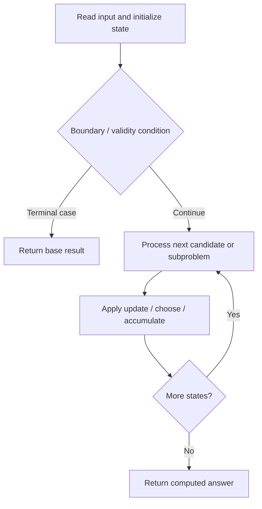

# 546. Remove Boxes

**Difficulty:** Hard  
**Concept family:** [Interval and Partition DP](https://github.com/gaurav1kr/Miscellaneous/blob/main/DSA/DP/DP_Mathematics_Master_Guide_Illustrated/Theory/Chapter-06.md)  
**Problem:** https://leetcode.com/problems/remove-boxes/  
**Original submission:** https://leetcode.com/submissions/detail/1590161113/

## Understand the mathematics first

This problem belongs to the study family **Interval and Partition DP**. Start by defining the objective and minimal sufficient state; inspect the code to identify the actual transitions.

### Problem-specific recurrence

Refer to the source-grounded algorithm walkthrough below for the state transitions used by your implementation. The generic family recurrence has been removed because it may not apply to this problem.

## Code landmarks

- `int solve(int l , int r , vector < int > & boxes , int k , int dp[101][101][101]){`
- `if(dp[l][r][k_here] >= 0) return dp[l][r][k];`
- `ans = max(ans , solve(m , r, boxes , k+1 , dp) + solve(l+1 , m-1 , boxes , 0 , dp));`

## Source-grounded algorithm walkthrough (expanded coverage)

> **Verification level:** The observations below are extracted from your actual Accepted C++ implementation. The symbolic trace is a **code-reading dry-run worksheet**, not a fabricated numerical run. The generic family formula above is not necessarily this problem's recurrence.

### 1. Identify the actual state and algorithm

**Problem:** 546. Remove Boxes. Recursive state transitions are present. Check memoization, state identity, termination, and whether branches are mutually exclusive.

| Role | C++ source line | Evidence from your solution |
|---|---:|---|
| Candidate state / accumulator | 5 | `int solve(int l , int r , vector < int > & boxes , int k , int dp[101][101][101]){` |
| Candidate state / accumulator | 12 | `if(dp[l][r][k_here] >= 0) return dp[l][r][k];` |
| Candidate state / accumulator | 20 | `int ans = (k+1)*(k+1) + solve(l+1 , r , boxes , 0 , dp);` |
| Boundary / termination | 7 | `if(l > r) return 0;` |
| Boundary / termination | 12 | `if(dp[l][r][k_here] >= 0) return dp[l][r][k];` |
| Boundary / termination | 24 | `if(boxes[l] == boxes[m]){` |
| Traversal order | 14 | `while(l+1 <= r && boxes[l] == boxes[l+1])` |
| Traversal order | 22 | `for(int m = l+1 ; m <=r ; m++)` |
| Transition / update | 20 | `int ans = (k+1)*(k+1) + solve(l+1 , r , boxes , 0 , dp);` |
| Transition / update | 26 | `ans = max(ans , solve(m , r, boxes , k+1 , dp) + solve(l+1 , m-1 , boxes , 0 , dp));` |
| Transition / update | 31 | `return dp[l_here][r][k_here] = ans;` |
| Return / result | 7 | `if(l > r) return 0;` |
| Return / result | 12 | `if(dp[l][r][k_here] >= 0) return dp[l][r][k];` |

### 2. Trace the dependency chain



This is a **control-flow reading diagram**, not a claim about the exact shape of the mathematical state graph. Follow the code line numbers above to draw the actual dependency arrows.

### 3. Symbolic dry-run worksheet

| Stage | State to record | Mathematical question to answer |
|---|---|---|
| Initialize | Inputs, initialized containers/accumulators | What does the initial value mean? |
| First iteration / recursive call | Loop indices, branch, current state | Which predecessor states are available? |
| First update | Before → after for the updated variable | Why is this transition legal? Does it add, minimize, maximize, or overwrite? |
| Next iteration | Updated state and next candidate | Can a value be reused in this traversal order? |
| Finish | Return expression and its value | Why does this correspond to the problem's requested result? |

### 4. Mathematical explanation checklist

1. Define the exact meaning of each state variable, including all indices and constraints.
2. Translate the update expression into a mathematical equation **only after** establishing the state invariant.
3. Prove the transitions are exhaustive and do not double-count or reuse forbidden elements.
4. Check empty input, smallest input, impossible cases, and overflow/modulo behavior.
5. Compute a small numerical example using the actual problem constraints, then compare each row to the original C++.


---

## Your original Accepted C++ submission (unaltered)

```cpp
class Solution 
{
public:

    int solve(int l , int r , vector < int > & boxes , int k , int dp[101][101][101]){
       
        if(l > r) return 0; 

        int k_here = k; 
        int l_here = l; 

        if(dp[l][r][k_here] >= 0) return dp[l][r][k];  

        while(l+1 <= r && boxes[l] == boxes[l+1]) 
        {
            k++; 
            l++; 
        }

        int ans = (k+1)*(k+1) + solve(l+1 , r , boxes , 0 , dp); 

        for(int m = l+1 ; m <=r ; m++)
        {
            if(boxes[l] == boxes[m]){

                ans = max(ans , solve(m , r, boxes , k+1 , dp) + solve(l+1 , m-1 , boxes , 0 , dp)); 

            }
        }

        return dp[l_here][r][k_here] = ans; 
    }
    int removeBoxes(vector<int>& boxes) 
    {
        int dp[101][101][101]; 
        memset(dp , -1 , sizeof(dp)); 
        int n = boxes.size(); 
        return solve(0 , n-1 , boxes , 0 , dp);     
    }
};
```

## Time and Space Complexity

- **Time:** `O(number of reachable states × work per state), if memoized`
- **Auxiliary space:** `O(number of memoized states + recursion depth)`

**Reasoning:** Count distinct memo keys and transitions. Without effective memoization, recursive branching can be exponential.

**Status:** Code-informed complexity guidance; exact tight bounds have not been individually verified.
