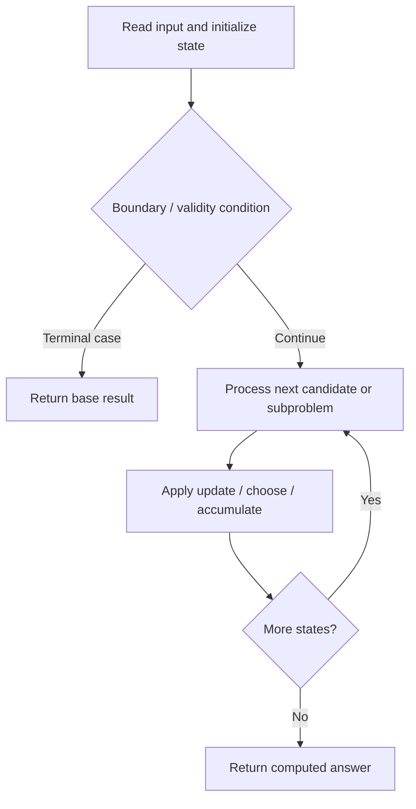

# 576. Out of Boundary Paths

**Difficulty:** Medium  
**Concept family:** [Grid Paths and Geometric DP](https://github.com/gaurav1kr/Miscellaneous/blob/main/DSA/DP/DP_Mathematics_Master_Guide_Illustrated/Theory/Chapter-03.md)  
**Problem:** https://leetcode.com/problems/out-of-boundary-paths/  
**Original submission:** https://leetcode.com/submissions/detail/1590164929/

## Understand the mathematics first

This problem belongs to the study family **Grid Paths and Geometric DP**. Start by defining the objective and minimal sufficient state; inspect the code to identify the actual transitions.

### Problem-specific recurrence

Refer to the source-grounded algorithm walkthrough below for the state transitions used by your implementation. The generic family recurrence has been removed because it may not apply to this problem.

## Code landmarks

- `int dp[55][55][55];`
- `if(dp[i][j][moves] != -1)`
- `return dp[i][j][moves];`

## Source-grounded algorithm walkthrough (expanded coverage)

> **Verification level:** The observations below are extracted from your actual Accepted C++ implementation. The symbolic trace is a **code-reading dry-run worksheet**, not a fabricated numerical run. The generic family formula above is not necessarily this problem's recurrence.

### 1. Identify the actual state and algorithm

**Problem:** 576. Out of Boundary Paths. Recursive state transitions are present. Check memoization, state identity, termination, and whether branches are mutually exclusive.

| Role | C++ source line | Evidence from your solution |
|---|---:|---|
| Candidate state / accumulator | 3 | `int dp[55][55][55];` |
| Candidate state / accumulator | 15 | `if(dp[i][j][moves] != -1)` |
| Candidate state / accumulator | 16 | `return dp[i][j][moves];` |
| Boundary / termination | 9 | `if(i < 0 \|\| i >= n \|\| j < 0 \|\| j >= m)` |
| Boundary / termination | 10 | `return 1;` |
| Boundary / termination | 12 | `if(moves <= 0)` |
| Traversal order | — | No obvious matching statement; inspect the original C++ below. |
| Transition / update | 23 | `return dp[i][j][moves] = (up % mod + down % mod + left % mod + right % mod) % mod;` |
| Return / result | 10 | `return 1;` |
| Return / result | 13 | `return 0;` |

### 2. Trace the dependency chain



This is a **control-flow reading diagram**, not a claim about the exact shape of the mathematical state graph. Follow the code line numbers above to draw the actual dependency arrows.

### 3. Symbolic dry-run worksheet

| Stage | State to record | Mathematical question to answer |
|---|---|---|
| Initialize | Inputs, initialized containers/accumulators | What does the initial value mean? |
| First iteration / recursive call | Loop indices, branch, current state | Which predecessor states are available? |
| First update | Before → after for the updated variable | Why is this transition legal? Does it add, minimize, maximize, or overwrite? |
| Next iteration | Updated state and next candidate | Can a value be reused in this traversal order? |
| Finish | Return expression and its value | Why does this correspond to the problem's requested result? |

### 4. Mathematical explanation checklist

1. Define the exact meaning of each state variable, including all indices and constraints.
2. Translate the update expression into a mathematical equation **only after** establishing the state invariant.
3. Prove the transitions are exhaustive and do not double-count or reuse forbidden elements.
4. Check empty input, smallest input, impossible cases, and overflow/modulo behavior.
5. Compute a small numerical example using the actual problem constraints, then compare each row to the original C++.


---

## Your original Accepted C++ submission (unaltered)

```cpp
class Solution {
public:
    int dp[55][55][55];
    long long mod = 1e9 + 7;
    
    int dfs(int i, int j, int n, int m, int moves)
    {
        
        if(i < 0 || i >= n || j < 0 || j >= m)
            return 1;
        
        if(moves <= 0)
            return 0;
        
        if(dp[i][j][moves] != -1)
            return dp[i][j][moves];
        
        int up = dfs(i - 1, j, n, m, moves - 1);
        int down = dfs(i + 1, j, n, m, moves - 1);
        int left = dfs(i, j - 1, n, m, moves - 1);
        int right = dfs(i, j + 1, n, m, moves - 1);
        
        return dp[i][j][moves] = (up % mod + down % mod + left % mod + right % mod) % mod;
    }
    
    int findPaths(int n, int m, int maxMove, int startRow, int startColumn) {
        memset(dp, -1, sizeof(dp));
        return dfs(startRow, startColumn, n, m, maxMove);
    }
};
```

## Time and Space Complexity

- **Time:** `O(number of reachable states × work per state), if memoized`
- **Auxiliary space:** `O(number of memoized states + recursion depth)`

**Reasoning:** Count distinct memo keys and transitions. Without effective memoization, recursive branching can be exponential.

**Status:** Code-informed complexity guidance; exact tight bounds have not been individually verified.
