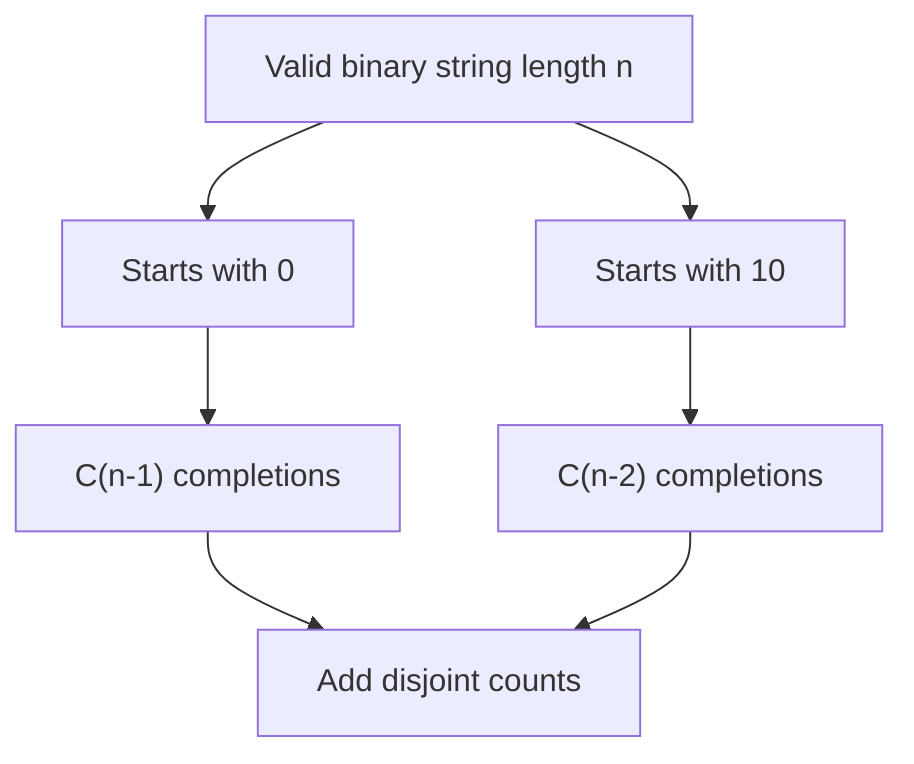
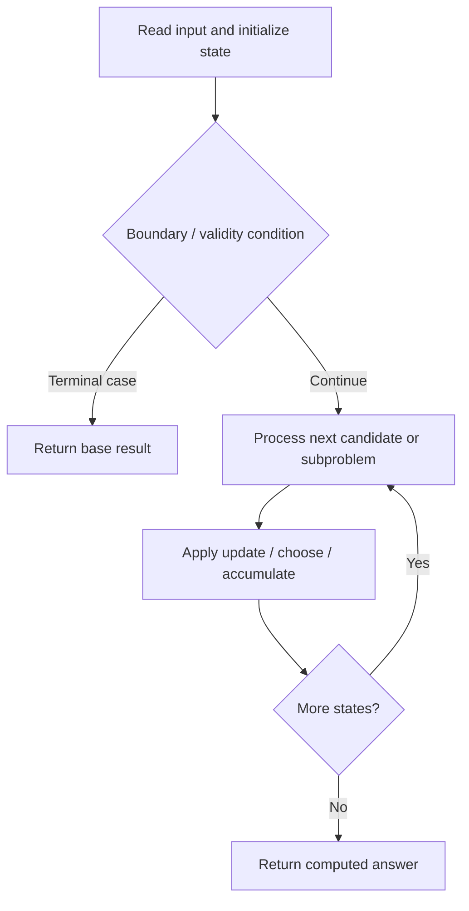

# 600. Non-negative Integers without Consecutive Ones

**Difficulty:** Hard  
**Concept family:** [Digit DP, Counting and Probability](https://github.com/gaurav1kr/Miscellaneous/blob/main/DSA/DP/DP_Mathematics_Master_Guide_Illustrated/Theory/Chapter-11.md)  
**Problem:** https://leetcode.com/problems/non-negative-integers-without-consecutive-ones/  
**Original submission:** https://leetcode.com/submissions/detail/1593694865/

## Understand the mathematics first

This problem belongs to the study family **Digit DP, Counting and Probability**. Start by defining the objective and minimal sufficient state; inspect the code to identify the actual transitions.

### Problem-specific recurrence

Refer to the source-grounded algorithm walkthrough below for the state transitions used by your implementation. The generic family recurrence has been removed because it may not apply to this problem.

## Code landmarks

- `dp[0] = 1;`
- `dp[1] = 2;`
- `dp[i] = dp[i - 1] + dp[i - 2];`

## Worked mathematical walkthrough (illustrated)

**State:** C(n): binary strings of length n without adjacent ones.

**Transition:** `C(n)=C(n-1)+C(n-2), with C(0)=1 and C(1)=2`

**Why:** Split valid strings by their beginning: starting with 0 leaves n-1 unrestricted valid positions; starting with 10 leaves n-2. Counting numbers ≤N adds a tight-bound condition.



**Hand calculation:** Length 3 strings: 000,001,010,100,101. Thus C(3)=5.

**Six-month revision test:** Without looking at the code, reconstruct the state, enumerate the legal choices, and justify why this transition does not miss or double-count any answer.

---

## Source-grounded algorithm walkthrough (expanded coverage)

> **Verification level:** The observations below are extracted from your actual Accepted C++ implementation. The symbolic trace is a **code-reading dry-run worksheet**, not a fabricated numerical run. The generic family formula above is not necessarily this problem's recurrence.

### 1. Identify the actual state and algorithm

**Problem:** 600. Non-negative Integers without Consecutive Ones. An explicit state table or memo is present. Interpret each index as a mathematical state and every update as a transition.

| Role | C++ source line | Evidence from your solution |
|---|---:|---|
| Candidate state / accumulator | 4 | `vector<int> dp(31, 0);` |
| Candidate state / accumulator | 5 | `dp[0] = 1;` |
| Candidate state / accumulator | 6 | `dp[1] = 2;` |
| Boundary / termination | 5 | `dp[0] = 1;` |
| Boundary / termination | 13 | `if ((n & (1 << i)) != 0) {` |
| Boundary / termination | 15 | `if (prevBit) return res;` |
| Traversal order | 8 | `for (int i = 2; i < 31; ++i)` |
| Traversal order | 12 | `for (int i = 29; i >= 0; --i) {` |
| Transition / update | 5 | `dp[0] = 1;` |
| Transition / update | 6 | `dp[1] = 2;` |
| Transition / update | 9 | `dp[i] = dp[i - 1] + dp[i - 2];` |
| Transition / update | 11 | `int res = 0, prevBit = 0;` |
| Return / result | 15 | `if (prevBit) return res;` |
| Return / result | 22 | `return res + 1;` |

### 2. Trace the dependency chain



This is a **control-flow reading diagram**, not a claim about the exact shape of the mathematical state graph. Follow the code line numbers above to draw the actual dependency arrows.

### 3. Symbolic dry-run worksheet

| Stage | State to record | Mathematical question to answer |
|---|---|---|
| Initialize | Inputs, initialized containers/accumulators | What does the initial value mean? |
| First iteration / recursive call | Loop indices, branch, current state | Which predecessor states are available? |
| First update | Before → after for the updated variable | Why is this transition legal? Does it add, minimize, maximize, or overwrite? |
| Next iteration | Updated state and next candidate | Can a value be reused in this traversal order? |
| Finish | Return expression and its value | Why does this correspond to the problem's requested result? |

### 4. Mathematical explanation checklist

1. Define the exact meaning of each state variable, including all indices and constraints.
2. Translate the update expression into a mathematical equation **only after** establishing the state invariant.
3. Prove the transitions are exhaustive and do not double-count or reuse forbidden elements.
4. Check empty input, smallest input, impossible cases, and overflow/modulo behavior.
5. Compute a small numerical example using the actual problem constraints, then compare each row to the original C++.


---

## Your original Accepted C++ submission (unaltered)

```cpp
class Solution {
public:
    int findIntegers(int n) {
        vector<int> dp(31, 0);
        dp[0] = 1;
        dp[1] = 2;

        for (int i = 2; i < 31; ++i)
            dp[i] = dp[i - 1] + dp[i - 2];

        int res = 0, prevBit = 0;
        for (int i = 29; i >= 0; --i) {
            if ((n & (1 << i)) != 0) {
                res += dp[i];
                if (prevBit) return res;
                prevBit = 1;
            } else {
                prevBit = 0;
            }
        }

        return res + 1;
    }
};
```

## Time and Space Complexity

- **Time:** `Depends on loop nesting and bounds`
- **Auxiliary space:** `Depends on auxiliary arrays/containers`

**Reasoning:** Count how many iterations each loop executes and whether loops are nested; do not assume all nested loops are quadratic.

**Status:** Code-informed complexity guidance; exact tight bounds have not been individually verified.
