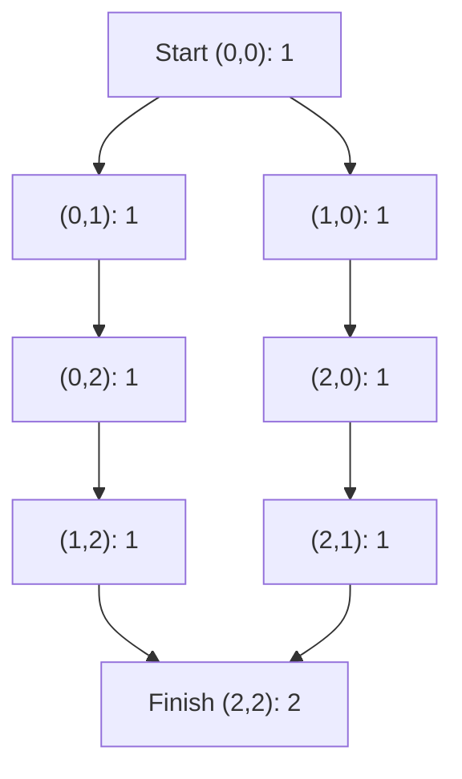

# 63. Unique Paths II

**Difficulty:** Medium  
**Concept family:** [Grid Paths and Geometric DP](https://github.com/gaurav1kr/Miscellaneous/blob/main/DSA/DP/DP_Mathematics_Master_Guide_Illustrated/Theory/Chapter-03.md)  
**Problem:** https://leetcode.com/problems/unique-paths-ii/  
**Original submission:** https://leetcode.com/submissions/detail/1536202601/

## Understand the mathematics first

Each unblocked cell inherits paths from top and left.

### Related concept template (not necessarily this problem’s recurrence)

$$
W(i,j)=W(i-1,j)+W(i,j-1)
$$

**What this template illustrates:** Obstacles force W(i,j)=0; one-row compression.

**Derivation exercise:** Define exactly what each state variable means for this problem; list valid choices, base cases, and forbidden transitions. Check the submitted code against that invariant. The family template alone is not a substitute for a problem-specific proof.

## Code landmarks

- `dp[0] = 1; // Start point`
- `dp[j] = 0; // No path through an obstacle`
- `dp[j] += dp[j - 1]; // Add paths from the left cell`

## Worked mathematical walkthrough (illustrated)

**State:** Number of valid routes ending at cell r,c.

**Transition:** `P(r,c)=P(r-1,c)+P(r,c-1) for unblocked cells; otherwise 0`

**Why:** Every arrival comes from above or left. Since the last move is different, the two sets of paths do not overlap. Blocked cells contribute zero.



**Hand calculation:** 3×3 grid with obstacle at (1,1): row 0 = [1,1,1]; row 1 = [1,0,1]; row 2 = [1,1,2]. Answer 2.

**Six-month revision test:** Without looking at the code, reconstruct the state, enumerate the legal choices, and justify why this transition does not miss or double-count any answer.

---

## Detailed dry run — Unique Paths II: blocked states contribute zero

### Start from the mathematical question

Let W(r,c) count legal paths to (r,c); an obstacle removes all paths through its cell.

### Derive the recurrence

```math
W(r,c)=\begin{cases}0 & obstacle(r,c)\\W(r-1,c)+W(r,c-1)& otherwise\end{cases}
```

**Why the transition is correct:** The same last-step counting recurrence works, except invalid states have zero ways. The in-place 1D update preserves the previous-row count until it is overwritten.

### Concrete example

**Input:** `grid = [[0,0,0],[0,1,0],[0,0,0]]`


**Evaluate the states in dependency order:**

| Row/col | c=0 | c=1 | c=2 |
|---|---:|---:|---:|
| r=0 | 1 | 1 | 1 |
| r=1 | 1 | 0 (blocked) | 1 |
| r=2 | 1 | 1 | 2 |

**Expected result:** `2`.

### What to remember six months later

Explain (1) what one state means, (2) which earlier states it needs, (3) why those cases are exhaustive, and (4) why the answer is `2` for this input. Then inspect your preserved C++ solution below and match its variables to the mathematical states.

---

## Your original Accepted C++ submission (unaltered)

```cpp
class Solution 
{
public:
    int uniquePathsWithObstacles(vector<vector<int>>& obstacleGrid) 
    {
        int m = obstacleGrid.size();
        int n = obstacleGrid[0].size();
        
        // If the starting point or ending point is blocked, no paths are possible
        if (obstacleGrid[0][0] == 1 || obstacleGrid[m-1][n-1] == 1) 
        {
            return 0;
        }
        
        // DP array to store the number of ways to reach each cell in the current row
        vector<int> dp(n, 0);
        dp[0] = 1; // Start point
        
        for (int i = 0; i < m; ++i) 
        {
            for (int j = 0; j < n; ++j) 
            {
                if (obstacleGrid[i][j] == 1) 
                {
                    dp[j] = 0; // No path through an obstacle
                } 
                else if (j > 0) 
                {
                    dp[j] += dp[j - 1]; // Add paths from the left cell
                }
            }
        }
        
        return dp[n - 1];
    }
};
```

## Time and Space Complexity

- **Time:** `Depends on table dimensions and transitions per cell`
- **Auxiliary space:** `O(rows × columns) for the allocated table`

**Reasoning:** The two-dimensional table determines memory; time is its state count multiplied by work per state.

**Status:** Code-informed complexity guidance; exact tight bounds have not been individually verified.
