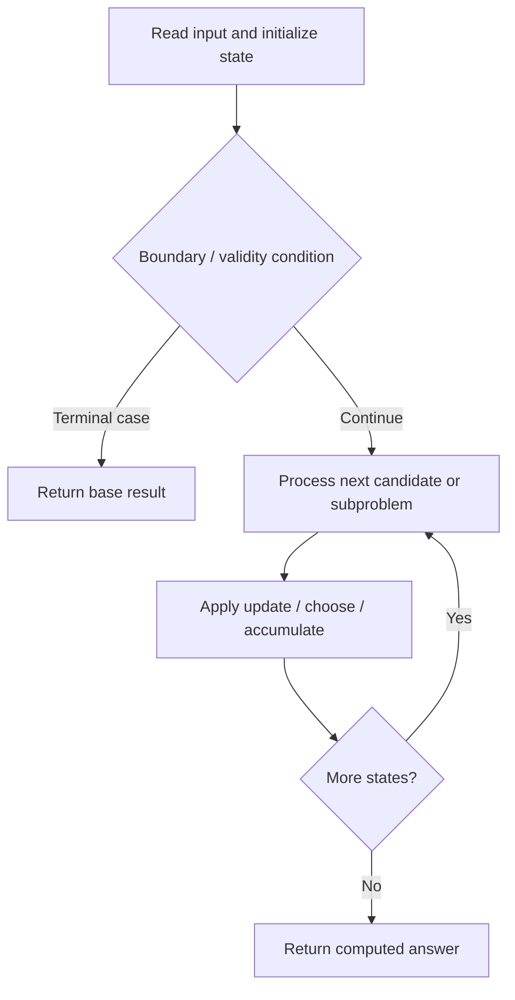

# 638. Shopping Offers

**Difficulty:** Medium  
**Concept family:** [Take-or-Skip and Knapsack](https://github.com/gaurav1kr/Miscellaneous/blob/main/DSA/DP/DP_Mathematics_Master_Guide_Illustrated/Theory/Chapter-02.md)  
**Problem:** https://leetcode.com/problems/shopping-offers/  
**Original submission:** https://leetcode.com/submissions/detail/1612881823/

## Understand the mathematics first

This problem belongs to the study family **Take-or-Skip and Knapsack**. Start by defining the objective and minimal sufficient state; inspect the code to identify the actual transitions.

### Related concept template (not necessarily this problem’s recurrence)

$$
F(i,c)=\max(F(i-1,c),v_i+F(i-1,c-w_i))
$$

**What this template illustrates:** Only use the take branch when the remaining capacity is feasible. Counting versions use addition; feasibility versions use logical OR.

**Derivation exercise:** Define exactly what each state variable means for this problem; list valid choices, base cases, and forbidden transitions. Check the submitted code against that invariant. The family template alone is not a substitute for a problem-specific proof.

## Code landmarks

- `if (memo.count(key)) return memo[key];`
- `res = min(res, sp.back() + dfs(price, special, temp));`
- `return memo[key] = res;`

## Source-grounded algorithm walkthrough (expanded coverage)

> **Verification level:** The observations below are extracted from your actual Accepted C++ implementation. The symbolic trace is a **code-reading dry-run worksheet**, not a fabricated numerical run. The generic family formula above is not necessarily this problem's recurrence.

### 1. Identify the actual state and algorithm

**Problem:** 638. Shopping Offers. Recursive state transitions are present. Check memoization, state identity, termination, and whether branches are mutually exclusive.

| Role | C++ source line | Evidence from your solution |
|---|---:|---|
| Candidate state / accumulator | 2 | `unordered_map<string, int> memo;` |
| Candidate state / accumulator | 6 | `if (memo.count(key)) return memo[key];` |
| Candidate state / accumulator | 8 | `int res = 0;` |
| Boundary / termination | 6 | `if (memo.count(key)) return memo[key];` |
| Boundary / termination | 15 | `if (temp[i] < sp[i]) break;` |
| Boundary / termination | 18 | `if (i == needs.size()) {` |
| Traversal order | 5 | `for (int n : needs) key += to_string(n) + ",";` |
| Traversal order | 9 | `for (int i = 0; i < price.size(); i++) res += price[i] * needs[i];` |
| Traversal order | 11 | `for (auto& sp : special) {` |
| Transition / update | 8 | `int res = 0;` |
| Transition / update | 9 | `for (int i = 0; i < price.size(); i++) res += price[i] * needs[i];` |
| Transition / update | 19 | `res = min(res, sp.back() + dfs(price, special, temp));` |
| Transition / update | 22 | `return memo[key] = res;` |
| Return / result | 6 | `if (memo.count(key)) return memo[key];` |
| Return / result | 22 | `return memo[key] = res;` |

### 2. Trace the dependency chain



This is a **control-flow reading diagram**, not a claim about the exact shape of the mathematical state graph. Follow the code line numbers above to draw the actual dependency arrows.

### 3. Symbolic dry-run worksheet

| Stage | State to record | Mathematical question to answer |
|---|---|---|
| Initialize | Inputs, initialized containers/accumulators | What does the initial value mean? |
| First iteration / recursive call | Loop indices, branch, current state | Which predecessor states are available? |
| First update | Before → after for the updated variable | Why is this transition legal? Does it add, minimize, maximize, or overwrite? |
| Next iteration | Updated state and next candidate | Can a value be reused in this traversal order? |
| Finish | Return expression and its value | Why does this correspond to the problem's requested result? |

### 4. Mathematical explanation checklist

1. Define the exact meaning of each state variable, including all indices and constraints.
2. Translate the update expression into a mathematical equation **only after** establishing the state invariant.
3. Prove the transitions are exhaustive and do not double-count or reuse forbidden elements.
4. Check empty input, smallest input, impossible cases, and overflow/modulo behavior.
5. Compute a small numerical example using the actual problem constraints, then compare each row to the original C++.


---

## Your original Accepted C++ submission (unaltered)

```cpp
class Solution {
    unordered_map<string, int> memo;
    int dfs(vector<int>& price, vector<vector<int>>& special, vector<int> needs) {
        string key = "";
        for (int n : needs) key += to_string(n) + ",";
        if (memo.count(key)) return memo[key];
        
        int res = 0;
        for (int i = 0; i < price.size(); i++) res += price[i] * needs[i];

        for (auto& sp : special) {
            vector<int> temp = needs;
            int i = 0;
            for (; i < needs.size(); i++) {
                if (temp[i] < sp[i]) break;
                temp[i] -= sp[i];
            }
            if (i == needs.size()) {
                res = min(res, sp.back() + dfs(price, special, temp));
            }
        }
        return memo[key] = res;
    }

public:
    int shoppingOffers(vector<int>& price, vector<vector<int>>& special, vector<int>& needs) {
        return dfs(price, special, needs);
    }
};
```

## Time and Space Complexity

- **Time:** `Depends on operations (typically O(log n) per ordered-container operation)`
- **Auxiliary space:** `Depends on number of stored entries`

**Reasoning:** An ordered container or heap introduces logarithmic insertion, lookup, or removal costs; multiply by operation count.

**Status:** Code-informed complexity guidance; exact tight bounds have not been individually verified.
