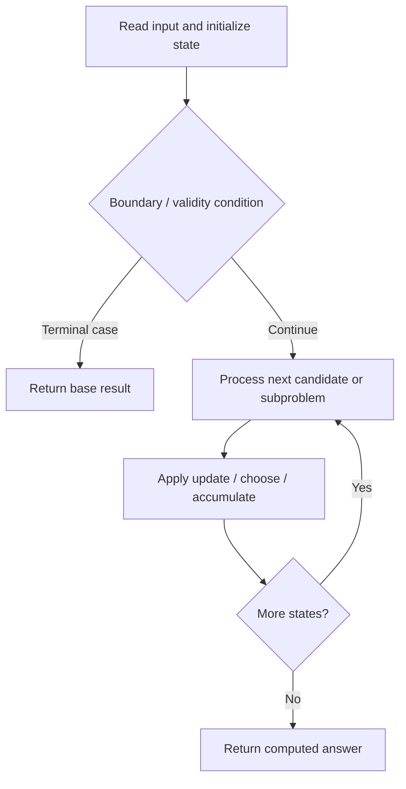

# 639. Decode Ways II

**Difficulty:** Hard  
**Concept family:** [Mathematical Recurrences and Combinatorics](https://github.com/gaurav1kr/Miscellaneous/blob/main/DSA/DP/DP_Mathematics_Master_Guide_Illustrated/Theory/Chapter-01.md)  
**Problem:** https://leetcode.com/problems/decode-ways-ii/  
**Original submission:** https://leetcode.com/submissions/detail/1593697005/

## Understand the mathematics first

This problem belongs to the study family **Mathematical Recurrences and Combinatorics**. Start by defining the objective and minimal sufficient state; inspect the code to identify the actual transitions.

### Related concept template (not necessarily this problem’s recurrence)

$$
F(n)=\sum_{c\in Choices(n)}F(next(n,c))
$$

**What this template illustrates:** For counting, add disjoint cases. For optimization, replace sum with min or max. Base cases must express empty structures correctly.

**Derivation exercise:** Define exactly what each state variable means for this problem; list valid choices, base cases, and forbidden transitions. Check the submitted code against that invariant. The family template alone is not a substitute for a problem-specific proof.

## Code landmarks

- `dp[0] = 1;`
- `dp[1] = s[0] == '0' ? 0 : (s[0] == '*' ? 9 : 1);`
- `dp[i] = (dp[i] + 9 * dp[i - 1]) % MOD;`

## Source-grounded algorithm walkthrough (expanded coverage)

> **Verification level:** The observations below are extracted from your actual Accepted C++ implementation. The symbolic trace is a **code-reading dry-run worksheet**, not a fabricated numerical run. The generic family formula above is not necessarily this problem's recurrence.

### 1. Identify the actual state and algorithm

**Problem:** 639. Decode Ways II. An explicit state table or memo is present. Interpret each index as a mathematical state and every update as a transition.

| Role | C++ source line | Evidence from your solution |
|---|---:|---|
| Candidate state / accumulator | 11 | `vector<long long> dp(n + 1, 0);` |
| Candidate state / accumulator | 12 | `dp[0] = 1;` |
| Candidate state / accumulator | 13 | `dp[1] = s[0] == '0' ? 0 : (s[0] == '*' ? 9 : 1);` |
| Boundary / termination | 12 | `dp[0] = 1;` |
| Boundary / termination | 18 | `if (c2 == '*') {` |
| Boundary / termination | 20 | `} else if (c2 != '0') {` |
| Traversal order | 15 | `for (int i = 2; i <= n; ++i) {` |
| Transition / update | 12 | `dp[0] = 1;` |
| Transition / update | 13 | `dp[1] = s[0] == '0' ? 0 : (s[0] == '*' ? 9 : 1);` |
| Transition / update | 19 | `dp[i] = (dp[i] + 9 * dp[i - 1]) % MOD;` |
| Transition / update | 21 | `dp[i] = (dp[i] + dp[i - 1]) % MOD;` |
| Return / result | 41 | `return dp[n];` |

### 2. Trace the dependency chain



This is a **control-flow reading diagram**, not a claim about the exact shape of the mathematical state graph. Follow the code line numbers above to draw the actual dependency arrows.

### 3. Symbolic dry-run worksheet

| Stage | State to record | Mathematical question to answer |
|---|---|---|
| Initialize | Inputs, initialized containers/accumulators | What does the initial value mean? |
| First iteration / recursive call | Loop indices, branch, current state | Which predecessor states are available? |
| First update | Before → after for the updated variable | Why is this transition legal? Does it add, minimize, maximize, or overwrite? |
| Next iteration | Updated state and next candidate | Can a value be reused in this traversal order? |
| Finish | Return expression and its value | Why does this correspond to the problem's requested result? |

### 4. Mathematical explanation checklist

1. Define the exact meaning of each state variable, including all indices and constraints.
2. Translate the update expression into a mathematical equation **only after** establishing the state invariant.
3. Prove the transitions are exhaustive and do not double-count or reuse forbidden elements.
4. Check empty input, smallest input, impossible cases, and overflow/modulo behavior.
5. Compute a small numerical example using the actual problem constraints, then compare each row to the original C++.


---

## Your original Accepted C++ submission (unaltered)

```cpp
#include <string>
#include <vector>

using namespace std;

class Solution {
public:
    int numDecodings(string s) {
        const int MOD = 1e9 + 7;
        int n = s.size();
        vector<long long> dp(n + 1, 0);
        dp[0] = 1;
        dp[1] = s[0] == '0' ? 0 : (s[0] == '*' ? 9 : 1);

        for (int i = 2; i <= n; ++i) {
            char c1 = s[i - 2], c2 = s[i - 1];

            if (c2 == '*') {
                dp[i] = (dp[i] + 9 * dp[i - 1]) % MOD;
            } else if (c2 != '0') {
                dp[i] = (dp[i] + dp[i - 1]) % MOD;
            }

            if (c1 == '1') {
                if (c2 == '*') dp[i] = (dp[i] + 9 * dp[i - 2]) % MOD;
                else dp[i] = (dp[i] + dp[i - 2]) % MOD;
            } else if (c1 == '2') {
                if (c2 == '*') dp[i] = (dp[i] + 6 * dp[i - 2]) % MOD;
                else if (c2 <= '6') dp[i] = (dp[i] + dp[i - 2]) % MOD;
            } else if (c1 == '*') {
                if (c2 == '*') {
                    dp[i] = (dp[i] + 15 * dp[i - 2]) % MOD;
                } else if (c2 <= '6') {
                    dp[i] = (dp[i] + 2 * dp[i - 2]) % MOD;
                } else {
                    dp[i] = (dp[i] + dp[i - 2]) % MOD;
                }
            }
        }

        return dp[n];
    }
};
```

## Time and Space Complexity

- **Time:** `Depends on loop nesting and bounds`
- **Auxiliary space:** `Depends on auxiliary arrays/containers`

**Reasoning:** Count how many iterations each loop executes and whether loops are nested; do not assume all nested loops are quadratic.

**Status:** Code-informed complexity guidance; exact tight bounds have not been individually verified.
