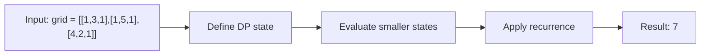

# 64. Minimum Path Sum

**Difficulty:** Medium  
**Concept family:** [Grid Paths and Geometric DP](https://github.com/gaurav1kr/Miscellaneous/blob/main/DSA/DP/DP_Mathematics_Master_Guide_Illustrated/Theory/Chapter-03.md)  
**Problem:** https://leetcode.com/problems/minimum-path-sum/  
**Original submission:** https://leetcode.com/submissions/detail/1615749852/

## Understand the mathematics first

Minimize accumulated cost on a grid.

### Related concept template (not necessarily this problem’s recurrence)

$$
C(i,j)=grid(i,j)+min(C(i-1,j),C(i,j-1))
$$

**What this template illustrates:** Compare with Unique Paths: min versus sum.

**Derivation exercise:** Define exactly what each state variable means for this problem; list valid choices, base cases, and forbidden transitions. Check the submitted code against that invariant. The family template alone is not a substitute for a problem-specific proof.

## Code landmarks

- `grid[i][j] += min(grid[i-1][j], grid[i][j-1]);`

## Detailed dry run — Minimum Path Sum: replace sum by minimum

### Start from the mathematical question

Let C(r,c) be the cheapest sum along any valid path from (0,0) to (r,c).

### Derive the recurrence

```math
C(r,c)=a[r][c]+\min(C(r-1,c),C(r,c-1))
```

**Why the transition is correct:** Same dependency graph as Unique Paths, but the problem asks for a cheapest path, not the number of paths: use min rather than addition.

### Concrete example

**Input:** `grid = [[1,3,1],[1,5,1],[4,2,1]]`



**Evaluate the states in dependency order:**

| Row/col | c=0 | c=1 | c=2 |
|---|---:|---:|---:|
| r=0 | 1 | 4 | 5 |
| r=1 | 2 | 7 | 6 |
| r=2 | 6 | 8 | 7 |

**Expected result:** `7`.

### What to remember six months later

Explain (1) what one state means, (2) which earlier states it needs, (3) why those cases are exhaustive, and (4) why the answer is `7` for this input. Then inspect your preserved C++ solution below and match its variables to the mathematical states.

---

## Your original Accepted C++ submission (unaltered)

```cpp
class Solution {
public:
    int minPathSum(vector<vector<int>>& grid) {
        int m = grid.size(), n = grid[0].size();
        for (int i = 1; i < m; i++) grid[i][0] += grid[i-1][0];
        for (int j = 1; j < n; j++) grid[0][j] += grid[0][j-1];
        for (int i = 1; i < m; i++) {
            for (int j = 1; j < n; j++) {
                grid[i][j] += min(grid[i-1][j], grid[i][j-1]);
            }
        }
        return grid[m-1][n-1];
    }
};
```

## Interview self-check

1. What is the smallest state that determines the remaining answer?
2. Why are the transitions exhaustive and valid?
3. What is the exact base case, including empty and impossible cases?
4. What is the time complexity (states × work per state)?
5. Can the memory be compressed without overwriting needed dependencies?
