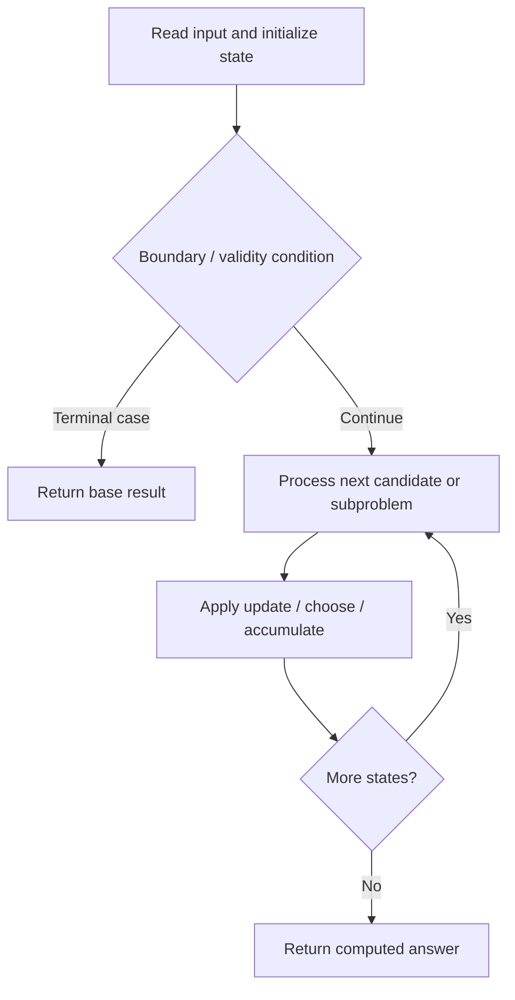

# 646. Maximum Length of Pair Chain

**Difficulty:** Medium  
**Concept family:** [Subsequence and Ordering DP](https://github.com/gaurav1kr/Miscellaneous/blob/main/DSA/DP/DP_Mathematics_Master_Guide_Illustrated/Theory/Chapter-05.md)  
**Problem:** https://leetcode.com/problems/maximum-length-of-pair-chain/  
**Original submission:** https://leetcode.com/submissions/detail/1373280296/

## Understand the mathematics first

This problem belongs to the study family **Subsequence and Ordering DP**. Start by defining the objective and minimal sufficient state; inspect the code to identify the actual transitions.

### Related concept template (not necessarily this problem’s recurrence)

$$
L(i)=1+\max_{j<i,\;a_j<a_i}L(j)
$$

**What this template illustrates:** When there is no predecessor, length is one. More advanced variants add dimensions such as last difference or number of chosen elements.

**Derivation exercise:** Define exactly what each state variable means for this problem; list valid choices, base cases, and forbidden transitions. Check the submitted code against that invariant. The family template alone is not a substitute for a problem-specific proof.

## Code landmarks

- `int dp[2002];`
- `min(end_to_min_len[p[1]+1000], p[1]-p[0]);`
- `pmin = min(p[0], pmin);`

## Source-grounded algorithm walkthrough (expanded coverage)

> **Verification level:** The observations below are extracted from your actual Accepted C++ implementation. The symbolic trace is a **code-reading dry-run worksheet**, not a fabricated numerical run. The generic family formula above is not necessarily this problem's recurrence.

### 1. Identify the actual state and algorithm

**Problem:** 646. Maximum Length of Pair Chain. An explicit state table or memo is present. Interpret each index as a mathematical state and every update as a transition.

| Role | C++ source line | Evidence from your solution |
|---|---:|---|
| Candidate state / accumulator | 3 | `int dp[2002];` |
| Candidate state / accumulator | 17 | `dp[i+1001] = dp[i+1000];` |
| Candidate state / accumulator | 19 | `dp[i+1001] = max(dp[i+1001], dp[i+1000-end_to_min_len[i+1000]]+1);` |
| Boundary / termination | 18 | `if(end_to_min_len[i+1000]){` |
| Traversal order | 10 | `for(const auto& p: pairs){` |
| Traversal order | 16 | `for(int i = pmin; i <= pmax; i++){` |
| Transition / update | 12 | `min(end_to_min_len[p[1]+1000], p[1]-p[0]);` |
| Transition / update | 13 | `pmin = min(p[0], pmin);` |
| Transition / update | 14 | `pmax = max(p[1], pmax);` |
| Transition / update | 17 | `dp[i+1001] = dp[i+1000];` |
| Return / result | 22 | `return dp[pmax+1001];` |

### 2. Trace the dependency chain



This is a **control-flow reading diagram**, not a claim about the exact shape of the mathematical state graph. Follow the code line numbers above to draw the actual dependency arrows.

### 3. Symbolic dry-run worksheet

| Stage | State to record | Mathematical question to answer |
|---|---|---|
| Initialize | Inputs, initialized containers/accumulators | What does the initial value mean? |
| First iteration / recursive call | Loop indices, branch, current state | Which predecessor states are available? |
| First update | Before → after for the updated variable | Why is this transition legal? Does it add, minimize, maximize, or overwrite? |
| Next iteration | Updated state and next candidate | Can a value be reused in this traversal order? |
| Finish | Return expression and its value | Why does this correspond to the problem's requested result? |

### 4. Mathematical explanation checklist

1. Define the exact meaning of each state variable, including all indices and constraints.
2. Translate the update expression into a mathematical equation **only after** establishing the state invariant.
3. Prove the transitions are exhaustive and do not double-count or reuse forbidden elements.
4. Check empty input, smallest input, impossible cases, and overflow/modulo behavior.
5. Compute a small numerical example using the actual problem constraints, then compare each row to the original C++.


---

## Your original Accepted C++ submission (unaltered)

```cpp
class Solution {
public:
    int dp[2002];
    int end_to_min_len[2002];
    int findLongestChain(vector<vector<int>>& pairs) {
        memset(dp, 0, sizeof(dp));
        memset(end_to_min_len, 0, sizeof(end_to_min_len));
        int pmax = -1001;
        int pmin = 1001;
        for(const auto& p: pairs){
            end_to_min_len[p[1]+1000] = end_to_min_len[p[1]+1000] == 0 ? p[1]-p[0] :
            min(end_to_min_len[p[1]+1000], p[1]-p[0]);
            pmin = min(p[0], pmin);
            pmax = max(p[1], pmax);
        }
        for(int i = pmin; i <= pmax; i++){
            dp[i+1001] = dp[i+1000];
            if(end_to_min_len[i+1000]){
                dp[i+1001] = max(dp[i+1001], dp[i+1000-end_to_min_len[i+1000]]+1);
            }
        }
        return dp[pmax+1001];
    }
};
```

## Time and Space Complexity

- **Time:** `Depends on table dimensions and transitions per cell`
- **Auxiliary space:** `O(rows × columns) for the allocated table`

**Reasoning:** The two-dimensional table determines memory; time is its state count multiplied by work per state.

**Status:** Code-informed complexity guidance; exact tight bounds have not been individually verified.
