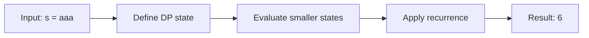

# 647. Palindromic Substrings

**Difficulty:** Medium  
**Concept family:** [Interval and Partition DP](https://github.com/gaurav1kr/Miscellaneous/blob/main/DSA/DP/DP_Mathematics_Master_Guide_Illustrated/Theory/Chapter-06.md)  
**Problem:** https://leetcode.com/problems/palindromic-substrings/  
**Original submission:** https://leetcode.com/submissions/detail/1541360778/

## Understand the mathematics first

This problem belongs to the study family **Interval and Partition DP**. Start by defining the objective and minimal sufficient state; inspect the code to identify the actual transitions.

### Problem-specific recurrence

Refer to the source-grounded algorithm walkthrough below for the state transitions used by your implementation. The generic family recurrence has been removed because it may not apply to this problem.

## Code landmarks

- `while (left >= 0 && right < n && s[left] == s[right]) {`

## Detailed dry run — Palindromic substrings: inward equality

### Start from the mathematical question

Let P(i,j) indicate whether the contiguous substring s[i..j] is a palindrome.

### Derive the recurrence

```math
P(i,j)=(s_i=s_j)\land(j-i<2\ \lor\ P(i+1,j-1))
```

**Why the transition is correct:** The endpoints must agree and the interior must itself be palindromic. Center expansion computes the same structure without storing the full boolean table.

### Concrete example

**Input:** `s = "aaa"`



**Evaluate the states in dependency order:**

| Substring length | Palindromic substrings | Count |
|---|---|---:|
| 1 | a at 0, a at 1, a at 2 | 3 |
| 2 | aa at [0,1], aa at [1,2] | 2 |
| 3 | aaa at [0,2] | 1 |

**Expected result:** `6`.

### What to remember six months later

Explain (1) what one state means, (2) which earlier states it needs, (3) why those cases are exhaustive, and (4) why the answer is `6` for this input. Then inspect your preserved C++ solution below and match its variables to the mathematical states.

---

## Your original Accepted C++ submission (unaltered)

```cpp
class Solution {
public:
    int countSubstrings(string s) {
        int n = s.size();
        int count = 0;

        // Helper lambda function to expand around center
        auto expandAroundCenter = [&](int left, int right) {
            while (left >= 0 && right < n && s[left] == s[right]) {
                count++; // Count the palindrome
                left--;
                right++;
            }
        };

        // Iterate through each possible center
        for (int i = 0; i < n; i++) {
            // Odd-length palindromes (single center)
            expandAroundCenter(i, i);

            // Even-length palindromes (two-center)
            expandAroundCenter(i, i + 1);
        }

        return count;
    }
};
```

## Time and Space Complexity

- **Time:** `Depends on loop nesting and bounds`
- **Auxiliary space:** `Depends on auxiliary arrays/containers`

**Reasoning:** Count how many iterations each loop executes and whether loops are nested; do not assume all nested loops are quadratic.

**Status:** Code-informed complexity guidance; exact tight bounds have not been individually verified.
