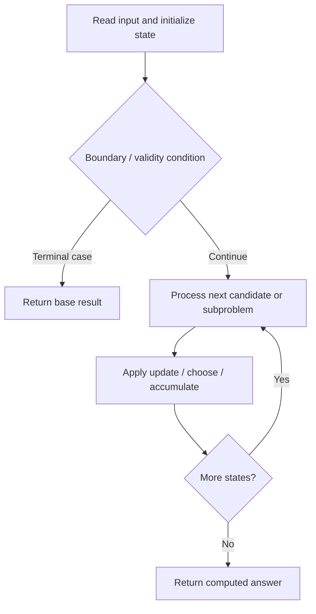

# 673. Number of Longest Increasing Subsequence

**Difficulty:** Medium  
**Concept family:** [Subsequence and Ordering DP](https://github.com/gaurav1kr/Miscellaneous/blob/main/DSA/DP/DP_Mathematics_Master_Guide_Illustrated/Theory/Chapter-05.md)  
**Problem:** https://leetcode.com/problems/number-of-longest-increasing-subsequence/  
**Original submission:** https://leetcode.com/submissions/detail/1501843838/

## Understand the mathematics first

This problem belongs to the study family **Subsequence and Ordering DP**. Start by defining the objective and minimal sufficient state; inspect the code to identify the actual transitions.

### Problem-specific recurrence

Refer to the source-grounded algorithm walkthrough below for the state transitions used by your implementation. The generic family recurrence has been removed because it may not apply to this problem.

## Code landmarks

- `vector<int> dp(n, 1);  // dp[i] will store the length of LIS ending at i`
- `if (dp[j] + 1 > dp[i]) {`
- `dp[i] = dp[j] + 1;`

## Source-grounded algorithm walkthrough (expanded coverage)

> **Verification level:** The observations below are extracted from your actual Accepted C++ implementation. The symbolic trace is a **code-reading dry-run worksheet**, not a fabricated numerical run. The generic family formula above is not necessarily this problem's recurrence.

### 1. Identify the actual state and algorithm

**Problem:** 673. Number of Longest Increasing Subsequence. An explicit state table or memo is present. Interpret each index as a mathematical state and every update as a transition.

| Role | C++ source line | Evidence from your solution |
|---|---:|---|
| Candidate state / accumulator | 7 | `vector<int> dp(n, 1);  // dp[i] will store the length of LIS ending at i` |
| Candidate state / accumulator | 8 | `vector<int> count(n, 1);  // count[i] will store the number of LIS ending at i` |
| Candidate state / accumulator | 16 | `if (dp[j] + 1 > dp[i]) {` |
| Boundary / termination | 4 | `if (nums.empty()) return 0;` |
| Boundary / termination | 15 | `if (nums[i] > nums[j]) {` |
| Boundary / termination | 16 | `if (dp[j] + 1 > dp[i]) {` |
| Traversal order | 13 | `for (int i = 1; i < n; ++i) {` |
| Traversal order | 14 | `for (int j = 0; j < i; ++j) {` |
| Traversal order | 27 | `for (int i = 0; i < n; ++i) {` |
| Transition / update | 17 | `dp[i] = dp[j] + 1;` |
| Transition / update | 18 | `count[i] = count[j];  // reset the count to count[j]` |
| Transition / update | 20 | `count[i] += count[j];  // add count[j] to count[i]` |
| Transition / update | 24 | `maxLength = max(maxLength, dp[i]);  // update maxLength` |
| Return / result | 4 | `if (nums.empty()) return 0;` |
| Return / result | 33 | `return totalCount;` |

### 2. Trace the dependency chain



This is a **control-flow reading diagram**, not a claim about the exact shape of the mathematical state graph. Follow the code line numbers above to draw the actual dependency arrows.

### 3. Symbolic dry-run worksheet

| Stage | State to record | Mathematical question to answer |
|---|---|---|
| Initialize | Inputs, initialized containers/accumulators | What does the initial value mean? |
| First iteration / recursive call | Loop indices, branch, current state | Which predecessor states are available? |
| First update | Before → after for the updated variable | Why is this transition legal? Does it add, minimize, maximize, or overwrite? |
| Next iteration | Updated state and next candidate | Can a value be reused in this traversal order? |
| Finish | Return expression and its value | Why does this correspond to the problem's requested result? |

### 4. Mathematical explanation checklist

1. Define the exact meaning of each state variable, including all indices and constraints.
2. Translate the update expression into a mathematical equation **only after** establishing the state invariant.
3. Prove the transitions are exhaustive and do not double-count or reuse forbidden elements.
4. Check empty input, smallest input, impossible cases, and overflow/modulo behavior.
5. Compute a small numerical example using the actual problem constraints, then compare each row to the original C++.


---

## Your original Accepted C++ submission (unaltered)

```cpp
class Solution {
public:
    int findNumberOfLIS(vector<int>& nums) {
        if (nums.empty()) return 0;
        
        int n = nums.size();
        vector<int> dp(n, 1);  // dp[i] will store the length of LIS ending at i
        vector<int> count(n, 1);  // count[i] will store the number of LIS ending at i
        
        int maxLength = 1;
        int totalCount = 0;
        
        for (int i = 1; i < n; ++i) {
            for (int j = 0; j < i; ++j) {
                if (nums[i] > nums[j]) {
                    if (dp[j] + 1 > dp[i]) {
                        dp[i] = dp[j] + 1;
                        count[i] = count[j];  // reset the count to count[j]
                    } else if (dp[j] + 1 == dp[i]) {
                        count[i] += count[j];  // add count[j] to count[i]
                    }
                }
            }
            maxLength = max(maxLength, dp[i]);  // update maxLength
        }
        
        for (int i = 0; i < n; ++i) {
            if (dp[i] == maxLength) {
                totalCount += count[i];
            }
        }
        
        return totalCount;
    }
};
```

## Time and Space Complexity

- **Time:** `Depends on loop nesting and bounds`
- **Auxiliary space:** `Depends on auxiliary arrays/containers`

**Reasoning:** Count how many iterations each loop executes and whether loops are nested; do not assume all nested loops are quadratic.

**Status:** Code-informed complexity guidance; exact tight bounds have not been individually verified.
