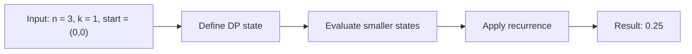

# 688. Knight Probability in Chessboard

**Difficulty:** Medium  
**Concept family:** [Digit DP, Counting and Probability](https://github.com/gaurav1kr/Miscellaneous/blob/main/DSA/DP/DP_Mathematics_Master_Guide_Illustrated/Theory/Chapter-11.md)  
**Problem:** https://leetcode.com/problems/knight-probability-in-chessboard/  
**Original submission:** https://leetcode.com/submissions/detail/1166081683/

## Understand the mathematics first

This problem belongs to the study family **Digit DP, Counting and Probability**. Start by defining the objective and minimal sufficient state; inspect the code to identify the actual transitions.

### Related concept template (not necessarily this problem’s recurrence)

$$
bestEnding(i)=\max(a_i,a_i+bestEnding(i-1))
$$

**What this template illustrates:** This is Kadane’s recurrence; other problems in this group may use greedy, stacks, two pointers, prefix sums, or a specialized optimization—not necessarily DP.

**Derivation exercise:** Define exactly what each state variable means for this problem; list valid choices, base cases, and forbidden transitions. Check the submitted code against that invariant. The family template alone is not a substitute for a problem-specific proof.

## Code landmarks

- `if (dp[nr][nc][k] != -1) return dp[nr][nc][k];`
- `return dp[nr][nc][k] = prob;`

## Detailed dry run — Knight probability: weighted state transitions

### Start from the mathematical question

Let P(t,r,c) be the probability a knight remains on the board for t more moves when starting at (r,c).

### Derive the recurrence

```math
P(t,r,c)=\frac18\sum_{(r\prime,c\prime)\in validKnightMoves(r,c)}P(t-1,r\prime,c\prime)
```

**Why the transition is correct:** Each of eight moves is equally likely. Invalid moves contribute zero; valid moves contribute their future survival probability weighted by 1/8.

### Concrete example

**Input:** `n = 3, k = 1, start = (0,0)`



**Evaluate the states in dependency order:**

| Knight destination from (0,0) | On 3×3 board? | Contribution |
|---|---|---:|
| (1,2) | Yes | 1/8 |
| (2,1) | Yes | 1/8 |
| Other six destinations | No | 0 |

**Expected result:** `0.25`.

### What to remember six months later

Explain (1) what one state means, (2) which earlier states it needs, (3) why those cases are exhaustive, and (4) why the answer is `0.25` for this input. Then inspect your preserved C++ solution below and match its variables to the mathematical states.

---

## Your original Accepted C++ submission (unaltered)

```cpp
class Solution
{
public:
    double f(int n, int k, int nr, int nc, vector<vector<vector<double>>>& dp)
    {
        if (nc < 0 || nr < 0 || nc >= n || nr >= n) return 0;
        if (k == 0) return 1;
        if (dp[nr][nc][k] != -1) return dp[nr][nc][k];
        int r[] = { -2,-2,-1,1,2,2,1,-1 };
        int c[] = { -1,1,2,2,1,-1,-2,-2 };
        double prob = 0;
        for (int i = 0; i < 8; i++)
        {
            prob += f(n, k - 1, nr + r[i], nc + c[i], dp) / 8.0;
        }
        return dp[nr][nc][k] = prob;
    }

    double knightProbability(int n, int k, int row, int col) 
    {
        if (k == 0) return 1;
        vector<vector<vector<double>>> dp(n, vector<vector<double>>(n, vector<double>(k + 1, -1)));
        return f(n, k, row, col, dp);
    }
};
```

## Time and Space Complexity

- **Time:** `Depends on 3D state count and transitions`
- **Auxiliary space:** `O(product of allocated DP dimensions)`

**Reasoning:** The code allocates a three-dimensional state table; inspect how many transitions are considered for each state.

**Status:** Code-informed complexity guidance; exact tight bounds have not been individually verified.
