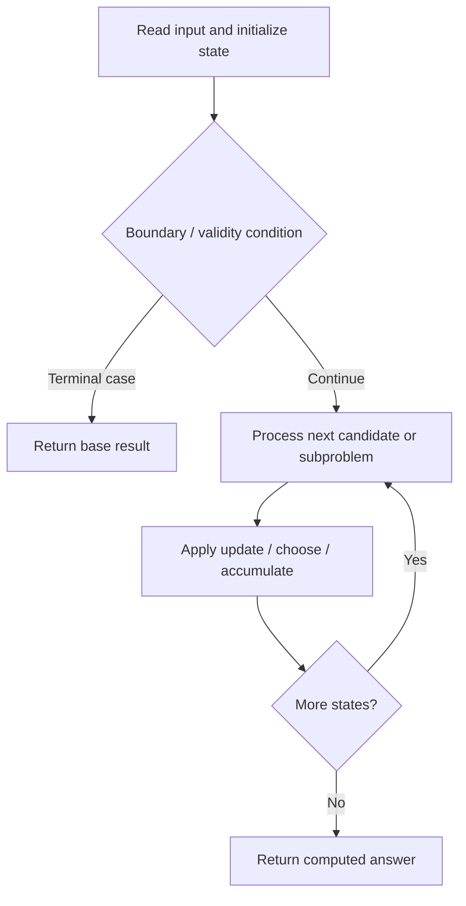

# 691. Stickers to Spell Word

**Difficulty:** Hard  
**Concept family:** [Take-or-Skip and Knapsack](https://github.com/gaurav1kr/Miscellaneous/blob/main/DSA/DP/DP_Mathematics_Master_Guide_Illustrated/Theory/Chapter-02.md)  
**Problem:** https://leetcode.com/problems/stickers-to-spell-word/  
**Original submission:** https://leetcode.com/submissions/detail/1595382409/

## Understand the mathematics first

This problem belongs to the study family **Take-or-Skip and Knapsack**. Start by defining the objective and minimal sufficient state; inspect the code to identify the actual transitions.

### Related concept template (not necessarily this problem’s recurrence)

$$
F(i,c)=\max(F(i-1,c),v_i+F(i-1,c-w_i))
$$

**What this template illustrates:** Only use the take branch when the remaining capacity is feasible. Counting versions use addition; feasibility versions use logical OR.

**Derivation exercise:** Define exactly what each state variable means for this problem; list valid choices, base cases, and forbidden transitions. Check the submitted code against that invariant. The family template alone is not a substitute for a problem-specific proof.

## Code landmarks

- `memo[""] = 0;`
- `if (memo.count(t)) return memo[t];`
- `if (temp != -1) res = min(res, 1 + temp);`

## Source-grounded algorithm walkthrough (expanded coverage)

> **Verification level:** The observations below are extracted from your actual Accepted C++ implementation. The symbolic trace is a **code-reading dry-run worksheet**, not a fabricated numerical run. The generic family formula above is not necessarily this problem's recurrence.

### 1. Identify the actual state and algorithm

**Problem:** 691. Stickers to Spell Word. An explicit state table or memo is present. Interpret each index as a mathematical state and every update as a transition.

| Role | C++ source line | Evidence from your solution |
|---|---:|---|
| Candidate state / accumulator | 13 | `vector<int> count(26, 0);` |
| Candidate state / accumulator | 18 | `unordered_map<string, int> memo;` |
| Candidate state / accumulator | 19 | `memo[""] = 0;` |
| Boundary / termination | 19 | `memo[""] = 0;` |
| Boundary / termination | 22 | `if (memo.count(t)) return memo[t];` |
| Boundary / termination | 28 | `if (s[t[0] - 'a'] == 0) continue;` |
| Traversal order | 12 | `for (string& s : stickers) {` |
| Traversal order | 14 | `for (char c : s) count[c - 'a']++;` |
| Traversal order | 24 | `for (char c : t) count[c - 'a']++;` |
| Transition / update | 15 | `stickerCount.push_back(count);` |
| Transition / update | 19 | `memo[""] = 0;` |
| Transition / update | 21 | `function<int(string)> dp = [&](string t) -> int {` |
| Transition / update | 26 | `int res = INT_MAX;` |
| Return / result | 22 | `if (memo.count(t)) return memo[t];` |
| Return / result | 37 | `return memo[t] = res == INT_MAX ? -1 : res;` |

### 2. Trace the dependency chain



This is a **control-flow reading diagram**, not a claim about the exact shape of the mathematical state graph. Follow the code line numbers above to draw the actual dependency arrows.

### 3. Symbolic dry-run worksheet

| Stage | State to record | Mathematical question to answer |
|---|---|---|
| Initialize | Inputs, initialized containers/accumulators | What does the initial value mean? |
| First iteration / recursive call | Loop indices, branch, current state | Which predecessor states are available? |
| First update | Before → after for the updated variable | Why is this transition legal? Does it add, minimize, maximize, or overwrite? |
| Next iteration | Updated state and next candidate | Can a value be reused in this traversal order? |
| Finish | Return expression and its value | Why does this correspond to the problem's requested result? |

### 4. Mathematical explanation checklist

1. Define the exact meaning of each state variable, including all indices and constraints.
2. Translate the update expression into a mathematical equation **only after** establishing the state invariant.
3. Prove the transitions are exhaustive and do not double-count or reuse forbidden elements.
4. Check empty input, smallest input, impossible cases, and overflow/modulo behavior.
5. Compute a small numerical example using the actual problem constraints, then compare each row to the original C++.


---

## Your original Accepted C++ submission (unaltered)

```cpp
#include <vector>
#include <string>
#include <unordered_map>

using namespace std;

class Solution {
public:
    int minStickers(vector<string>& stickers, string target) {
        int m = target.size();
        vector<vector<int>> stickerCount;
        for (string& s : stickers) {
            vector<int> count(26, 0);
            for (char c : s) count[c - 'a']++;
            stickerCount.push_back(count);
        }

        unordered_map<string, int> memo;
        memo[""] = 0;

        function<int(string)> dp = [&](string t) -> int {
            if (memo.count(t)) return memo[t];
            vector<int> count(26, 0);
            for (char c : t) count[c - 'a']++;

            int res = INT_MAX;
            for (auto& s : stickerCount) {
                if (s[t[0] - 'a'] == 0) continue;
                string next;
                for (int i = 0; i < 26; ++i) {
                    if (count[i] > s[i])
                        next += string(count[i] - s[i], 'a' + i);
                }
                int temp = dp(next);
                if (temp != -1) res = min(res, 1 + temp);
            }
            return memo[t] = res == INT_MAX ? -1 : res;
        };

        return dp(target);
    }
};
```

## Time and Space Complexity

- **Time:** `Depends on operations (typically O(log n) per ordered-container operation)`
- **Auxiliary space:** `Depends on number of stored entries`

**Reasoning:** An ordered container or heap introduces logarithmic insertion, lookup, or removal costs; multiply by operation count.

**Status:** Code-informed complexity guidance; exact tight bounds have not been individually verified.
