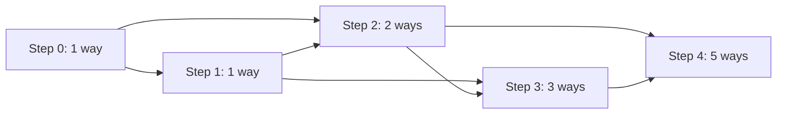
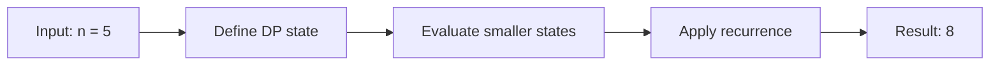

# 70. Climbing Stairs

**Difficulty:** Easy  
**Concept family:** [Mathematical Recurrences and Combinatorics](https://github.com/gaurav1kr/Miscellaneous/blob/main/DSA/DP/DP_Mathematics_Master_Guide_Illustrated/Theory/Chapter-01.md)  
**Problem:** https://leetcode.com/problems/climbing-stairs/  
**Original submission:** https://leetcode.com/submissions/detail/487837996/

## Understand the mathematics first

Condition on whether the final climb was one or two steps.

### Related concept template (not necessarily this problem’s recurrence)

$$
W(n)=W(n-1)+W(n-2)
$$

**What this template illustrates:** Fibonacci-like counting; your submitted base-case code deserves checking at n=2.

**Derivation exercise:** Define exactly what each state variable means for this problem; list valid choices, base cases, and forbidden transitions. Check the submitted code against that invariant. The family template alone is not a substitute for a problem-specific proof.

## Code landmarks

Read the loops, recursion, and boundary conditions in the original code.

## Worked mathematical walkthrough (illustrated)

**State:** Ways to reach step i.

**Transition:** `W(i)=W(i-1)+W(i-2)`

**Why:** Every valid path ends in a one-step or two-step move. These endings are disjoint, so add the counts.



**Hand calculation:** n=4: W(0)=1, W(1)=1, W(2)=2, W(3)=3, W(4)=5

**Six-month revision test:** Without looking at the code, reconstruct the state, enumerate the legal choices, and justify why this transition does not miss or double-count any answer.

---

## Detailed dry run — Climbing stairs: count disjoint last moves

### Start from the mathematical question

Let W(n) be the number of ways to climb n stairs using moves of size 1 or 2. Set W(0)=1: there is one empty sequence of moves.

### Derive the recurrence

```math
W(n)=W(n-1)+W(n-2)
```

**Why the transition is correct:** Partition all valid paths by their final move. A path cannot end in both a 1-step and 2-step move, so summing does not double-count.

### Concrete example

**Input:** `n = 5`



**Evaluate the states in dependency order:**

| Stairs n | 0 | 1 | 2 | 3 | 4 | 5 |
|---|---:|---:|---:|---:|---:|---:|
| W(n) | 1 | 1 | 2 | 3 | 5 | 8 |

**Expected result:** `8`.

### What to remember six months later

Explain (1) what one state means, (2) which earlier states it needs, (3) why those cases are exhaustive, and (4) why the answer is `8` for this input. Then inspect your preserved C++ solution below and match its variables to the mathematical states.

---

## Your original Accepted C++ submission (unaltered)

```cpp
class Solution 
{
public:
    int climbStairs(int n) 
    {
        if ( (n==1) || (n==0) )
        {
            return n ;
        }
        int a = 0 , b = 1 , c = 0 , i = 0 ;
        
        for(i=0;i<n;i++)
        {
            c = a + b ;
            a = b ;
            b = c ;
        }
        return c ;
    }
};
```

## Time and Space Complexity

- **Time:** `O(n)`
- **Auxiliary space:** `O(1)`

**Reasoning:** One iteration per step, retaining only the previous two values.

**Basis:** Analyzed algorithm structure in the preserved C++ submission.
