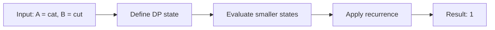

# 72. Edit Distance

**Difficulty:** Medium  
**Concept family:** [String Matching and Sequence Alignment](https://github.com/gaurav1kr/Miscellaneous/blob/main/DSA/DP/DP_Mathematics_Master_Guide_Illustrated/Theory/Chapter-04.md)  
**Problem:** https://leetcode.com/problems/edit-distance/  
**Original submission:** https://leetcode.com/submissions/detail/1542158052/

## Understand the mathematics first

Compare prefixes and decide final edit.

### Related concept template (not necessarily this problem’s recurrence)

$$
D(i,j)=min(D(i-1,j)+1,D(i,j-1)+1,D(i-1,j-1)+[a_i!=b_j])
$$

**What this template illustrates:** Insertion, deletion and substitution are exhaustive.

**Derivation exercise:** Define exactly what each state variable means for this problem; list valid choices, base cases, and forbidden transitions. Check the submitted code against that invariant. The family template alone is not a substitute for a problem-specific proof.

## Code landmarks

- `curr[j] = 1 + min({prev[j - 1], prev[j], curr[j - 1]});`

## Detailed dry run — Edit Distance: consider the final edit

### Start from the mathematical question

Let E(i,j) be the fewest insert/delete/replace operations to transform the first i characters of A into the first j characters of B.

### Derive the recurrence

```math
E(i,j)=\begin{cases}E(i-1,j-1)&A[i-1]=B[j-1]\\1+\min(E(i-1,j),E(i,j-1),E(i-1,j-1))&otherwise\end{cases}
```

**Why the transition is correct:** The last action must be deletion, insertion, replacement, or no action when the final characters already match.

### Concrete example

**Input:** `A = "cat", B = "cut"`



**Evaluate the states in dependency order:**

| A prefix / B prefix | empty | c | cu | cut |
|---|---:|---:|---:|---:|
| empty | 0 | 1 | 2 | 3 |
| c | 1 | 0 | 1 | 2 |
| ca | 2 | 1 | 1 | 2 |
| cat | 3 | 2 | 2 | 1 |

**Expected result:** `1`.

### What to remember six months later

Explain (1) what one state means, (2) which earlier states it needs, (3) why those cases are exhaustive, and (4) why the answer is `1` for this input. Then inspect your preserved C++ solution below and match its variables to the mathematical states.

---

## Your original Accepted C++ submission (unaltered)

```cpp
class Solution {
public:
   int minDistance(string word1, string word2) {
    int m = word1.size(), n = word2.size();
    vector<int> prev(n + 1), curr(n + 1);

    // Initialize base case: converting an empty string to word2
    for (int j = 0; j <= n; j++) {
        prev[j] = j;
    }

    for (int i = 1; i <= m; i++) {
        curr[0] = i; // Converting word1[0..i] to an empty string requires 'i' deletions
        for (int j = 1; j <= n; j++) {
            if (word1[i - 1] == word2[j - 1]) {
                curr[j] = prev[j - 1]; // No operation needed
            } else {
                curr[j] = 1 + min({prev[j - 1], prev[j], curr[j - 1]});
                // prev[j-1] -> replace, prev[j] -> delete, curr[j-1] -> insert
            }
        }
        prev = curr; // Move to next row
    }

    return prev[n];
}
};
```

## Interview self-check

1. What is the smallest state that determines the remaining answer?
2. Why are the transitions exhaustive and valid?
3. What is the exact base case, including empty and impossible cases?
4. What is the time complexity (states × work per state)?
5. Can the memory be compressed without overwriting needed dependencies?
